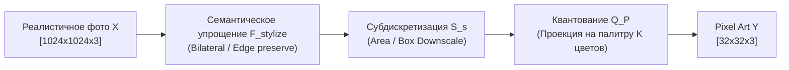

# Модели формирования изображений и операторы деградации

## 1. Краткое описание
В этой статье строго формализуются прямая модель формирования оптического изображения и математический оператор деградации $\mathcal{D}$, преобразующий фотореалистичную сцену в пиксель-арт. Рассматривается фундаментальная разница между классической деградацией супер-разрешения (свёртка + шум) и пикселизацией (нелинейная стилизация + экстремальная субдискретизация + дискретная квантизация).

---

## 2. Интуитивное объяснение

В классической обработке изображений (например, реставрация старых фото или астрофотография) физика процесса ясна:
1. Идеальный свет от объекта проходит через оптические линзы (происходит непрерывное оптическое размытие — свёртка с PSF, Point Spread Function).
2. Сенсор камеры захватывает фотоны и дискретизирует их в пиксели матрицы.
3. Электроника добавляет тепловой и квантовый шум (гауссов и пуассоновский шум).

Обращение такого процесса (деконволюция и денойзинг) хорошо изучено: мы ищем исходный непрерывный сигнал, устраняя известный вид размытия.

В случае **Pixel Art** процесс принципиально иной. Это не физический оптический дефект, а **интенциональная семантическая редукция**:
- Художник или алгоритм стилизации убирает второстепенную геометрию (морщины, волоски, заклепки).
- Непрерывные контуры принудительно выравниваются по ортогональной сетке целых чисел (Aliasing).
- Непрерывный спектр освещённости сжимается в 8–16 дискретных палитровых меток.

Поэтому оператор деградации пиксель-арта **необратим, нелинеен и кусочно-постоянен**.

---

## 3. Математическая постановка прямой модели и деградации



### 3.1. Классическая модель Super-Resolution (Непрерывная деградация)
В литературе по супер-разрешению (RCAN, SwinIR, Real-ESRGAN) оператор деградации задаётся линейной свёрткой:
$$y_{\text{classical}} = (x * \mathbf{k})_{\downarrow s} + \mathbf{n}_{\sigma}$$
где $\mathbf{k}$ — непрерывное ядро размытия (Gaussian blur kernel), $\downarrow s$ — операция децимации, $\mathbf{n}_{\sigma} \sim \mathcal{N}(0, \sigma^2 \mathbf{I})$ — аддитивный шум. Для такой системы градиент $\nabla_x y_{\text{classical}}$ легко вычисляется аналитически.

### 3.2. Модель деградации Pixel Art (Дискретная нелинейная деградация)
Для пиксель-арта оператор $\mathcal{D}$ определяется композицией:
$$y = \mathcal{D}(x) = \mathcal{Q}_{\mathcal{P}}\left( \mathcal{S}_{\downarrow s} \left( \mathcal{F}_{\text{stylize}}(x) \right) \right)$$

Разберём каждый компонент:

#### 1. Семантическая стилизация $\mathcal{F}_{\text{stylize}}$
Оператор подавляет высокочастотные вариации текстур, сохраняя главные границы объектов (Edge-preserving smoothing). В аналитическом виде аппроксимируется билатеральным фильтром:
$$\mathcal{F}_{\text{stylize}}(x)_p = \frac{1}{W_p} \sum_{q \in \Omega} x_q \exp\left(-\frac{\|p - q\|^2}{2\sigma_s^2}\right) \exp\left(-\frac{\|x_p - x_q\|^2}{2\sigma_r^2}\right)$$

#### 2. Субдискретизация $\mathcal{S}_{\downarrow s}$
Для шага сетки $s$ каждый пиксель низкого разрешения $y_{i, j}$ вычисляется усреднением по квадратному окну $\Omega_{i, j}$ размера $s \times s$:
$$\mathcal{S}_{\downarrow s}(x)_{i, j} = \frac{1}{s^2} \sum_{u=0}^{s-1} \sum_{v=0}^{s-1} x_{i \cdot s + u, \, j \cdot s + v}$$

#### 3. Оператор проекции на палитру $\mathcal{Q}_{\mathcal{P}}$
Проецирует каждый непрерывный цвет в ближайший элемент палитры $\mathcal{P} = \{\mathbf{c}_1, \dots, \mathbf{c}_K\}$ по евклидовому расстоянию в цветовом пространстве:
$$\mathcal{Q}_{\mathcal{P}}(\mathbf{v}) = \arg\min_{\mathbf{c}_k \in \mathcal{P}} \|\mathbf{v} - \mathbf{c}_k\|_2^2$$

---

## 4. Информационный анализ: Теорема Найквиста-Шеннона и Алиасинг

Согласно теореме Котельникова-Шеннона-Найквиста, непрерывный двумерный сигнал $x(u, v)$ с максимальной пространственной частотой $\omega_{\max} = (\omega_x, \omega_y)$ может быть однозначно реконструирован без искажений тогда и только тогда, когда частота дискретизации удовлетворяет условию:
$$\omega_s > 2 \omega_{\max}$$

В пиксель-арте частота дискретизации $\omega_s = \frac{1}{s}$ в десятки раз ниже частоты реального мира:
$$\omega_s \ll 2 \omega_{\max}$$
Это приводит к экстремальному **наложению частотных спектров (Aliasing)**:
$$X_{\text{sampled}}(\omega) = \sum_{k=-\infty}^{\infty} X(\omega - k \cdot \omega_s)$$

Высокие частоты реального мира (текстура щетины, ресницы, переплетение нитей кольчуги) зеркально отражаются в диапазон нулевых и низких частот, образуя зубчатые ступеньки (jaggies) и муаровые узоры.

### Проблема недифференцируемости $\mathcal{Q}_{\mathcal{P}}$
Оператор $\arg\min$ является кусочно-постоянным. Его градиент по входному цвету:
$$\frac{\partial \mathcal{Q}_{\mathcal{P}}(\mathbf{v})}{\partial \mathbf{v}} = \mathbf{0} \quad \text{почти всюду}$$
Это означает, что мы **не можем напрямую обучать сквозную нейросеть методом обратного распространения ошибки (Backpropagation)** через оператор квантования без специальных приёмов.

---

## 5. Практическая реализация: Дифференцируемый и аналитический операторы деградации

Ниже приведён код, реализующий два варианта:
1. Стандартный NumPy-оператор деградации для быстрой генерации обучающих пар.
2. Дифференцируемый PyTorch-слой с аппроксимацией через **Straight-Through Gumbel-Softmax** (как в Voxify3D, Huang et al., CVPR 2026), позволяющий оптимизировать палитру градиентным спуском.

```python
"""nn_upscaler.data.degradation_operator: Standard and differentiable degradation operators."""

import torch
import torch.nn as nn
import torch.nn.functional as F


class DifferentiablePaletteQuantizer(nn.Module):
    """Дифференцируемый квантователь палитры на базе Gumbel-Softmax и Straight-Through Estimator."""

    def __init__(self, palette_colors: torch.Tensor, temperature: float = 1.0):
        super().__init__()
        # palette_colors: [K, 3] (значения от 0.0 до 1.0)
        self.register_buffer("palette", palette_colors)
        self.temperature = temperature

    def forward(self, x: torch.Tensor) -> torch.Tensor:
        """
        Args:
            x: Входной тензор изображений [B, 3, H, W]
        Returns:
            Тензор квантованных изображений [B, 3, H, W] с дифференцируемым градиентом.
        """
        B, C, H, W = x.shape
        # Переводим в форму [B * H * W, 3]
        flat_x = x.permute(0, 2, 3, 1).reshape(-1, 3)

        # Вычисляем квадратичные евклидовы расстояния до каждого цвета палитры [N, K]
        # dists[i, k] = ||flat_x[i] - palette[k]||^2
        dists = torch.cdist(flat_x, self.palette, p=2) ** 2

        # Превращаем расстояния в логиты распределения (меньшее расстояние -> больший логит)
        logits = -dists / self.temperature

        if self.training:
            # Gumbel-Softmax с Straight-Through трюком
            soft_weights = F.gumbel_softmax(logits, tau=self.temperature, hard=True)
            quantized = torch.matmul(soft_weights, self.palette)
        else:
            # Детерминированный жесткий выбор
            nearest_idx = torch.argmin(dists, dim=1)
            quantized = self.palette[nearest_idx]

        return quantized.reshape(B, H, W, 3).permute(0, 3, 1, 2)


class PixelArtDegradationModule(nn.Module):
    """Полный модуль сквозной деградации высокого разрешения в пиксель-арт."""

    def __init__(self, scale_factor: int = 16, palette: torch.Tensor | None = None):
        super().__init__()
        self.scale_factor = scale_factor
        if palette is None:
            # По умолчанию: 16 цветов PICO-8
            palette = torch.tensor(
                [
                    [0.0, 0.0, 0.0],
                    [0.11, 0.17, 0.33],
                    [0.49, 0.15, 0.33],
                    [0.0, 0.53, 0.32],
                    [0.67, 0.32, 0.21],
                    [0.37, 0.34, 0.31],
                    [0.76, 0.76, 0.78],
                    [1.0, 0.95, 0.91],
                    [1.0, 0.0, 0.30],
                    [1.0, 0.64, 0.0],
                    [1.0, 0.93, 0.15],
                    [0.0, 0.89, 0.21],
                    [0.16, 0.68, 1.0],
                    [0.51, 0.46, 0.61],
                    [1.0, 0.47, 0.66],
                    [1.0, 0.80, 0.67],
                ],
                dtype=torch.float32,
            )
        self.quantizer = DifferentiablePaletteQuantizer(palette)

    def forward(self, hr_img: torch.Tensor) -> torch.Tensor:
        """
        hr_img: [B, 3, H, W]
        """
        # 1. Адаптивное субдискретизирование (Area downscaling)
        B, C, H, W = hr_img.shape
        target_h, target_w = H // self.scale_factor, W // self.scale_factor
        lr_downscaled = F.interpolate(hr_img, size=(target_h, target_w), mode="area")

        # 2. Квантование цветов
        lr_quantized = self.quantizer(lr_downscaled)

        return lr_quantized
```

---

## 6. Исследовательский анализ и ограничения

1. **Необратимость информации (Loss of Invertibility):**
   Субдискретизация и квантование уничтожают взаимно-однозначное соответствие (биективность). Множество решений $\{x \mid \mathcal{D}(x) = y\}$ образует многомерное невыпуклое подмногообразие в пространстве фотореалистичных изображений.
2. **Стохастичность обратной задачи:**
   Поскольку оператор деградации сжимает пространство состояний в тысячи раз, обратная система **обязана быть стохастической (вероятностной)**. Одному входному пиксель-арт спрайту должно соответствовать целое распределение валидных фотореалистичных реализаций с возможностью контролируемого сэмплирования через параметр `seed`.

---

## 7. Связанные темы
- Представление пиксель-арта: [`01_Fundamentals/01_Pixel_Art_Representation_and_Aesthetics.md`](01_Pixel_Art_Representation_and_Aesthetics.md)
- Теория вероятностей и информационный тупик: [`02_Mathematical_Foundations/01_Probability_and_Information_Theory.md`](../02_Mathematical_Foundations/01_Probability_and_Information_Theory.md)
- Синтетический пайплайн данных: [`05_Datasets_and_Preprocessing/02_Synthetic_Degradation_Pipeline.md`](../05_Datasets_and_Preprocessing/02_Synthetic_Degradation_Pipeline.md)
