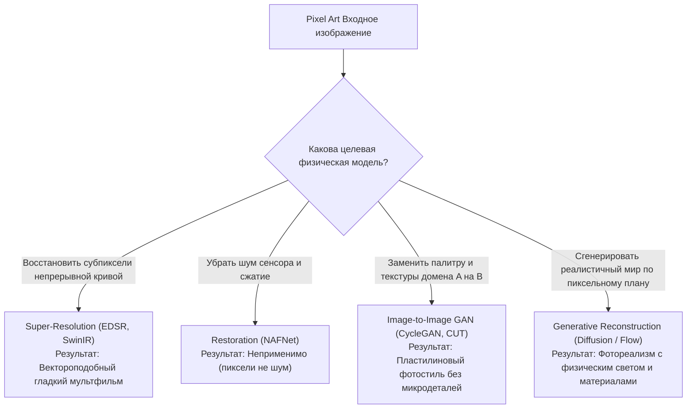

# Постановка задачи и таксономия вариантов применения

## 1. Краткое описание
В данной статье систематизируются различные постановки исследовательской и инженерной задачи **Pixel Art → Realism**. Рассматриваются фундаментальные различия четырёх классов обработки изображений (SR, Restoration, Translation, Generative Reconstruction), а также детально анализируются пять прикладных сценариев: одиночные иллюстрации, спрайты персонажей с альфа-каналом, модульные тайлы окружения, покадровая анимация и реконструкция 3D-представлений.

---

## 2. Интуитивное объяснение

Не существует единого универсального алгоритма, решающего задачу «превратить пиксели в реальность» одинаково хорошо для всех случаев:
- Если вы преобразуете **пейзаж**, вам важна глобальная перспектива, реалистичные облака и горизонт; мелкая галлюцинация птицы в небе допустима и даже желательна.
- Если вы преобразуете **спрайт главного героя игры**, любая галлюцинация (например, третья рука, изменившаяся форма меча или размытый силуэт на прозрачном фоне) полностью разрушает игровой ассет.
- Если вы преобразуете **тайл каменного пола $16\times 16$**, малейшее несовпадение текстуры на левом и правом краю сделает невозможным бесшовное замощение игрового уровня.
- Если вы преобразуете **анимацию бега из 8 кадров**, независимая генерация каждого кадра приведёт к стробоскопическому эффекту: лицо и одежда персонажа будут мутировать каждый кадр.

Поэтому корректная инженерная разработка начинается с выбора точной постановки задачи.

---

## 3. Сравнительная таксономия парадигм обработки изображений



| Парадигма | Входные предположения | Математический принцип | Ограничение на Pixel Art |
|---|---|---|---|
| **Super-Resolution (SR)** | Сигнал непрерывен; деградация — свёртка с ядром размытия. | Регрессия к среднему ($L_1$/Charbonnier лосс). | Не генерирует новые текстуры (поры, ткань); замыливает ступени. |
| **Image Restoration** | Сигнал повреждён случайным шумом сенсора, артефактами JPEG. | Фильтрация шума и инверсия искажений. | Пиксель-арт не имеет шума; каждый пиксель поставлен намеренно. |
| **Image Translation (cGAN)** | Домены $\mathcal{X}$ и $\mathcal{Y}$ имеют общую семантическую структуру. | Минимаксная игра дискриминатора и генератора. | Mode collapse при дефиците данных; плоский "пластилиновый" вид. |
| **Generative Reconstruction** | Исходный сигнал — жесткий пространственный якорь для сэмплирования из диффузионного априорного знания. | Стохастическое сэмплирование $p(x_{\text{photo}} \mid y_{\text{pixel}})$. | **Целевой подход.** Генерирует фотореалистичные материалы с нуля. |

---

## 4. Детальный анализ пяти прикладных постановок задачи

### 4.1. Постановка 1: Одиночные статичные сцены и концепт-арт
- **Вход:** Полнокадровые изображения ($64\times 64$ – $256\times 256$), RGB без альфа-канала.
- **Цель:** Создание детализированной картины или фото (1024x1024 и выше) с сохранением композиции, освещения и смысловых зон.
- **Особенности решения:**
  - Использование многомасштабного автопромптинга через Vision-Language Models (VLM).
  - Свобода генерации в фоновых областях (достраивание облаков, травы, звёзд).
  - Контроль перспективы через Depth ControlNet.

### 4.2. Постановка 2: Игровые спрайты и персонажи
- **Вход:** Изолированные объекты на прозрачном фоне (RGBA), размер $16\times 16$ – $64\times 64$.
- **Цель:** Фотореалистичный или околореалистичный персонаж со строгим сохранением силуэта и прозрачности.
- **Критические требования:**
  - **Альфа-маска как жесткое ограничение:** Запрет генерации любого контента за пределами исходного силуэта.
  - **Анатомическая корректность:** Сохранение позы, положения глаз, оружия и пропорций. Предотвращение появления лишних пальцев или конечностей.
  - **Решение:** Композиция ControlNet Tile ($w=0.8$) + Segment Anything (SAM) маска на этапе постобработки.

### 4.3. Постановка 3: Тайлы окружения и модульные сетки (Tilesets)
- **Вход:** Квадратные тайлы $16\times 16$ или $32\times 32$, изометрические блоки.
- **Цель:** Реалистичные текстуры материалов (трава, булыжник, кирпичная кладка, вода).
- **Критические требования:**
  - **Бесшовность (Seamless Tiling):** Значения на границах $x=0$ и $x=W$, а также $y=0$ и $y=H$ должны непрерывно переходить друг в друга:
    $$I(0, y) \approx I(W-1, y), \quad I(x, 0) \approx I(x, H-1)$$
  - **Единый вектор освещения:** Все тайлы одного биома должны иметь одинаковое направление солнечного света $\mathbf{L}_{\text{sun}}$.
  - **Решение:** Применение циклического дополнения (Circular Padding) в слоях свёртки диффузионного U-Net.

### 4.4. Постановка 4: Последовательности кадров и анимация
- **Вход:** Спрайт-листы (walk cycle, jump, attack), $4\text{–}16$ кадров.
- **Цель:** Плавная анимация высокой четкости без визуальных дефектов.
- **Критические требования:**
  - **Подавление мерцания (Deflickering):** Детали лица и фактура брони не должны изменяться от кадра к кадру.
  - **Субпиксельная когерентность:** Смещение зрачка на 1 пиксель должно трансформироваться в плавное микро-движение глаза, а не в генерацию нового лица.
  - **Решение:** Канонические поля деформаций (CoDeF), кросс-кадровое внимание (AnimateDiff) или оптический поток (RAFT warping loss).

### 4.5. Постановка 5: Преобразование в 3D-представление
- **Вход:** Ортогональные проекции спрайта в 4 или 8 направлениях.
- **Цель:** Полная 3D-модель (Mesh с PBR-текстурами), 3D Gaussian Splatting или воксельный объем.
- **Современный SOTA:**
  - *Voxify3D (Huang et al., CVPR 2026):* Ортогональная пиксельная супервизия и Gumbel-Softmax квантование палитры для дифференцируемой оптимизации 3D-мешей.
  - *Texel Splatting (Ebert, 2026):* Перспективно-стабильный рендеринг пиксель-арта через кубические карты.
  - *Monocular Depth/Normal Estimation:* Извлечение карт нормалей и глубин для динамического 2D/2.5D освещения в движках.

---

## 5. Практический пример: Модуль классификации задачи и выбора конфигурации

```python
"""nn_upscaler.pipeline_selector: Automatic pipeline configuration based on task type."""

from enum import Enum
from pydantic import BaseModel


class TaskSetting(str, Enum):
    SCENE = "scene"
    SPRITE = "sprite"
    TILESET = "tileset"
    ANIMATION = "animation"
    NEURAL_3D = "neural_3d"


class PipelineConfig(BaseModel):
    task: TaskSetting
    target_resolution: tuple[int, int]
    controlnet_tile_weight: float
    controlnet_depth_weight: float
    denoise_strength: float
    use_circular_padding: bool
    use_alpha_masking: bool
    temporal_consistency_module: str | None


def get_optimal_pipeline_config(task: TaskSetting) -> PipelineConfig:
    """Возвращает оптимизированные гиперпараметры под конкретную постановку задачи."""
    if task == TaskSetting.SPRITE:
        return PipelineConfig(
            task=task,
            target_resolution=(1024, 1024),
            controlnet_tile_weight=0.80,
            controlnet_depth_weight=0.35,
            denoise_strength=0.75,
            use_circular_padding=False,
            use_alpha_masking=True,
            temporal_consistency_module=None,
        )
    elif task == TaskSetting.TILESET:
        return PipelineConfig(
            task=task,
            target_resolution=(512, 512),
            controlnet_tile_weight=0.90,
            controlnet_depth_weight=0.20,
            denoise_strength=0.60,
            use_circular_padding=True,  # Обеспечивает бесшовность
            use_alpha_masking=False,
            temporal_consistency_module=None,
        )
    elif task == TaskSetting.ANIMATION:
        return PipelineConfig(
            task=task,
            target_resolution=(1024, 1024),
            controlnet_tile_weight=0.75,
            controlnet_depth_weight=0.30,
            denoise_strength=0.70,
            use_circular_padding=False,
            use_alpha_masking=True,
            temporal_consistency_module="CoDeF_Canonical_Warping",
        )
    else:  # SCENE
        return PipelineConfig(
            task=task,
            target_resolution=(1024, 1024),
            controlnet_tile_weight=0.70,
            controlnet_depth_weight=0.40,
            denoise_strength=0.85,
            use_circular_padding=False,
            use_alpha_masking=False,
            temporal_consistency_module=None,
        )
```

---

## 6. Связанные темы
- Представление пиксель-арта: [`01_Fundamentals/01_Pixel_Art_Representation_and_Aesthetics.md`](01_Pixel_Art_Representation_and_Aesthetics.md)
- Механизмы структурного сохранения: [`04_Structure_Preservation/01_Structural_Conditioning_Signals.md`](../04_Structure_Preservation/01_Structural_Conditioning_Signals.md)
- Временная стабильность видео: [`09_Real_Time_and_Games/02_Temporal_Consistency_and_Deflickering.md`](../09_Real_Time_and_Games/02_Temporal_Consistency_and_Deflickering.md)
