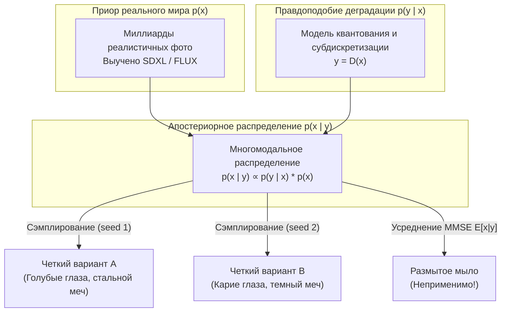

# Теория вероятностей и теория информации в обратных задачах

## 1. Краткое описание
В этой статье излагаются теоретико-вероятностные и информационные основы задачи Pixel Art → Realism. Математически доказывается, почему минимизация среднеквадратичной ошибки (MSE) неизбежно приводит к размытому изображению (мылу), формулируется байесовская постановка задачи через условное распределение $p(x \mid y)$, анализируется информационный дефицит энтропии Шеннона и обосновывается необходимость стохастического сэмплирования из апостериорного распределения (Posterior Sampling).

---

## 2. Интуитивное объяснение: Ловушка среднего лица

Представьте, что вам показали размытое или пиксельное пятно размером $4\times 4$, про которое известно только одно: это человеческий глаз.
Какого он цвета? Он может быть:
- Голубым (с вероятностью 40%)
- Карим (с вероятностью 40%)
- Зелёным (с вероятностью 20%)

Если мы обучим нейросеть методом классической регрессии минимизировать расстояние $L_2$ (среднеквадратичную ошибку между предсказанием и истинным фото), нейросеть быстро поймёт математический закон:  
*«Чтобы в среднем ошибаться меньше всего, нужно предсказать среднее арифметическое всех возможных вариантов».*

В результате сеть выдаст **серо-грязный полупрозрачный глаз**, которого в реальности не существует в природе! Этот феномен называется **усреднением мод (Mode Averaging)**.

Вместо усреднения человек ожидает от генеративного ИИ **выбора одной конкретной правдоподобной моды**: сгенерировать чёткий, резкий, идеально детализированный голубой глаз с сосудами и ресницами (при `seed=1`) или не менее реалистичный карий глаз (при `seed=2`). Это и есть переход от регрессии к вероятностному сэмплированию.

---

## 3. Байесовский вывод и формулировка задачи



### 3.1. Формула Байеса для условной генерации
Пусть $x \in \mathcal{X}$ — целевое реалистичное изображение, а $y \in \mathcal{Y}$ — входной пиксель-арт. Согласно теореме Байеса:
$$p(x \mid y) = \frac{p(y \mid x) p(x)}{p(y)} = \frac{p(y \mid x) p(x)}{\int_{\mathcal{X}} p(y \mid x') p(x') dx'}$$

Где:
- $p(x)$ — **априорное распределение естественных изображений (Natural Image Prior)**. Задаёт вероятность того, что изображение $x$ выглядит как реальный физический мир (гладкие градиенты, естественные текстуры, анатомия). В современных системах это распределение закодировано в весах базовой диффузионной модели (SDXL, FLUX.1).
- $p(y \mid x)$ — **функция правдоподобия (Likelihood / Degradation Model)**. Вероятность получить спрайт $y$ из изображения $x$. Если оператор деградации $\mathcal{D}$ детерминирован, то:
  $$p(y \mid x) = \delta(y - \mathcal{D}(x))$$
  где $\delta$ — дельта-функция Дирака.
- $p(x \mid y)$ — **апостериорное распределение (Posterior)**. Плотность вероятности всех реалистичных изображений, которые при пикселизации дают ровно спрайт $y$.

---

### 3.2. Почему классический MMSE порождает «мыло»

Классические сверхразрешающие модели (SRCNN, EDSR, SwinIR), обучаемые с функцией потерь $L_2 = \|x - \hat{x}\|_2^2$, ищут оценку минимальной среднеквадратичной ошибки (Minimum Mean Squared Error, MMSE):
$$\hat{x}_{\text{MMSE}} = \arg\min_{\hat{x}} \mathbb{E}_{x \sim p(x \mid y)} \left[ \|x - \hat{x}\|_2^2 \right]$$

Взяв производную по $\hat{x}$ и приравняв к нулю:
$$\frac{\partial}{\partial \hat{x}} \int \|x - \hat{x}\|_2^2 \, p(x \mid y) dx = -2 \int (x - \hat{x}) p(x \mid y) dx = 0$$
$$\hat{x}_{\text{MMSE}} = \int x \cdot p(x \mid y) dx = \mathbb{E}[x \mid y]$$

**Математический вывод:**  
Оценка MMSE в точности равна **математическому ожиданию** апостериорного распределения.  
Если $p(x \mid y)$ является многомодальным (распределение имеет несколько изолированных пиков — разные причёски, цвета глаз, узоры ткани), то среднее значение $\mathbb{E}[x \mid y]$ лежит в области между пиками — там, где плотность вероятности реального мира равна нулю!

### 3.3. MAP против Posterior Sampling

- **MAP (Maximum A Posteriori):**
  $$\hat{x}_{\text{MAP}} = \arg\max_x p(x \mid y) = \arg\max_x \left[ \log p(y \mid x) + \log p(x) \right]$$
  Находит одну наиболее вероятную моду. Однако в пространствах размерности $\sim 10^6$ мода распределения часто страдает от неестественной гладкости.
- **Posterior Sampling (Целевой подход):**
  Сэмплирование случайной величины напрямую из апостериорного распределения:
  $$\hat{x} \sim p(x \mid y)$$
  Диффузионные модели решают именно эту задачу через стохастическое интегрирование обратного дифференциального уравнения.

---

## 4. Информационный анализ: Энтропия Шеннона и информационный дефицит

Пусть входной спрайт $Y$ имеет разрешение $32 \times 32$ и дискретную палитру из 16 цветов.
Энтропия Шеннона случайной величины $Y$ ограничена сверху равномерным распределением цветов:
$$H(Y) = -\sum_{i} P(y_i) \log_2 P(y_i) \le 32 \times 32 \times \log_2(16) = 1024 \times 4 = 4096 \text{ бит}$$

Целевое реалистичное изображение $X$ имеет разрешение $1024 \times 1024$ при 24 битах на пиксел (8 бит на канал RGB). Предполагая консервативную эмпирическую оценку энтропии естественных фото $\approx 2.5$ бит/пиксел:
$$H(X) \approx 1024 \times 1024 \times 2.5 = 2\,621\,440 \text{ бит} \approx 2.62 \text{ Мбит}$$

### Теорема о взаимной информации
Взаимная информация $I(X; Y)$ показывает, сколько информации о реалистичном мире содержится в спрайте:
$$I(X; Y) = H(X) - H(X \mid Y) \le H(Y) \le 4096 \text{ бит}$$

Вычислим условную энтропию $H(X \mid Y)$ — меру остаточной неопределённости, которую модель **обязана придумать самостоятельно**:
$$H(X \mid Y) = H(X) - I(X; Y) \ge 2\,621\,440 - 4\,096 = 2\,617\,344 \text{ бит}$$

**Фундаментальный вывод:**  
Входной пиксель-арт определяет не более **$0.15\%$** информации итогового реалистичного изображения. Оставшиеся **$99.85\%$** информации извлекаются из генеративного априорного знания модели $p(x)$.

---

## 5. Практическая реализация: Моделирование коллапса среднего (MMSE vs Sampling)

Следующий скрипт наглядно демонстрирует фундаментальную разницу между поиском математического ожидания (регрессия к среднему) и вероятностным сэмплированием мод:

```python
"""nn_upscaler.math.posterior_demo: Demonstration of Mode Averaging vs Posterior Sampling."""

import numpy as np


def simulate_inverse_problem():
    """Симуляция обратной задачи с мультимодальным апостериорным распределением."""
    # Предположим, истинное значение высокочастотной текстуры x имеет две равновероятные моды:
    # Мода 1: x ~ N(+3.0, 0.2^2) (светлая полированная сталь)
    # Мода 2: x ~ N(-3.0, 0.2^2) (чернёный металл с гравировкой)
    n_samples = 10000
    modes = np.random.choice([-1, 1], size=n_samples)
    x_true = modes * 3.0 + np.random.normal(0, 0.2, size=n_samples)

    # Оператор деградации: усреднение до нуля y = E[x] = 0
    y_observed = 0.0

    # 1. MMSE оценка (традиционные SR CNN с L2 лоссом):
    x_mmse = np.mean(x_true)

    # 2. Posterior Sampling (Генеративная диффузия):
    # Модель выбирает одну из валидных мод случайным образом
    sample_seed_1 = np.random.normal(+3.0, 0.2)
    sample_seed_2 = np.random.normal(-3.0, 0.2)

    print(f"[*] Наблюдаемый вход (Pixel Art): y = {y_observed:.2f}")
    print(f"[-] Результат L2/MMSE регрессии: x_pred = {x_mmse:.4f} (Размытое серное ничто!)")
    print(f"[+] Сэмпл 1 (Seed 1, Diffusion): x_pred = {sample_seed_1:.4f} (Четкая текстура 1)")
    print(f"[+] Сэмпл 2 (Seed 2, Diffusion): x_pred = {sample_seed_2:.4f} (Четкая текстура 2)")


if __name__ == "__main__":
    simulate_inverse_problem()
```

---

## 6. Исследовательский анализ и выводы

1. Любые попытки решить задачу Pixel Art → Realism с помощью чистых регрессионных сетей (PSNR-oriented CNN / Transformers) математически обречены на порождение серого пластикового размытия.
2. Единственный научно состоятельный путь — использование **вероятностных генеративных моделей (Diffusion, Flow Matching)**, способных производить сэмплирование $x \sim p(x \mid y)$ из многомодального апостериорного распределения.
3. Управление генерацией (ControlNet) есть не что иное, как сужение апостериорного распределения вдоль гиперповерхности условий: $p(x \mid y, c_{\text{depth}}, c_{\text{tile}})$.

---

## 7. Связанные темы
- Вариационные автоэнкодеры: [`02_Mathematical_Foundations/02_Variational_Autoencoders_and_Latent_Spaces.md`](02_Variational_Autoencoders_and_Latent_Spaces.md)
- Теория диффузионных процессов: [`02_Mathematical_Foundations/04_Diffusion_Models_and_SDEs.md`](02_Diffusion_Models_and_SDEs.md)
- Перцептивные функции потерь: [`02_Mathematical_Foundations/06_Loss_Functions_and_Perceptual_Metrics.md`](06_Loss_Functions_and_Perceptual_Metrics.md)
