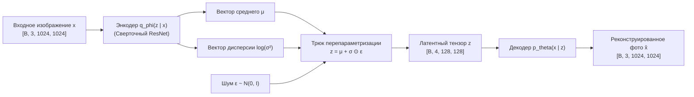

# Вариационные автоэнкодеры и сжатые латентные пространства

## 1. Краткое описание
В этой статье подробно разбирается математический вывод вариационных автоэнкодеров (VAE), формулировка нижней границы доказательства (ELBO), трюк с перепараметризацией и дискретное векторное квантование (VQ-VAE). Исследуется роль VAE как пространственного компрессора данных в моделях Latent Diffusion (SD1.5, SDXL, FLUX), а также анализируются артефакты искажения пиксельной сетки при прямом кодировании в латентное пространство.

---

## 2. Интуитивное объяснение: Зачем нужно скрытое пространство?

Прямое обучение диффузионных моделей в исходном пиксельном пространстве изображения высокого разрешения ($1024 \times 1024 \times 3$) сталкивается с колоссальными вычислительными затратами:
- Каждое изображение содержит $3\,145\,728$ скалярных значений.
- Внимание в трансформерах и свертки высокого разрешения требуют сотен гигабайт видеопамяти и колоссального времени инференса.
- При этом большая часть этих миллионов чисел описывает высокочастотный перцептивно незначимый шум (микроструктуру сенсора камеры), а не высокоуровневую семантику сцены.

Идея **Latent Diffusion** (Rombach et al., CVPR 2022) заключается в разделении генерации на два этапа:
1. **Перцептивное сжатие (Perceptual Compression):** Предварительно обученный VAE сжимает изображение в 8 раз по каждой пространственной оси ($f=8$), превращая вход $1024 \times 1024 \times 3$ в латентный тензор $128 \times 128 \times 4$. Размерность данных падает в **48 раз** без видимой глазу потери качества!
2. **Семантическая диффузия (Semantic Diffusion):** Тяжёлый генеративный процесс предсказания формы и текстур протекает исключительно в компактном латентном пространстве.

---

## 3. Математический вывод Вариационного Автоэнкодера (VAE)



### 3.1. Формулировка маргинального правдоподобия
Мы хотим максимизировать логарифм правдоподобия данных $\log p_\theta(x)$ для распределения реальных изображений:
$$\log p_\theta(x) = \log \int p_\theta(x, z) \, dz = \log \int p_\theta(x \mid z) p(z) \, dz$$
Этот интеграл аналитически невычислим (intractable), так как истинное апостериорное распределение $p(z \mid x)$ неизвестно.

### 3.2. Пошаговый вывод вариационной нижней границы (ELBO)
Введём аппроксимирующее распределение энкодера $q_\phi(z \mid x)$:
$$\begin{aligned}
\log p_\theta(x) &= \log \int q_\phi(z \mid x) \frac{p_\theta(x, z)}{q_\phi(z \mid x)} \, dz \\
&= \log \mathbb{E}_{q_\phi(z \mid x)} \left[ \frac{p_\theta(x, z)}{q_\phi(z \mid x)} \right]
\end{aligned}$$

Применяя неравенство Йенсена ($\log \mathbb{E}[X] \ge \mathbb{E}[\log X]$ для вогнутой функции логарифма):
$$\begin{aligned}
\log p_\theta(x) &\ge \mathbb{E}_{q_\phi(z \mid x)} \left[ \log \frac{p_\theta(x, z)}{q_\phi(z \mid x)} \right] \\
&= \mathbb{E}_{q_\phi(z \mid x)} \left[ \log \frac{p_\theta(x \mid z) p(z)}{q_\phi(z \mid x)} \right] \\
&= \mathbb{E}_{q_\phi(z \mid x)} [\log p_\theta(x \mid z)] - \mathbb{E}_{q_\phi(z \mid x)} \left[ \log \frac{q_\phi(z \mid x)}{p(z)} \right]
\end{aligned}$$

Получаем **Evidence Lower Bound (ELBO)**:
$$\mathcal{L}_{\text{ELBO}}(\theta, \phi; x) = \underbrace{\mathbb{E}_{q_\phi(z \mid x)} [\log p_\theta(x \mid z)]}_{\text{Ошибка реконструкции}} - \underbrace{D_{\text{KL}}(q_\phi(z \mid x) \parallel p(z))}_{\text{Регуляризация Кульбака-Лейблера}}$$

---

### 3.3. Аналитический вывод KL-дивергенции для Гауссова распределения
Пусть априорное распределение латентов стандартное нормальное: $p(z) = \mathcal{N}(0, \mathbf{I})$, а вариационный энкодер предсказывает диагональное распределение $q_\phi(z \mid x) = \mathcal{N}(\mu, \operatorname{diag}(\sigma^2))$.

Дивергенция Кульбака-Лейблера между двумя $J$-мерными гауссианами вычисляется по формуле:
$$D_{\text{KL}}(q \parallel p) = \int q(z) \log \frac{q(z)}{p(z)} \, dz = -\frac{1}{2} \sum_{j=1}^J \left( 1 + \log(\sigma_j^2) - \mu_j^2 - \sigma_j^2 \right)$$

### 3.4. Трюк с перепараметризацией (Reparameterization Trick)
Операция взятия случайного сэмпла $z \sim q_\phi(z \mid x)$ стохастична и не позволяет вычислить градиент $\nabla_\phi$.  
Трюк заключается в вынесении стохастичности во внешний шум $\epsilon \sim \mathcal{N}(0, \mathbf{I})$:
$$z = \mu(x) + \sigma(x) \odot \epsilon$$
Теперь градиент по параметрам энкодера легко проходит через $\mu$ и $\sigma$:
$$\frac{\partial z}{\partial \phi} = \frac{\partial \mu}{\partial \phi} + \epsilon \odot \frac{\partial \sigma}{\partial \phi}$$

---

## 4. VAE в архитектурах Latent Diffusion (SD1.5, SDXL, FLUX)

### Масштабирующие коэффициенты (Scaling Factors)
Дисперсия скрытого пространства после обучения VAE обычно не равна 1.0. Чтобы процесс диффузии протекал со стандартным единичным шумом, латентные тензоры умножаются на эмпирический константный скаляр:
$$z_{\text{scaled}} = z \cdot \text{scale\_factor}$$

| Архитектура | Форма латента на входе | Каналы $c$ | Фактор сжатия $f$ | Масштабирующий фактор (Scale Factor) |
|---|---|---|---|---|
| **SD 1.5 / SD 2.1** | $[B, 4, 64, 64]$ | 4 | $8\times$ | $\sigma_{\text{scale}} = 0.18215$ |
| **SDXL 1.0** | $[B, 4, 128, 128]$ | 4 | $8\times$ | $\sigma_{\text{scale}} = 0.13025$ |
| **FLUX.1** | $[B, 16, 128, 128]$ | 16 | $8\times$ | $\sigma_{\text{scale}} = 0.3611$ (16-канальный VAE) |

---

## 5. Практическая реализация: Работа с VAE в PyTorch и Diffusers

Модуль демонстрирует корректное кодирование изображения в латентное пространство, масштабирование дисперсии и безопасное декодирование с тайлингом (Tiled VAE decoding) для предотвращения ошибок Out-of-Memory (OOM):

```python
"""nn_upscaler.models.vae_utils: Latent encoding and memory-safe tiled decoding."""

import torch
from diffusers import AutoencoderKL
from PIL import Image
from torchvision import transforms


class LatentSpaceManager:
    """Управление латентным пространством VAE в SDXL пайплайнах."""

    def __init__(self, vae_model_id: str = "stabilityai/sdxl-vae", device: str = "cuda"):
        self.device = torch.device(device)
        self.vae = AutoencoderKL.from_pretrained(
            vae_model_id, torch_dtype=torch.float16 if device == "cuda" else torch.float32
        ).to(self.device)
        # Включение тайлинга для экономии VRAM при декодировании больших разрешений
        self.vae.enable_tiling()
        self.scale_factor = self.vae.config.scaling_factor

    def encode_image(self, pil_image: Image.Image) -> torch.Tensor:
        """Кодирование изображения в нормализованный латентный тензор z."""
        transform = transforms.Compose(
            [transforms.ToTensor(), transforms.Normalize([0.5, 0.5, 0.5], [0.5, 0.5, 0.5])]
        )
        tensor = transform(pil_image).unsqueeze(0).to(self.device, dtype=self.vae.dtype)

        with torch.no_grad():
            # Извлекаем среднее распределения без стохастического шума для инференса
            latent = self.vae.encode(tensor).latent_dist.mean
            latent_scaled = latent * self.scale_factor

        return latent_scaled  # Форма: [1, 4, H // 8, W // 8]

    def decode_latent(self, latent_scaled: torch.Tensor) -> Image.Image:
        """Декодирование латентного тензора обратно в RGB-изображение."""
        with torch.no_grad():
            # Деномализация латента
            latent = latent_scaled / self.scale_factor
            decoded = self.vae.decode(latent).sample

            # Приведение из [-1, 1] в [0, 255] uint8
            decoded = (decoded / 2 + 0.5).clamp(0, 1)
            decoded_np = (decoded.squeeze(0).permute(1, 2, 0).cpu().float().numpy() * 255).astype(
                "uint8"
            )

        return Image.fromarray(decoded_np)
```

---

## 6. Исследовательский анализ: Проблема прямого кодирования Pixel Art в VAE

Если подать пиксель-арт $32 \times 32$ напрямую в стандартный VAE энкодер Stable Diffusion:
1. **Пространственный коллапс:** При факторе сжатия $f=8$ латентный тензор будет иметь размер всего **$4 \times 4$ ячейки**. Вся сложная геометрия персонажа сожмётся в матрицу из 16 скрытых векторов!
2. **Высокочастотный артефакт размытия:** Сверточные фильтры энкодера VAE обучены на непрерывных фото. Резкие однопиксельные перепады контраста вызывают явление Гиббса (звон и рябь вокруг контуров).

### Инженерное решение в задаче Pixel Art → Realism:
Пиксель-арт **никогда не кодируется напрямую в латентный шум на ранних этапах без предварительного масштабирования**.  
Спрайт сначала апскейлится через `Nearest-Neighbor` до целевого разрешения ($1024 \times 1024$), сглаживается билатеральным фильтром и подаётся в **ControlNet-адаптер как пространственное условие**, оставляя диффузионный латент свободным для генерации фотореализма.

---

## 7. Связанные темы
- Математика диффузионных моделей: [`02_Mathematical_Foundations/04_Diffusion_Models_and_SDEs.md`](04_Diffusion_Models_and_SDEs.md)
- Архитектура SDXL: [`03_Architectures/03_Latent_Diffusion_SD15_SDXL.md`](../03_Architectures/03_Latent_Diffusion_SD15_SDXL.md)
- Управление структурой: [`04_Structure_Preservation/01_Structural_Conditioning_Signals.md`](../04_Structure_Preservation/01_Structural_Conditioning_Signals.md)
