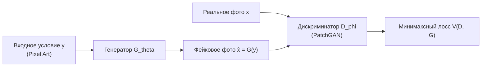

# Генеративно-состязательные сети (GAN) и трансляция изображений

## 1. Краткое описание
В этой статье подробно рассматривается математический аппарат генеративно-состязательных сетей (GAN), анализируется минимаксная оптимизация, дивергенция Дженсена-Шеннона и расстояние Вассерштейна (WGAN-GP). Исследуются архитектуры условных сетей трансляции изображений (Pix2Pix, PatchGAN, CycleGAN, CUT) и оценивается их применимость к задаче Pixel Art → Realism.

---

## 2. Интуитивное объяснение: Дуэль художника и критика

В парадигме GAN генерация формулируется как игра двух игроков:
- **Генератор ($G$):** Фальшивомонетчик, пытающийся превратить грубый пиксельный набросок в фотореалистичную картину.
- **Дискриминатор ($D$):** Искусствовед-критик, задача которого — отличить подделку генератора от реальной фотографии.

В процессе состязательного обучения дискриминатор штрафует генератор за любые «пластиковые» текстуры или нефизические артефакты, заставляя его выучивать сложнейшие высокочастотные распределения реального мира.

Главное преимущество GAN перед диффузионными моделями — **мгновенная скорость**: генератор представляет собой прямую сверточную сеть (feed-forward network), выполняющую генерацию за один прямой проход ($10\text{–}30\text{ мс}$). Главная проблема — **катастрофическая нестабильность обучения** и склонность к коллапсу мод (mode collapse).

---

## 3. Математическая формулировка классического GAN



### 3.1. Минимаксная оптимизация
Генератор $G$ и дискриминатор $D$ решают задачу оптимизации с целевой функцией $V(D, G)$:
$$\min_G \max_D V(D, G) = \mathbb{E}_{x \sim p_{\text{data}}(x)} [\log D(x)] + \mathbb{E}_{z \sim p_z(z)} [\log (1 - D(G(z)))]$$

### 3.2. Вывод оптимального дискриминатора
При фиксированном генераторе $G$ с распределением сгенерированных данных $p_g$, интеграл целевой функции имеет вид:
$$V(D, G) = \int_{\mathcal{X}} \left[ p_{\text{data}}(x) \log D(x) + p_g(x) \log(1 - D(x)) \right] dx$$

Для каждого $x \in \mathcal{X}$ найдём максимум подынтегрального выражения $f(y) = a \log y + b \log(1 - y)$, взяв производную:
$$\frac{df}{dy} = \frac{a}{y} - \frac{b}{1 - y} = 0 \implies a(1 - y) = b y \implies y^* = \frac{a}{a + b}$$

Подставляя $a = p_{\text{data}}(x)$ и $b = p_g(x)$, получаем аналитическую форму оптимального дискриминатора $D^*(x)$:
$$D^*(x) = \frac{p_{\text{data}}(x)}{p_{\text{data}}(x) + p_g(x)}$$

### 3.3. Связь с дивергенцией Дженсена-Шеннона (JS Divergence)
Подставим $D^*(x)$ обратно в целевую функцию $V(D^*, G)$:
$$\begin{aligned}
V(D^*, G) &= \mathbb{E}_{x \sim p_{\text{data}}} \left[ \log \frac{p_{\text{data}}(x)}{p_{\text{data}}(x) + p_g(x)} \right] + \mathbb{E}_{x \sim p_g} \left[ \log \frac{p_g(x)}{p_{\text{data}}(x) + p_g(x)} \right] \\
&= -\log(4) + D_{\text{KL}}\left( p_{\text{data}} \parallel \frac{p_{\text{data}} + p_g}{2} \right) + D_{\text{KL}}\left( p_g \parallel \frac{p_{\text{data}} + p_g}{2} \right) \\
&= -\log(4) + 2 \cdot D_{\text{JS}}(p_{\text{data}} \parallel p_g)
\end{aligned}$$

**Фундаментальная проблема классического GAN:**  
Если распределения $p_{\text{data}}$ и $p_g$ лежат на непересекающихся низкоразмерных многообразиях в $\mathbb{R}^d$ (что практически всегда верно для изображений высокого разрешения), то дивергенция Дженсена-Шеннона константно равна $\log(2)$, а градиенты $\nabla_G V(D, G)$ обращаются в **ноль**. Генератор перестаёт обучаться (затухание градиентов).

---

## 4. Архитектуры Image-to-Image трансляции

### 4.1. PatchGAN Дискриминатор (Pix2Pix / Pix2PixHD)
Вместо того чтобы классифицировать все изображение как «целиком реальное или целиком фейковое» (что приводит к потере локальной резкости), дискриминатор PatchGAN (Isola et al., CVPR 2017) выдаёт матрицу логитов размера $N \times N$.  
Каждый элемент матрицы оценивает реалистичность локального патча размером $70 \times 70$ пикселей. Это заставляет генератор качественно воссоздавать микротекстуры.

Целевая функция Pix2Pix сочетает состязательный лосс и попиксельный $L_1$:
$$\mathcal{L}_{\text{Pix2Pix}}(G, D) = \mathcal{L}_{\text{cGAN}}(G, D) + \lambda \mathbb{E}_{x, y} \left[ \|x - G(y)\|_1 \right]$$

### 4.2. CycleGAN: Непарная трансляция с сохранением цикла
Если парных данных $X \leftrightarrow Y$ нет, CycleGAN (Zhu et al., ICCV 2017) обучает два взаимно-обратных генератора $G: \mathcal{Y} \to \mathcal{X}$ и $F: \mathcal{X} \to \mathcal{Y}$ с требованием циклической согласованности:
$$\mathcal{L}_{\text{cyc}}(G, F) = \mathbb{E}_{y} [\|F(G(y)) - y\|_1] + \mathbb{E}_{x} [\|G(F(x)) - x\|_1]$$

### 4.3. Contrastive Unpaired Translation (CUT)
Вместо тяжёлого двойного цикла CUT (Park et al., ECCV 2020) использует контрастивное обучение патчей (PatchNCE). Патч в сгенерированном реалистичном изображении должен быть ближе к соответствующему патчу пиксель-арта в том же месте, чем к любым случайным патчам того же спрайта:
$$\ell(v, v^+, v^-) = -\log \left( \frac{\exp(v \cdot v^+ / \tau)}{\exp(v \cdot v^+ / \tau) + \sum_{n} \exp(v \cdot v_n^- / \tau)} \right)$$

---

## 5. Практическая реализация: PatchGAN Дискриминатор в PyTorch

```python
"""nn_upscaler.models.patchgan: Multi-scale PatchGAN Discriminator with Spectral Normalization."""

import torch
import torch.nn as nn
from torch.nn.utils import spectral_norm


class PatchGANDiscriminator(nn.Module):
    """PatchGAN дискриминатор для оценки локальной реалистичности патчей 70x70."""

    def __init__(self, in_channels: int = 6, num_filters: int = 64):
        super().__init__()
        # in_channels = 3 (Pixel Art) + 3 (Realism/Fake Photo) = 6 каналов на входе

        def conv_block(in_c, out_c, stride=2, normalize=True):
            layers = [
                spectral_norm(nn.Conv2d(in_c, out_c, kernel_size=4, stride=stride, padding=1))
            ]
            if normalize:
                layers.append(nn.InstanceNorm2d(out_c))
            layers.append(nn.LeakyReLU(0.2, inplace=True))
            return layers

        self.model = nn.Sequential(
            *conv_block(in_channels, num_filters, stride=2, normalize=False),  # 512x512 -> 256x256
            *conv_block(num_filters, num_filters * 2, stride=2),  # 256x256 -> 128x128
            *conv_block(num_filters * 2, num_filters * 4, stride=2),  # 128x128 -> 64x64
            *conv_block(num_filters * 4, num_filters * 8, stride=1),  # 64x64 -> 63x63
            spectral_norm(
                nn.Conv2d(num_filters * 8, 1, kernel_size=4, stride=1, padding=1)
            ),  # Выходной логит
        )

    def forward(self, condition: torch.Tensor, target: torch.Tensor) -> torch.Tensor:
        """
        condition: Pixel Art тензор [B, 3, H, W]
        target: Фотореалистичный сэмпл [B, 3, H, W]
        """
        x = torch.cat([condition, target], dim=1)
        return self.model(x)  # Матрица логитов [B, 1, H_out, W_out]
```

---

## 6. Исследовательский анализ для Pixel Art → Realism

| Аспект | GAN-модели (Pix2PixHD / CUT) | Диффузионные модели (SDXL / ControlNet) |
|---|---|---|
| **Скорость инференса** | **15–30 мс (Пригодно для 60 FPS)** | 2–8 секунд (Непригодно для real-time) |
| **Качество микротекстур** | Среднее; склонность к мылу и пластику | **Исключительное; фотореалистичные поры, ткань, металл** |
| **Стабильность обучения** | Низкая; требует балансировки $\lambda$ | Высокая; стабильный лосс предсказания шума |
| **Семантическое разнообразие** | Страдает от Mode Collapse | Высокое; генерация сотен уникальных вариаций |

**Инженерный вывод:**  
GAN-модели не способны конкурировать с диффузией в качестве оффлайн-генератора текстур высокой четкости. Однако они представляют колоссальную ценность на этапе **дистилляции знаний (Knowledge Distillation)**: большой диффузионный пайплайн генерирует оффлайн-датасет, на котором затем обучается компактный PatchGAN-генератор для интеграции в видеоигры в реальном времени.

---

## 7. Связанные темы
- Математика диффузии: [`02_Mathematical_Foundations/04_Diffusion_Models_and_SDEs.md`](04_Diffusion_Models_and_SDEs.md)
- Сравнение классических архитектур: [`03_Architectures/02_GAN_Translation_Models.md`](../03_Architectures/02_GAN_Translation_Models.md)
- Интеграция в движки: [`09_Real_Time_and_Games/04_Game_Engine_Integration_Godot_Unity.md`](../09_Real_Time_and_Games/04_Game_Engine_Integration_Godot_Unity.md)
