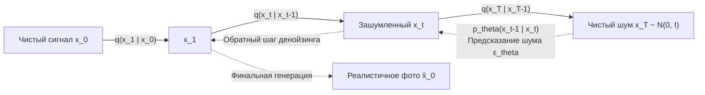

# Диффузионные вероятностные модели и стохастические дифференциальные уравнения (SDE)

## 1. Краткое описание
В этой статье даётся исчерпывающий математический вывод дискретных диффузионных вероятностных моделей (DDPM), непрерывных стохастических дифференциальных уравнений (SDE) и обыкновенных дифференциальных уравнений вероятностного течения (Probability Flow ODE). Подробно разбирается метод бесклассификаторного направления (Classifier-Free Guidance, CFG) и алгоритм SDEdit, лежащие в основе генеративного преобразования Pixel Art → Realism.

---

## 2. Интуитивное объяснение: Физика термодинамики

Представьте каплю синих чернил, упавшую в стакан с чистой водой. Со временем молекулы чернил сталкиваются с молекулами воды (броуновское движение), капля расплывается, и через несколько минут вода превращается в равномерный мутный раствор максимальной энтропии. Это **прямой процесс диффузии** — превращение структурированного порядка в чистый случайный шум.

Математическое чудо современных диффузионных моделей заключается в том, что мы обучаем нейронную сеть **обращать стрелу времени вспять**:
1. Начиная со стакана с мутным шумом, сеть на каждом миллисекундном шаге предсказывает, в каком направлении сместились молекулы.
2. Делая сотни маленьких шагов назад, модель аккуратно собирает случайный шум обратно в идеально чёткую каплю чернил — реалистичное изображение с физически достоверными свойствами.

В задаче **Pixel Art → Realism** пиксельный спрайт выступает магнитным полем, которое направляет движение молекул шума так, чтобы они собрались в фотореалистичного персонажа строго заданной формы и позы.

---

## 3. Дискретный математический вывод DDPM (Ho et al., 2020)



### 3.1. Прямой процесс диффузии (Forward Process)
Прямой процесс представляет собой марковскую цепь, которая постепенно добавляет гауссов шум к чистому изображению $x_0 \sim q(x_0)$ на протяжении $T$ дискретных шагов:
$$q(x_1, \dots, x_T \mid x_0) = \prod_{t=1}^T q(x_t \mid x_{t-1})$$
$$q(x_t \mid x_{t-1}) = \mathcal{N}\left( x_t; \sqrt{1 - \beta_t} x_{t-1}, \beta_t \mathbf{I} \right)$$
где $\beta_1 < \beta_2 < \dots < \beta_T$ — заранее заданное расписание дисперсии (variance schedule).

#### Маргинальное распределение на произвольном шаге $t$
Определим $\alpha_t = 1 - \beta_t$ и кумулятивное произведение $\bar{\alpha}_t = \prod_{s=1}^t \alpha_s$.  
Используя свойство суммы независимых гауссовых случайных величин:
$$x_t = \sqrt{\alpha_t} x_{t-1} + \sqrt{1 - \alpha_t} \epsilon_{t-1} = \dots = \sqrt{\bar{\alpha}_t} x_0 + \sqrt{1 - \bar{\alpha}_t} \epsilon$$
где $\epsilon \sim \mathcal{N}(0, \mathbf{I})$.

Следовательно, мы можем получить зашумлённое состояние $x_t$ на **любом шаге $t$ мгновенно в аналитическом виде**:
$$q(x_t \mid x_0) = \mathcal{N}\left( x_t; \sqrt{\bar{\alpha}_t} x_0, (1 - \bar{\alpha}_t) \mathbf{I} \right)$$

---

### 3.2. Обратный процесс (Reverse Process)
Истинное апостериорное распределение шага назад при условии знания исходного $x_0$ также является гауссовым по формуле Байеса:
$$q(x_{t-1} \mid x_t, x_0) = \mathcal{N}\left( x_{t-1}; \tilde{\mu}_t(x_t, x_0), \tilde{\beta}_t \mathbf{I} \right)$$

Вычислим параметры $\tilde{\mu}_t$ и $\tilde{\beta}_t$:
$$\tilde{\beta}_t = \frac{1 - \bar{\alpha}_{t-1}}{1 - \bar{\alpha}_t} \beta_t$$
$$\tilde{\mu}_t(x_t, x_0) = \frac{\sqrt{\bar{\alpha}_{t-1}}\beta_t}{1 - \bar{\alpha}_t} x_0 + \frac{\sqrt{\alpha_t}(1 - \bar{\alpha}_{t-1})}{1 - \bar{\alpha}_t} x_t$$

Выражая $x_0$ через $x_t$ из формулы прямого процесса ($x_0 = \frac{x_t - \sqrt{1 - \bar{\alpha}_t}\epsilon}{\sqrt{\bar{\alpha}_t}}$) и подставляя в выражение для среднего:
$$\tilde{\mu}_t(x_t, \epsilon) = \frac{1}{\sqrt{\alpha_t}} \left( x_t - \frac{\beta_t}{\sqrt{1 - \bar{\alpha}_t}} \epsilon \right)$$

### 3.3. Функция потерь обучения (Simplified Objective)
Нейронная сеть $\epsilon_\theta(x_t, t)$ обучается предсказывать шум $\epsilon$, который был добавлен к изображению:
$$\mathcal{L}_{\text{simple}}(\theta) = \mathbb{E}_{t \sim [1, T], \, x_0 \sim q(x_0), \, \epsilon \sim \mathcal{N}(0, \mathbf{I})} \left[ \| \epsilon - \epsilon_\theta(x_t, t) \|_2^2 \right]$$

---

## 4. Непрерывные SDE и Score Matching (Song et al., 2021)

При стремлении числа шагов $T \to \infty$ и $\Delta t \to 0$ процесс диффузии переходит в непрерывное **стохастическое дифференциальное уравнение Ито (Itô SDE)**:
$$dx = f(x, t) dt + g(t) dw$$
где $f(x, t)$ — вектор сноса (drift coefficient), $g(t)$ — коэффициент диффузии, а $w$ — стандартный броуновский процесс.

### Обратное стохастическое уравнение (Reverse-time SDE)
Согласно фундаментальной теореме Андерсона (1982), обратный процесс во времени $t: T \to 0$ описывается уравнением:
$$dx = \left[ f(x, t) - g(t)^2 \nabla_x \log p_t(x) \right] dt + g(t) d\bar{w}$$
где $d\bar{w}$ — броуновское движение, текущее назад во времени, а $\nabla_x \log p_t(x)$ — **Score Function (градиент логарифма плотности распределения)**.

### Связь предсказания шума и Score Function:
$$\nabla_x \log p_t(x) = -\frac{\epsilon_\theta(x_t, t)}{\sqrt{1 - \bar{\alpha}_t}}$$

### Детерминированное течение (Probability Flow ODE)
Для любого диффузионного SDE существует детерминированное обыкновенное дифференциальное уравнение, обладающее абсолютно теми же маргинальными распределениями $p_t(x)$:
$$\frac{dx}{dt} = f(x, t) - \frac{1}{2} g(t)^2 \nabla_x \log p_t(x)$$
Это позволяет использовать быстрые численные решатели ODE (DPM-Solver, Euler) и осуществлять инференс за 20–30 шагов вместо 1000.

---

## 5. Механизм управления: Classifier-Free Guidance (CFG)

Для управления направлением генерации условием $c$ (текстовый промпт, ControlNet-карта) Хо и Салимэнс предложили интерполяцию между безусловным и условным предсказанием:
$$\tilde{\epsilon}_\theta(x_t, c) = \epsilon_\theta(x_t, \emptyset) + s \cdot \left( \epsilon_\theta(x_t, c) - \epsilon_\theta(x_t, \emptyset) \right)$$
где $s \ge 1.0$ — коэффициент усиления (guidance scale).

Физический смысл: мы сдвигаем градиент генерации строго вдоль вектора направления условия, подавляя моду универсального распределения данных:
$$\nabla_x \log p(x_t \mid c) = \nabla_x \log p(x_t) + s \cdot \nabla_x \log p(c \mid x_t)$$

---

## 6. Алгоритм SDEdit и почему наивный подход ломается на Pixel Art

Алгоритм SDEdit (Meng et al., ICLR 2022) предлагает простейшую схему Image-to-Image:
1. Берём входной пиксель-арт $y$.
2. Добавляем шум до промежуточного уровня $t_0 \in [0, T]$ (сила шума $t_0 / T \in [0.0, 1.0]$):
   $$x_{t_0} = \sqrt{\bar{\alpha}_{t_0}} y + \sqrt{1 - \bar{\alpha}_{t_0}} \epsilon$$
3. Запускаем стандартный денойзинг из точки $x_{t_0}$ до $0$.

```
[ Pixel Art Y ] ── Добавление шума до t0 ──> [ x_t0 ] ── Денойзинг t0 -> 0 ──> [ Результат ]
```

### Дилемма параметров в задаче Pixel Art:
- **Если $t_0$ мало ($t_0 < 0.5$):** Модель не успевает перерисовать геометрию; результат сохраняет квадратные пиксельные кирпичи и ступенчатые контуры исходного спрайта.
- **Если $t_0$ велико ($t_0 > 0.8$):** Шум полностью разрушает форму спрайта; диффузия начинает свободную галлюцинацию, меняя позу персонажа, оружие и цвет глаз.

**Вывод:** Наивный SDEdit непригоден для контролируемой депикселизации.  
Необходимо использовать **полный цикл диффузии от $t=T$ до $0$**, управляемый внешними адаптерами (**ControlNet**), подающими структуру через параллельный канал, независимый от шумового тензора!

---

## 7. Практическая реализация: DDPM прямого и обратного шага на PyTorch

```python
"""nn_upscaler.math.diffusion_core: Mathematical core of Gaussian Diffusion and SDEdit."""

import torch
import torch.nn as nn


class GaussianDiffusionEngine:
    """Математический движок планирования шума и сэмплирования DDPM."""

    def __init__(self, timesteps: int = 1000, beta_start: float = 0.00085, beta_end: float = 0.012):
        self.timesteps = timesteps
        # Линейное расписание бета (как в классическом LDM)
        self.betas = (
            torch.linspace(beta_start**0.5, beta_end**0.5, timesteps, dtype=torch.float32) ** 2
        )
        self.alphas = 1.0 - self.betas
        self.alphas_cumprod = torch.cumprod(self.alphas, dim=0)

    def q_sample(
        self, x_0: torch.Tensor, t: torch.Tensor, noise: torch.Tensor | None = None
    ) -> torch.Tensor:
        """Прямой процесс диффузии: x_t = sqrt(alpha_bar_t) * x_0 + sqrt(1 - alpha_bar_t) * noise."""
        if noise is None:
            noise = torch.randn_like(x_0)

        device = x_0.device
        alpha_bar = self.alphas_cumprod.to(device)[t].view(-1, 1, 1, 1)

        mean = torch.sqrt(alpha_bar) * x_0
        std = torch.sqrt(1.0 - alpha_bar)
        return mean + std * noise

    def p_sample_step(
        self,
        model: nn.Module,
        x_t: torch.Tensor,
        t: int,
        cond: torch.Tensor,
        guidance_scale: float = 7.5,
    ) -> torch.Tensor:
        """Один шаг обратного денойзинга с применением Classifier-Free Guidance."""
        device = x_t.device
        t_tensor = torch.full((x_t.shape[0],), t, device=device, dtype=torch.long)

        # Вычисление сдвоенного шума (условный и безусловный прогон)
        with torch.no_grad():
            eps_cond = model(x_t, t_tensor, cond)
            eps_uncond = model(x_t, t_tensor, torch.zeros_like(cond))
            # Применение формулы CFG
            eps_pred = eps_uncond + guidance_scale * (eps_cond - eps_uncond)

        beta_t = self.betas.to(device)[t]
        alpha_t = self.alphas.to(device)[t]
        alpha_bar_t = self.alphas_cumprod.to(device)[t]

        # Вычисление среднего значения x_{t-1}
        mean = (1.0 / torch.sqrt(alpha_t)) * (
            x_t - (beta_t / torch.sqrt(1.0 - alpha_bar_t)) * eps_pred
        )

        if t > 0:
            noise = torch.randn_like(x_t)
            sigma = torch.sqrt(beta_t)
            return mean + sigma * noise
        else:
            return mean
```

---

## 8. Связанные темы
- Flow Matching и DiT трансформеры: [`02_Mathematical_Foundations/05_Flow_Matching_and_Diffusion_Transformers.md`](05_Flow_Matching_and_Diffusion_Transformers.md)
- ControlNet и адаптеры: [`03_Architectures/04_ControlNet_and_Adapters.md`](../03_Architectures/04_ControlNet_and_Adapters.md)
- Устранение артефактов сетки: [`04_Structure_Preservation/01_Structural_Conditioning_Signals.md`](../04_Structure_Preservation/01_Structural_Conditioning_Signals.md)
