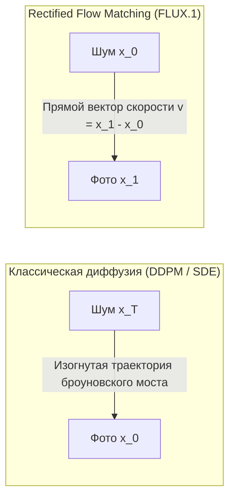

# Flow Matching и трансформеры диффузии (Diffusion Transformers / DiT)

## 1. Краткое описание
В этой статье рассматривается передовой математический аппарат генерации изображений: непрерывное сопоставление потоков (Flow Matching), выпрямленные потоки (Rectified Flow) и архитектуры трансформеров диффузии (DiT / MM-DiT). Анализируются преимущества прямых траекторий переноса вероятностей над броуновскими процессами SDE, а также исследуется архитектура моделей семейства FLUX.1 в контексте задачи Pixel Art → Realism.

---

## 2. Интуитивное объяснение: Прямые дороги вместо блужданий

Классическая диффузия (DDPM / SDE) перемещает точки из распределения шума в распределение данных вдоль сильно искривлённых, случайных траекторий. Чтобы не сойти с этой сложной кривой, численному интегратору приходится делать десятки или сотни мелких шагов, тратя колоссальные вычислительные ресурсы GPU.

**Rectified Flow Matching** задаёт радикально простой вопрос:  
*«Зачем ходить зигзагами, если кратчайшее расстояние между двумя точками — прямая линия?»*

Модель обучается строить постоянное векторное поле скоростей, которое перемещает шум $x_0$ в реалистичное изображение $x_1$ **по прямой траектории с постоянной скоростью**. В результате численное решение обыкновенного дифференциального уравнения (ODE) становится предельно точным даже при малом числе шагов (Euler solver за 15–20 шагов).

---

## 3. Математические основы Flow Matching (Lipman et al., 2023)



### 3.1. Уравнение непрерывности и векторное поле
Пусть плотность вероятности $p_t(x)$ непрерывно меняется во времени $t \in [0, 1]$ от начального априорного распределения $p_0 = \mathcal{N}(0, \mathbf{I})$ к целевому распределению данных $p_1 = p_{\text{data}}$.  
Эволюция плотности подчиняется фундаментальному уравнению непрерывности гидродинамики (Continuity Equation):
$$\frac{\partial p_t(x)}{\partial t} + \nabla \cdot \left( p_t(x) v_t(x) \right) = 0$$
где $v_t(x): \mathbb{R}^d \times [0, 1] \to \mathbb{R}^d$ — искомое зависящее от времени векторное поле скоростей.

Генерация нового сэмпла сводится к решению задачи Коши для дифференциального уравнения (ODE):
$$\frac{dx_t}{dt} = v_t(x_t), \quad x_0 \sim p_0$$
$$x_1 = x_0 + \int_0^1 v_t(x_t) \, dt$$

---

### 3.2. Выпрямленные потоки (Rectified Flow / Conditional Flow Matching)
Вместо сложного нелинейного поля скоростей выберем простейшую прямолинейную интерполяцию между парой $(x_0, x_1)$:
$$x_t = \psi_t(x_0, x_1) = (1 - t) x_0 + t x_1, \quad t \in [0, 1]$$

Производная координаты по времени вдоль этой траектории постоянна и равна разности векторов:
$$\frac{dx_t}{dt} = x_1 - x_0$$

#### Целевая функция обучения (Conditional Flow Matching Objective):
Нейронная сеть $v_\theta(x_t, t)$ параметризует векторное поле и обучается минимизировать среднеквадратичное расхождение с истинной скоростью движения:
$$\mathcal{L}_{\text{CFM}}(\theta) = \mathbb{E}_{t \sim \mathcal{U}[0, 1], \, x_0 \sim \mathcal{N}(0, \mathbf{I}), \, x_1 \sim p_{\text{data}}} \left[ \| v_\theta(x_t, t) - (x_1 - x_0) \|_2^2 \right]$$

**Главное достоинство:**  
Лосс CFM не требует вычисления интегралов или прогона марковских цепочек. Обучение абсолютно стабильно, дифференцируемо и сводится к стандартной $L_2$-регрессии вектора скорости.

---

## 4. Diffusion Transformers (DiT) и MM-DiT

Классический бэкбон Stable Diffusion — это сверточный U-Net. Однако свертки обладают локальным индуктивным смещением (local inductive bias) и плохо масштабируются на модели свыше $2\text{–}3$ миллиардов параметров.

Архитектура **Diffusion Transformer (DiT)** (Peebles & Xie, ICCV 2023) полностью заменяет U-Net на Vision Transformer:
1. **Patchify:** Латентное изображение $z \in \mathbb{R}^{H \times W \times C}$ нарезается на непересекающиеся пространственные патчи $p \times p$ (обычно $2\times 2$) и проецируется в последовательность токенов длины $N = \frac{H W}{p^2}$ размерности $D$.
2. **adaLN-Zero (Adaptive Layer Normalization):** Временной шаг $t$ и условия масштабируют и сдвигают активации перед слоями внимания:
   $$\operatorname{adaLN}(h, y) = \gamma(y) \odot \left( \frac{h - \mu}{\sigma} \right) + \beta(y)$$
   где веса $\gamma, \beta, \alpha$ инициализируются строгими нулями при старте обучения.

### Архитектура MM-DiT (FLUX.1 и Stable Diffusion 3)
В моделях FLUX.1 используется двухпотоковый трансформер (Multi-Modal DiT):
- Текстовый поток (токены из T5-XXL размерности 4096) и визуальный поток (токены латента изображения) обрабатываются собственными линейными проекциями $Q, K, V$.
- В блоке совместного внимания (Joint Self-Attention) текстовые и визуальные токены объединяются в единую матрицу внимания, позволяя каждому пикселю напрямую взаимодействовать с каждым словом текстового описания.

```
Текстовые токены [T5-XXL] ────┐
                              ├──> [ Joint Attention MM-DiT ] ──> Обновление векторов скорости
Визуальные токены [Latent]  ──┘
```

---

## 5. Практическая реализация: Модуль Conditional Flow Matching в PyTorch

```python
"""nn_upscaler.math.flow_matching: Minimal Conditional Flow Matching (CFM) layer."""

import torch
import torch.nn as nn


class RectifiedFlowTrainer(nn.Module):
    """Модуль обучения прямолинейных потоков (Rectified Flow / CFM)."""

    def __init__(self, velocity_model: nn.Module):
        super().__init__()
        self.velocity_model = velocity_model

    def forward(self, x_1: torch.Tensor, cond: torch.Tensor) -> torch.Tensor:
        """
        x_1: Целевое реалистичное изображение (High-Res Latent) [B, C, H, W]
        cond: Условие (Pixel Art + Text)
        """
        B = x_1.shape[0]
        device = x_1.device

        # 1. Сэмплирование шума x_0 ~ N(0, I)
        x_0 = torch.randn_like(x_1)

        # 2. Случайный шаг времени t ~ Uniform(0, 1)
        t = torch.rand(B, device=device)
        t_view = t.view(B, 1, 1, 1)

        # 3. Прямолинейная интерполяция координаты: x_t = (1 - t) * x_0 + t * x_1
        x_t = (1.0 - t_view) * x_0 + t_view * x_1

        # 4. Истинный вектор целевой скорости вдоль прямой
        target_velocity = x_1 - x_0

        # 5. Предсказание скорости нейросетью
        predicted_velocity = self.velocity_model(x_t, t, cond)

        # 6. Функция потерь CFM: L2 расхождение скоростей
        loss = torch.mean((predicted_velocity - target_velocity) ** 2)
        return loss

    @torch.no_grad()
    def sample_euler(
        self,
        shape: tuple[int, ...],
        cond: torch.Tensor,
        num_steps: int = 20,
        device: str = "cuda",
    ) -> torch.Tensor:
        """Инференс: решение ODE методом Эйлера за малое число шагов."""
        dt = 1.0 / num_steps
        x_t = torch.randn(shape, device=device)  # Старт из x_0 ~ N(0, I)

        for step in range(num_steps):
            t_val = step * dt
            t = torch.full((shape[0],), t_val, device=device)
            velocity = self.velocity_model(x_t, t, cond)
            # Шаг Эйлера: x_{t+dt} = x_t + v * dt
            x_t = x_t + velocity * dt

        return x_t  # Финальное реалистичное изображение в t=1
```

---

## 6. Исследовательский анализ: Применимость FLUX.1 к Pixel Art → Realism

| Характеристика | SDXL (Latent Diffusion U-Net) | FLUX.1-dev (Rectified Flow MM-DiT) |
|---|---|---|
| **Разрешение и текстуры** | Отличное (1024x1024) | **Исключительное (1024x1024 – 2048x2048)** |
| **Сложные материалы (кожа, сталь)** | Высокая реалистичность | **Фотографический микроуровень (PBR-качество)** |
| **Память (VRAM при инференсе)** | **8–12 ГБ (Доступно на домашних GPU)** | 16–24 ГБ (Требует топовых серверов / FP8) |
| **Задержка генерации** | **5–8 секунд на RTX 4090** | 20–40 секунд на RTX 4090 |
| **Доступность ControlNet-Tile** | **Сформированная зрелая экосистема** | Только формирующиеся экспериментальные адаптеры |

**Научный вывод:**  
FLUX.1 представляет собой безусловный SOTA по качеству рендеринга микродеталей. Однако из-за экстремальных требований к видеопамяти и отсутствия зрелых ControlNet-Tile адаптеров коммерческого уровня, FLUX.1 рекомендуется использовать как **инструмент оффлайн-генерации эталонных датасетов**, в то время как рабочий продакшн-пайплайн целесообразно строить на базе **SDXL**.

---

## 7. Связанные темы
- Диффузионные SDE: [`02_Mathematical_Foundations/04_Diffusion_Models_and_SDEs.md`](04_Diffusion_Models_and_SDEs.md)
- Анализ модели FLUX: [`03_Architectures/06_Modern_Flow_Matching_FLUX.md`](../03_Architectures/06_Modern_Flow_Matching_FLUX.md)
- Требования к оборудованию: [`06_Training_and_Fine_Tuning/04_Hardware_and_VRAM_Management.md`](../06_Training_and_Fine_Tuning/04_Hardware_and_VRAM_Management.md)
