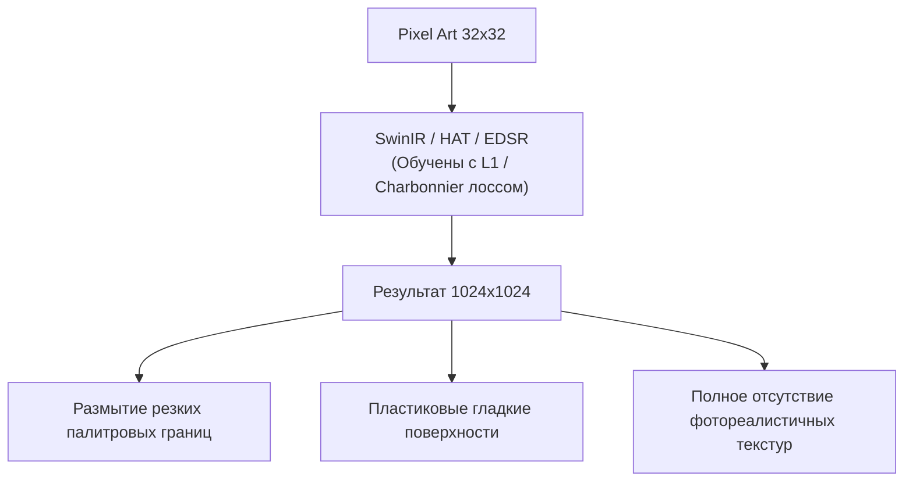

# Классические фильтры и регрессионное супер-разрешение (SR)

## 1. Краткое описание
В этой статье анализируются классические алгоритмы масштабирования пиксель-арта (Nearest-Neighbor, xBRZ, Kopf-Lischinski) и современные сверточные и трансформерные модели регрессионного супер-разрешения (EDSR, SwinIR, HAT). Математически и визуально объясняется, почему эти методы принципиально неспособны решить задачу генерации фотореализма, и как их можно эффективно использовать в качестве направляющих препроцессоров.

---

## 2. Интуитивное объяснение: Сглаживание кубиков не делает их живыми

Представьте, что перед вами скульптура человека, грубо вытесанная из гигантских деревянных брусков (Minecraft-подобный пиксельный человечек).

- **Nearest-Neighbor** просто делает эти деревянные кубики больше по размеру. Бруски остаются брусками.
- **Bicubic Interpolation** размывает края брусков, превращая скульптуру в невнятное оплывшее мыло.
- **xBRZ и Kopf-Lischinski** срезают острые углы брусков рубанком, превращая их в идеально гладкие полированные трубки и овалы. Получается красивая векторная фигурка в стиле мультфильмов Flash/SVG, но она по-прежнему абсолютно безжизненна.
- **SwinIR и HAT (Deep SR)** стараются сгладить переходы с помощью глубоких нейросетей, обученных на фото. В результате получается странный «акварельный пластилин»: переходы сглажены, но ни пор кожи, ни волосков, ни блеска металла не появляется.

Чтобы превратить деревянную статую в **настоящего живого человека из плоти и крови**, нужно не сглаживать грани, а **сгенерировать биологические и физические материалы с нуля**.

---

## 3. Классические алгоритмы геометрической депикселизации

### 3.1. Эвристические масштабирующие фильтры (xBRZ)
Алгоритмы семейства EPX, Scale2x, hq2x и **xBRZ** работают в локальном окне $3\times 3$ или $4\times 4$ пикселя.
В xBRZ анализируются цветовые дистанции между соседними пикселями в цветовом пространстве YCbCr:
$$d(A, B) = 2 |Y_A - Y_B| + |Cb_A - Cb_B| + |Cr_A - Cr_B|$$
Если обнаруживается наклонное ребро (например, два диагональных пикселя одного цвета, окруженные другим фоном), пиксель делится на субпиксельные треугольники, сглаживая ступенчатость под фиксированными углами ($30^\circ, 45^\circ, 60^\circ$).

### 3.2. Алгоритм Копфа-Лищинского (Kopf-Lischinski, SIGGRAPH 2011)
Знаковая работа *"Depixelizing Pixel Art"* подошла к задаче как к топологической проблеме вычислительной геометрии:
1. **Построение графа пикселей:** Каждый пиксель рассматривается как вершина дуального графа. Узлы соединяются рёбрами, если пиксели имеют одинаковый цвет.
2. **Разрешение неоднозначностей $2\times 2$ (Diagonal Ambiguities):** В шахматных конфигурациях $2\times 2$, где две диагонали пересекаются, применяются эвристики: связность кривых, обнаружение замкнутых контуров и тонких линий.
3. **Оптимизация ячеек Вороного:** Границы пиксельных блоков деформируются в гладкие сплайны Безье, минимизируя кривизну контуров.

```
Исходная диагональ       Граф смежности            Сплайн Безье (Kopf-Lischinski)
[ B ] [ W ]            [ B ]───[ W ]                    ╭──────╮
[ W ] [ B ]              \  \ /  /          ───>       │      │ (Гладкий вектор)
                       [ W ]───[ B ]                    ╰──────╯
```

*Ограничение:* Алгоритм генерирует масштабируемую векторную графику (SVG), но не создаёт реалистичных текстур.

---

## 4. Регрессионные архитектуры глубокого супер-разрешения

### 4.1. EDSR (Enhanced Deep Residual Networks, Lim et al., CVPR 2017)
Модель убирает слои пакетной нормализации (Batch Normalization) из блоков ResNet, сохраняя точность цветового диапазона. Увеличение разрешения выполняется через слой перетасовки пикселей (**PixelShuffle / Sub-Pixel Convolution**):
$$\mathcal{P}(T)_{c, y, x} = T_{c \cdot r^2 + (y \bmod r) \cdot r + (x \bmod r), \, \lfloor y/r \rfloor, \, \lfloor x/r \rfloor}$$

### 4.2. SwinIR и HAT (Hybrid Attention Transformer, Chen et al., CVPR 2023)
Используют механизм внимания со сдвинутыми окнами (Shifted Window Self-Attention). Модель HAT объединяет канальное внимание (Channel Attention) и оконное самовнимание, активируя огромные рецептивные поля.

### Почему глубокие регрессионные SR-модели терпят крах на Pixel Art?



1. **Регрессионная цель:** Сети обучаются минимизировать расстояние $L_1 = \|x - \hat{x}\|_1$ до ground truth. Как доказано в [Теории вероятностей](../02_Mathematical_Foundations/01_Probability_and_Information_Theory.md), это заставляет сеть выдавать медианное значение распределения.
2. **Несоответствие физической модели:** Модели ожидают размытие Гаусса, а получают ступенчатый дизеринг, который ошибочно пытаются размыть.

---

## 5. Практическая реализация: Сравнительный бейзлайнер в PyTorch

В репозитории `nn-upscaler` реализованы классические и сверточные бейзлайны:
- `NearestNeighborUpscaler` (`EXP-000`)
- `BicubicUpscaler` (`EXP-001`)
- `EDSRLightUpscaler` (`EXP-003`)

Ниже представлен код запуска и сравнения метрик:

```python
"""nn_upscaler.benchmark_baselines: Quantitative comparison of classic and regression SR baselines."""

import time
import torch
from PIL import Image
from torchvision import transforms
from nn_upscaler.models.baselines import BicubicUpscaler, NearestNeighborUpscaler
from nn_upscaler.models.edsr import EDSRLightUpscaler
from nn_upscaler.utils.device import get_device


def evaluate_baselines(image_path: str, scale: int = 4):
    device = get_device()
    img = Image.open(image_path).convert("RGB")
    tensor_img = transforms.ToTensor()(img).unsqueeze(0).to(device)

    models = {
        "Nearest": NearestNeighborUpscaler(scale_factor=scale),
        "Bicubic": BicubicUpscaler(scale_factor=scale),
        "EDSR-Light": EDSRLightUpscaler(scale_factor=scale).to(device),
    }

    print(f"=== Сравнение бейзлайнов на {image_path} (Устройство: {device}) ===")
    for name, model in models.items():
        start = time.perf_counter()
        with torch.no_grad():
            out = model(tensor_img)
        elapsed = (time.perf_counter() - start) * 1000
        print(
            f"[*] {name:12s} | Время инференса: {elapsed:6.2f} мс | Форма выхода: {list(out.shape)}"
        )


if __name__ == "__main__":
    evaluate_baselines("data/samples/sample_sprite.png", scale=4)
```

---

## 6. Исследовательский вывод: Роль классических методов в SOTA-системах

Хотя классические алгоритмы (xBRZ, Kopf-Lischinski, Bilateral Filter) не способны сами по себе сгенерировать фотореализм, они играют **незаменимую роль в качестве входных препроцессоров**:
- Прямая подача ступенчатого пиксель-арта в диффузионные детекторы контуров разрушает генерацию (артефакт кирпичной кладки).
- Предварительное сглаживание через xBRZ или билатеральный фильтр преобразует ступени в гладкие контурные направляющие, которые идеально воспринимаются моделями **ControlNet-Lineart** и **ControlNet-SoftEdge**.

---

## 7. Связанные темы
- Модели деградации: [`01_Fundamentals/02_Image_Formation_and_Degradation_Models.md`](../01_Fundamentals/02_Image_Formation_and_Degradation_Models.md)
- Устранение артефактов сетки: [`04_Structure_Preservation/01_Structural_Conditioning_Signals.md`](../04_Structure_Preservation/01_Structural_Conditioning_Signals.md)
- Журнал экспериментов: [`EXPERIMENTS.md`](../../EXPERIMENTS.md)
