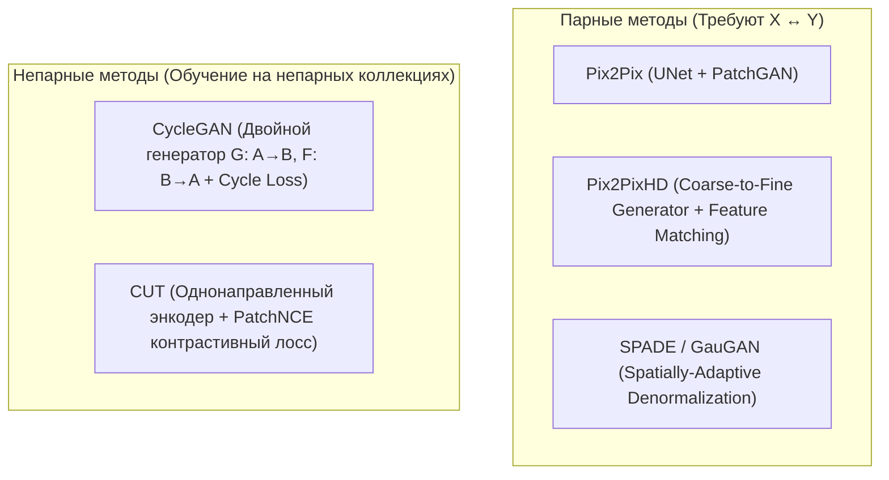

# Модели трансляции изображений на базе GAN (Pix2PixHD, CycleGAN, CUT, SPADE)

## 1. Краткое описание
В этой статье рассматриваются архитектуры генеративно-состязательной трансляции изображений (Image-to-Image Translation). Анализируются парные подходы (Pix2Pix, Pix2PixHD, SPADE) и непарные методы (CycleGAN, CUT). Исследуются механизмы многомасштабного состязательного обучения, пространственно-адаптивной нормализации и оценивается потенциал GAN-сетей для оффлайн- и real-time-конверсии пиксельной графики.

---

## 2. Интуитивное объяснение

В эпоху до диффузионных моделей генеративно-состязательные сети (GAN) были главным инструментом преобразования стилей. Идея трансляции проста: мы создаем нейросеть-генератор, которая принимает на вход пиксельное изображение и сразу, за один прямой проход сквозь сверточные слои, «перекрашивает» его в фотографию.

- Если у нас есть пары «спрайт $\leftrightarrow$ фото», **Pix2PixHD** учится напрямую переносить геометрию.
- Если пар нет, **CycleGAN** переводит спрайт в фото, а затем пытается восстановить спрайт обратно (циклическая согласованность).

Главная сильная сторона GAN — **огромная скорость** ($20\text{–}30\text{ мс}$). Главная слабость — **дефицит фантазии**: сеть способна перекрасить цвета и сгладить границы, но не может достоверно сгенерировать сложнейшие физические свойства материалов (поры кожи, блеск кольчуги, преломление света в каплях росы), которые легко синтезируют диффузионные модели.

---

## 3. Детальный разбор ключевых архитектур



### 3.1. Pix2PixHD (Wang et al., CVPR 2018)
Эволюция классического Pix2Pix для изображений высокого разрешения ($2048 \times 1024$):
1. **Генератор из двух подсетей (Coarse-to-Fine):**
   - $G_1$ (Global Generator): Обрабатывает изображение низкого разрешения ($1024 \times 512$).
   - $G_2$ (Local Enhancer): Принимает выход $G_1$ и исходный кадр высокого разрешения, удваивая масштаб.
2. **Мультимасштабные дискриминаторы ($D_1, D_2, D_3$):** Три идентичных PatchGAN дискриминатора работают на исходном масштабе, $2\times$ субдискретизированном и $4\times$ субдискретизированном. Это гарантирует одновременную оценку глобальной композиции и микротекстур.
3. **Feature Matching Loss:** Евклидово расстояние между промежуточными слоями активаций дискриминатора стабилизирует обучение:
   $$\mathcal{L}_{\text{FM}}(G, D_k) = \mathbb{E}_{x, y} \sum_{i=1}^T \frac{1}{N_i} \| D_k^{(i)}(x, y) - D_k^{(i)}(x, G(x)) \|_1$$

### 3.2. SPADE / GauGAN (Park et al., CVPR 2019)
В традиционных генераторах карты условий подаются только на входной слой. В глубоких слоях U-Net пространственная семантическая информация «забывается».
Архитектура **SPADE (Spatially-Adaptive Normalization)** заменяет BatchNorm на пространственную модуляцию:
$$\operatorname{SPADE}(h, y) = \gamma_{c, y, x}(y) \cdot \frac{h_{c, y, x} - \mu_c}{\sigma_c} + \beta_{c, y, x}(y)$$
где коэффициенты масштаба $\gamma$ и сдвига $\beta$ вычисляются отдельными свертками **непосредственно из карты условий $y$ на каждом слое генератора**.

### 3.3. Contrastive Unpaired Translation (CUT, Park et al., ECCV 2020)
Главная проблема CycleGAN в задаче Pixel Art → Realism — предположение о биективности (обратимости): сеть обязана уметь вернуть фото обратно в спрайт. Но пикселизация необратима!
CUT отменяет обратный генератор. Вместо этого энкодер извлекает многоуровневые признаки, и лосс **PatchNCE** максимизирует взаимную информацию между соответствующими пространственными точками спрайта и сгенерированного фото.

---

## 4. Практическая реализация: ResNet Генератор для Image-to-Image трансляции

```python
"""nn_upscaler.models.resnet_generator: Fast feed-forward generator with residual blocks."""

import torch
import torch.nn as nn


class ResidualBlock(nn.Module):
    """Остаточный блок с отражающим дополнением (Reflection Padding)."""

    def __init__(self, channels: int):
        super().__init__()
        self.conv = nn.Sequential(
            nn.ReflectionPad2d(1),
            nn.Conv2d(channels, channels, kernel_size=3, bias=False),
            nn.InstanceNorm2d(channels),
            nn.ReLU(inplace=True),
            nn.ReflectionPad2d(1),
            nn.Conv2d(channels, channels, kernel_size=3, bias=False),
            nn.InstanceNorm2d(channels),
        )

    def forward(self, x: torch.Tensor) -> torch.Tensor:
        return x + self.conv(x)


class FastTranslationGenerator(nn.Module):
    """Сверточный генератор прямой трансляции Pixel Art -> Realism (30 мс инференс)."""

    def __init__(
        self,
        in_channels: int = 3,
        out_channels: int = 3,
        num_filters: int = 64,
        num_res_blocks: int = 9,
    ):
        super().__init__()

        # Входной блок кодирования
        model = [
            nn.ReflectionPad2d(3),
            nn.Conv2d(in_channels, num_filters, kernel_size=7, bias=False),
            nn.InstanceNorm2d(num_filters),
            nn.ReLU(inplace=True),
        ]

        # Субдискретизация (Downsampling)
        curr_dim = num_filters
        for _ in range(2):
            model += [
                nn.Conv2d(curr_dim, curr_dim * 2, kernel_size=3, stride=2, padding=1, bias=False),
                nn.InstanceNorm2d(curr_dim * 2),
                nn.ReLU(inplace=True),
            ]
            curr_dim *= 2

        # Бутылочное горлышко (ResNet Blocks)
        for _ in range(num_res_blocks):
            model += [ResidualBlock(curr_dim)]

        # Апскейлинг (Upsampling через Transposed Conv)
        for _ in range(2):
            model += [
                nn.ConvTranspose2d(
                    curr_dim,
                    curr_dim // 2,
                    kernel_size=3,
                    stride=2,
                    padding=1,
                    output_padding=1,
                    bias=False,
                ),
                nn.InstanceNorm2d(curr_dim // 2),
                nn.ReLU(inplace=True),
            ]
            curr_dim //= 2

        # Выходной RGB слой
        model += [
            nn.ReflectionPad2d(3),
            nn.Conv2d(curr_dim, out_channels, kernel_size=7),
            nn.Tanh(),
        ]

        self.model = nn.Sequential(*model)

    def forward(self, x: torch.Tensor) -> torch.Tensor:
        return self.model(x)
```

---

## 5. Исследовательский анализ и сравнение подходов

| Критерий | Pix2PixHD | CycleGAN | CUT | Диффузия (SDXL + ControlNet) |
|---|---|---|---|---|
| **Требуемые данные** | Строгие пары $X \leftrightarrow Y$ | Непарные коллекции | Непарные коллекции | Zero-shot / Текстовый промпт |
| **Геометрическая стабильность** | Высокая (попиксельный $L_1$) | Низкая (частый дрейф позы) | Средняя | **Исключительная** |
| **Уровень фотореализма** | 6.5 / 10 | 5.5 / 10 | 6.8 / 10 | **9.5 / 10 (SOTA)** |
| **Время генерации кадра** | **~25 мс** | **~25 мс** | **~20 мс** | ~6000 мс |
| **Потребление VRAM** | 2–4 ГБ | 2–4 ГБ | 2–4 ГБ | 10–14 ГБ |

### Вывод:
Прямые GAN-модели незаменимы при создании **легковесных интерактивных фильтров реального времени для игр (Real-Time In-Game Shaders)**. Однако для генерации высокодетализированных игровых ассетов и фотореализма коммерческого уровня они уступают диффузионным системам.

---

## 6. Связанные темы
- Математика GAN и PatchGAN: [`02_Mathematical_Foundations/03_Generative_Adversarial_Networks.md`](../02_Mathematical_Foundations/03_Generative_Adversarial_Networks.md)
- Диффузионный стек SDXL: [`03_Architectures/03_Latent_Diffusion_SD15_SDXL.md`](03_Latent_Diffusion_SD15_SDXL.md)
- Real-Time инференс: [`09_Real_Time_and_Games/03_Real_Time_Inference_and_StreamDiffusion.md`](../09_Real_Time_and_Games/03_Real_Time_Inference_and_StreamDiffusion.md)
