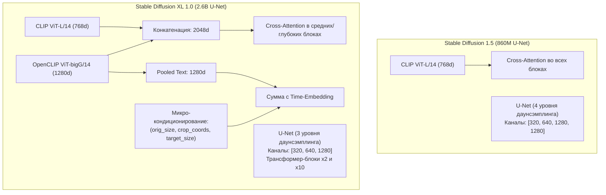

# Архитектуры Latent Diffusion: Сравнительный анализ SD 1.5 и SDXL

## 1. Краткое описание
В этой статье даётся глубокий сравнительный инженерный анализ двух ключевых фундаментов латентной диффузии: Stable Diffusion 1.5 и Stable Diffusion XL (SDXL). Анализируются изменения топологии U-Net, переход к двойному текстовому энкодеру, механизм микро-кондиционирования по координатам обрезки и архитектурные причины, делающие SDXL стандартом для фотореалистичной депикселизации.

---

## 2. Интуитивное объяснение

Когда перед диффузионной моделью ставится задача нарисовать человека в полный рост:
- **SD 1.5 (2022 год)** обучалась на квадратных изображениях $512 \times 512$. На лице персонажа размером во весь рост оставалось всего $30 \times 30$ пикселей латента. В результате лица персонажей получались размытыми, искажёнными или с несколькими ртами («синдром мутантов»). При попытке принудительной генерации в $1024 \times 1024$ модель начинала дублировать туловища.
- **SDXL (2023–2024 годы)** изначально спроектирована под нативное разрешение **$1024 \times 1024$** и мультиаспектные соотношения сторон. Параметры модели увеличены в 3 раза, а текстовое понимание опирается на гигантский энкодер OpenCLIP-G. В результате SDXL способна прорисовать реалистичные глаза, фактуру ткани и блики на металле даже для мелких персонажей.

Для задачи **Pixel Art → Realism** переход на SDXL критичен: спрайт персонажа $32\times 32$ увеличивается в 32 раза, требуя генерации миллионов новых физических деталей без дублирования конечностей.

---

## 3. Архитектурное сравнение: SD 1.5 против SDXL



### 3.1. Структурные различия бэкбона U-Net

| Параметр | Stable Diffusion 1.5 | Stable Diffusion XL (SDXL 1.0) |
|---|---|---|
| **Число параметров U-Net** | ~860 миллионов | **~2.6 миллиарда (прирост в $3\times$)** |
| **Базовое разрешение обучения** | $512 \times 512$ | **$1024 \times 1024$ (нативно)** |
| **Каналы блоков свертки** | `[320, 640, 1280, 1280]` (4 уровня) | `[320, 640, 1280]` (3 уровня) |
| **Глубина Transformer Blocks** | По 1 блоку на каждом уровне | `[0, 2, 10]` блоков (фокус на глубоких слоях) |
| **Текстовые энкодеры** | Один: OpenAI CLIP ViT-L/14 (768d) | **Два:** CLIP ViT-L + OpenCLIP ViT-bigG (2048d) |
| **Кондиционирование пулом текста** | Отсутствует | Наличие pooled text projection (1280d) |
| **Микро-кондиционирование** | Отсутствует | **Размер, кроп-координаты, целевое разрешение** |
| **Латентный VAE** | 4 канала, scale factor = 0.18215 | 4 канала, улучшенный VAE (scale = 0.13025) |

---

### 3.2. Математика микро-кондиционирования SDXL

В ранних моделях диффузии изображения для обучения обрезались случайным образом до размера $512 \times 512$. В результате модель запоминала обрезанные макушки голов и ноги за пределами кадра.  
SDXL решает эту проблему явной подачей метаданных обрезки:
$$\mathbf{c}_{\text{size}} = \left[ H_{\text{orig}}, W_{\text{orig}}, c_{\text{top}}, c_{\text{left}}, H_{\text{target}}, W_{\text{target}} \right]$$

Каждая координата проецируется через синусоидальное позиционное кодирование Фурье:
$$\operatorname{PE}(v) = \left[ \sin(\omega_1 v), \cos(\omega_1 v), \dots, \sin(\omega_d v), \cos(\omega_d v) \right]$$
Полученные векторы суммируются с векторным представлением временного шага $t$ и pooled-текстовым эмбеддингом.  
*Результат для Pixel Art:* Мы можем принудительно задать $(c_{\text{top}}=0, c_{\text{left}}=0)$, гарантируя, что персонаж отрендерится целиком, без случайных срезов оружия или шлема.

---

## 4. Практическая реализация: Конфигурация и запуск SDXL в PyTorch

```python
"""nn_upscaler.models.sdxl_setup: Production configuration for SDXL Latent Diffusion Pipeline."""

import torch
from diffusers import DPMSolverMultistepScheduler, StableDiffusionXLPipeline
from nn_upscaler.utils.device import get_device


def create_optimized_sdxl_pipeline(
    model_id: str = "stabilityai/stable-diffusion-xl-base-1.0",
) -> StableDiffusionXLPipeline:
    """Создаёт и конфигурирует оптимизированный пайплайн SDXL."""
    device = get_device()
    dtype = torch.float32 if device.type == "mps" else torch.float16

    print(f"[*] Инициализация SDXL пайплайна на {device} ({dtype})...")
    pipe = StableDiffusionXLPipeline.from_pretrained(
        model_id,
        torch_dtype=dtype,
        use_safetensors=True,
        variant="fp16" if dtype == torch.float16 else None,
    ).to(device)

    # Замена дефолтного планировщика на ультра-стабильный DPM++ 2M Karras (25 шагов)
    pipe.scheduler = DPMSolverMultistepScheduler.from_config(
        pipe.scheduler.config,
        use_karras_sigmas=True,
        algorithm_type="dpmsolver++",
    )

    # Оптимизация памяти для GPU с VRAM < 16GB
    if device.type == "cuda":
        pipe.enable_vae_tiling()
        pipe.enable_model_cpu_offload()
    elif device.type == "mps":
        pipe.enable_vae_tiling()

    return pipe
```

---

## 5. Исследовательский вердикт: Почему SDXL — базис для Pixel Art → Realism

1. **Экосистема адаптеров:** Под SDXL обучен лучший открытый адаптер структурной реставрации `xinsir/controlnet-tile-sdxl-1.0` (лицензия Apache 2.0).
2. **Аппаратная доступность:** В отличие от FLUX.1 (требующего $>16$ ГБ), SDXL в режиме FP16/CPU-offload стабильно помещается в 8–12 ГБ VRAM и запускается на потребительских картах NVIDIA RTX 3060/4060, а также на Apple Silicon (M1/M2/M3 Pro с 16–18 ГБ памяти).
3. **Качество деталей:** Объёма параметров $2.6B$ достаточно для синтеза достоверных физических материалов (металл, стекло, кожа, волосы).

---

## 6. Связанные темы
- ControlNet и адаптеры: [`03_Architectures/04_ControlNet_and_Adapters.md`](04_ControlNet_and_Adapters.md)
- IP-Adapter и референсы: [`03_Architectures/05_IP_Adapter_and_Reference_Conditioning.md`](05_IP_Adapter_and_Reference_Conditioning.md)
- Оптимизация памяти (MPS/CUDA): [`06_Training_and_Fine_Tuning/04_Hardware_and_VRAM_Management.md`](../06_Training_and_Fine_Tuning/04_Hardware_and_VRAM_Management.md)
