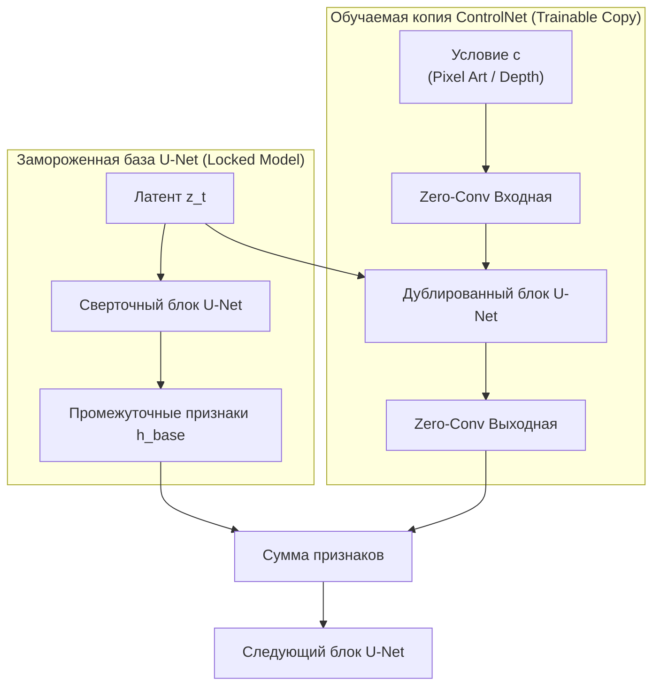

# Архитектура ControlNet и адаптеры структурного контроля

## 1. Краткое описание
В этой статье подробно рассматривается математическая и архитектурная концепция ControlNet (Zhang & Agrawala, ICCV 2023) и легковесных адаптеров T2I-Adapter. Доказывается теорема о нулевых свертках (Zero-Convolutions), исследуется механизм мульти-контроля (Multi-ControlNet) и анализируется специализированный адаптер ControlNet-Tile, выступающий ключевым ядром сохранения геометрии в задаче Pixel Art → Realism.

---

## 2. Интуитивное объяснение: Рельсы для генеративного воображения

Базовая модель Stable Diffusion похожа на гениального, но неуправляемого художника: если попросить его нарисовать «рыцаря», он нарисует великолепную картину, но поза, угол поворота головы и форма щита будут выбраны совершенно случайно.

**ControlNet** решает эту проблему, создавая систему **жестких структурных рельсов**:
- Мы замораживаем базовую модель (чтобы она не разучилась рисовать фотореалистичные материалы).
- Рядом создаём обучаемую копию её органов восприятия (энкодера U-Net).
- Подаём в эту копию направляющую карту (пиксельный спрайт или карту глубины).
- В самом начале обучения связь между адаптером и базой блокируется специальными «нулевыми замками» (Zero-Convolutions). Постепенно обучаясь, ControlNet начинает мягко направлять U-Net, заставляя его накладывать реалистичные текстуры строго внутри контуров исходного пиксель-арта.

---

## 3. Архитектура ControlNet и математика Zero-Convolutions



### 3.1. Теорема о нулевых свертках (Zero-Convolutions)
Zero-Convolution — это сверточный слой $1\times 1$, веса $W$ и смещения $b$ которого инициализируются строгими нулями:
$$\mathcal{Z}(x; \Theta) = W \cdot x + b, \quad \text{где } W = \mathbf{0}, \, b = \mathbf{0}$$

#### Доказательство стабильности старта обучения:
1. Для любого входного тензора признаков $x$ выход нулевой свертки тождественно равен нулю:
   $$\mathcal{Z}(x; \Theta) \equiv \mathbf{0}$$
2. В первый момент времени выход композитного блока U-Net равен:
   $$h_{\text{composite}} = h_{\text{base}} + \mathcal{Z}(h_{\text{control}}) = h_{\text{base}} + \mathbf{0} = h_{\text{base}}$$
   Выход объединённой сети **в точности равен выходу предобученной базовой модели**. Не происходит никакого случайного разрушения генеративного распределения!
3. Вычислим градиенты по параметрам весов $W$ на первом шаге обратного распространения:
   $$\frac{\partial \mathcal{Z}}{\partial W} = x^T$$
   $$\frac{\partial \mathcal{L}}{\partial W} = \frac{\partial \mathcal{L}}{\partial h_{\text{composite}}} \cdot \frac{\partial \mathcal{Z}}{\partial W} = \frac{\partial \mathcal{L}}{\partial h_{\text{composite}}} \cdot x^T \neq \mathbf{0}$$
   **Градиент по весам не равен нулю!** На первом же шаге веса $W$ начинают обновляться и аккуратно направлять генерацию.

---

## 4. Специфика адаптеров для Pixel Art → Realism

### 4.1. ControlNet-Tile: Спасение от пиксельного шума
Стандартные детекторы (Canny, HED) выделяют каждый пиксель спрайта как физическое ребро, что приводит к появлению кирпичной сетки.  
**ControlNet-Tile (`xinsir/controlnet-tile-sdxl-1.0`)** обучается с прогрессивным размытием Гаусса и передискретизацией обучающих изображений.
- Модель **игнорирует высокочастотную решетку пикселей**.
- Модель **считывает низкочастотные цветовые массы и силуэты**.
- При инференсе с весом $w_{\text{tile}} \in [0.70, 0.85]$ она идеально удерживает границы предметов, позволяя U-Net генерировать внутри них гладкие реалистичные текстуры.

### 4.2. T2I-Adapter против ControlNet
- **T2I-Adapter (Mou et al., AAAI 2024):** Не дублирует блоки U-Net. Использует компактную 4-уровневую сверточную пирамиду (77M параметров). Память: +500 МБ.
- **ControlNet:** Полностью дублирует кодировщик U-Net (1.25B параметров для SDXL). Память: +2.5 ГБ.
- *Вердикт:* Для грубого направления достаточно T2I-Adapter, но для экстремальной точности удержания силуэта спрайта **ControlNet обеспечивает существенно более высокую структурную верность**.

---

## 5. Мульти-контроль (Multi-ControlNet Composition)

В продакшн-пайплайне используется взвешенная суперпозиция нескольких адаптеров:
$$h_{\text{out}} = h_{\text{base}} + w_{\text{tile}} \cdot \mathcal{Z}_{\text{tile}}(c_{\text{tile}}) + w_{\text{depth}} \cdot \mathcal{Z}_{\text{depth}}(c_{\text{depth}})$$

```python
"""nn_upscaler.models.multi_controlnet: Initialization and weighting of Multi-ControlNet SDXL."""

import torch
from diffusers import ControlNetModel, StableDiffusionXLControlNetPipeline
from nn_upscaler.utils.device import get_device


def setup_multi_controlnet_pipeline(
    tile_id: str = "xinsir/controlnet-tile-sdxl-1.0",
    depth_id: str = "diffusers/controlnet-depth-sdxl-1.0",
) -> StableDiffusionXLControlNetPipeline:
    device = get_device()
    dtype = torch.float32 if device.type == "mps" else torch.float16

    print(f"[*] Загрузка мульти-адаптеров ControlNet на {device}...")
    controlnet_tile = ControlNetModel.from_pretrained(tile_id, torch_dtype=dtype)
    controlnet_depth = ControlNetModel.from_pretrained(depth_id, torch_dtype=dtype)

    pipe = StableDiffusionXLControlNetPipeline.from_pretrained(
        "stabilityai/stable-diffusion-xl-base-1.0",
        controlnet=[controlnet_tile, controlnet_depth],
        torch_dtype=dtype,
    ).to(device)

    return pipe
```

### Калибровочная таблица весов мульти-контроля:
- $w_{\text{tile}} = 0.75$ — удерживает цветовую палитру и расположение элементов.
- $w_{\text{depth}} = 0.35$ — предотвращает плоские «картонные» артефакты, задавая объем и ракурс.
- Диапазон воздействия: `controlnet_start=0.0`, `controlnet_end=0.85` (на последних 15% шагов денойзинга адаптеры отключаются, позволяя базовой модели свободно нарисовать микропоры и тончайшие блики).

---

## 6. Связанные темы
- Предотвращение артефактов сетки: [`04_Structure_Preservation/01_Structural_Conditioning_Signals.md`](../04_Structure_Preservation/01_Structural_Conditioning_Signals.md)
- IP-Adapter и стиль: [`03_Architectures/05_IP_Adapter_and_Reference_Conditioning.md`](05_IP_Adapter_and_Reference_Conditioning.md)
- Продакшн пайплайн: [`08_Practical_Implementation/02_Diffusers_Production_Pipeline.md`](../08_Practical_Implementation/02_Diffusers_Production_Pipeline.md)
