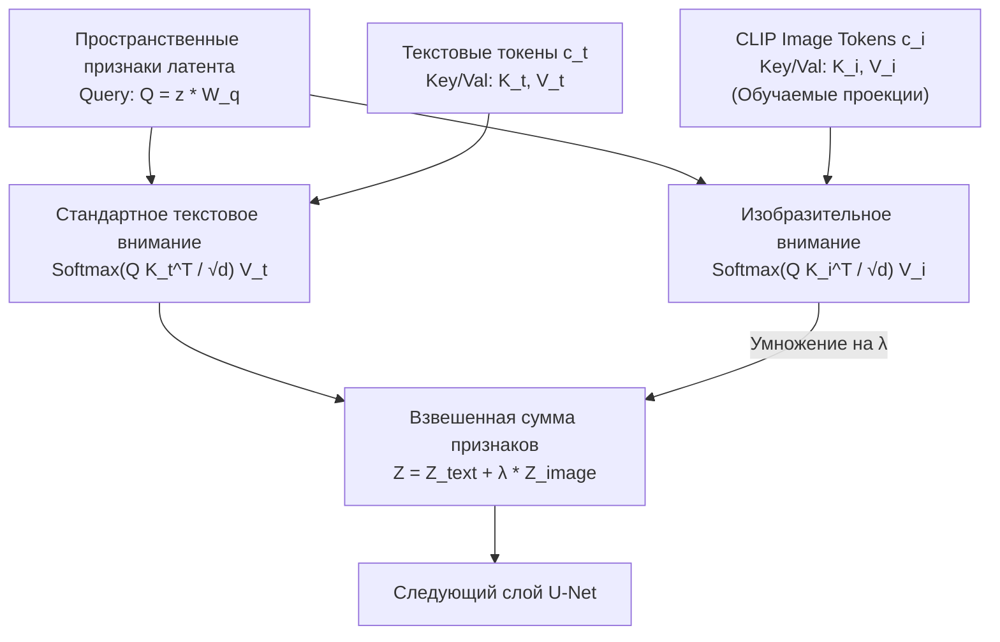

# IP-Adapter и референсное кондиционирование (Decoupled Cross-Attention)

## 1. Краткое описание
В этой статье рассматривается механизм внедрения визуальных референсов с помощью IP-Adapter (Image Prompt Adapter, Ye et al., 2023). Математически выводится концепция развязанного перекрёстного внимания (Decoupled Cross-Attention), объясняется принцип ортогонального разделения геометрии (через ControlNet) и текстуры (через IP-Adapter), а также решается проблема утечки формы (shape leakage) референсного изображения.

---

## 2. Интуитивное объяснение: Разделение чертежа и материала

Представьте архитектора, создающего 3D-модель средневекового замка:
1. **Чертеж (ControlNet):** Задаёт точные размеры башен, толщину стен и расположение бойниц (извлекается из пиксель-арт сцены).
2. **Палитра материалов (IP-Adapter):** Фотография реального гранитного карьера с замшелыми камнями (подаётся как референс).
3. **Описание (Текстовый промпт):** «Замок на закате, кинематографичный свет».

Если попытаться описать сложнейшую текстуру старинного камня словами в промпте («rough porous grey granite with lichen and cracks...»), диффузионная модель всё равно не угадает в точности физическую фактуру.  
**IP-Adapter** позволяет подать на вход фотографию реального материала или костюма. При этом модель забирает с референса **только текстуру и стиль**, строго накладывая их на геометрию пиксель-арта, заданную через ControlNet.

---

## 3. Математика развязанного перекрёстного внимания (Decoupled Cross-Attention)



### 3.1. Ограничение наивного объединения модальностей
В стандартном перекрёстном внимании вектор запросов $Q$ извлекается из скрытого состояния U-Net, а ключи $K$ и значения $V$ проецируются из конкатенированного вектора текста и изображения:
$$K = [c_t, c_i] W_k, \quad V = [c_t, c_i] W_v$$
Поскольку текстовые энкодеры (CLIP Text) и визуальные энкодеры (CLIP Vision) имеют разные распределения эмбеддингов, при обучении возникает деструктивная интерференция (модальный конфликт): текстовое управление подавляет визуальные детали или наоборот.

### 3.2. Формулировка Decoupled Cross-Attention
IP-Adapter замораживает оригинальные проекции $W_k, W_v$ для текста и добавляет **независимые параллельные обучаемые проекции** $W_k^i, W_v^i$ для визуальных токенов:
$$Q = Z W_q, \quad K_t = c_t W_k, \quad V_t = c_t W_v$$
$$K_i = c_i W_k^i, \quad V_i = c_i W_v^i$$

Итоговый выход слоя внимания вычисляется как линейная комбинация двух независимых операций:
$$\operatorname{Attention}_{\text{decoupled}} = \operatorname{Softmax}\left( \frac{Q K_t^T}{\sqrt{d}} \right) V_t + \lambda \cdot \operatorname{Softmax}\left( \frac{Q K_i^T}{\sqrt{d}} \right) V_i$$
где $\lambda \in [0.0, 1.0]$ — весовой коэффициент силы влияния визуального референса.

---

## 4. Разделение геометрии и стиля в задаче Pixel Art → Realism

При совместном использовании трех каналов управления:
1. **ControlNet-Tile:** Передаёт пространственные низкочастотные координаты $c_{\text{spatial}}(x, y)$.
2. **IP-Adapter:** Передаёт высокочастотные распределения физических текстур $c_{\text{texture}}$.
3. **Текстовый промпт:** Направляет семантическую категорию объекта $c_{\text{class}}$.

```
Геометрия  (ГДЕ рисовать)  <─── ControlNet-Tile  <─── Pixel Art Спрайт
Текстуры   (ЧЕМ рисовать)  <─── IP-Adapter       <─── Фото реального материала
Семантика  (ЧТО рисовать)  <─── Text Prompt      <─── "medieval knight, iron plate"
```

---

## 5. Практическая реализация: Интеграция IP-Adapter с ControlNet в Diffusers

```python
"""nn_upscaler.models.ip_adapter_pipeline: Integration of IP-Adapter with SDXL ControlNet."""

import torch
from diffusers import StableDiffusionXLControlNetPipeline
from PIL import Image
from nn_upscaler.utils.device import get_device


def setup_ip_adapter_pipeline(
    pipeline: StableDiffusionXLControlNetPipeline,
    ip_adapter_weight: float = 0.60,
) -> StableDiffusionXLControlNetPipeline:
    """Подключает веса IP-Adapter Plus к существующему SDXL ControlNet пайплайну."""
    device = get_device()
    print("[*] Загрузка весов IP-Adapter для SDXL...")

    pipeline.load_ip_adapter(
        "h94/IP-Adapter",
        subfolder="sdxl_models",
        weight_name="ip-adapter-plus_sdxl_vit-h.safetensors",
    )
    pipeline.set_ip_adapter_scale(ip_adapter_weight)
    return pipeline


def run_conditioned_generation(
    pipeline: StableDiffusionXLControlNetPipeline,
    pixel_art_image: Image.Image,
    reference_texture: Image.Image,
    prompt: str,
) -> Image.Image:
    """Генерация с тройным контролем: Pixel Art (Tile) + Reference (IP-Adapter) + Prompt."""
    generator = torch.Generator(device="cpu").manual_seed(42)

    output = pipeline(
        prompt=prompt,
        image=pixel_art_image,  # Вход для ControlNet-Tile
        ip_adapter_image=reference_texture,  # Вход для IP-Adapter
        controlnet_conditioning_scale=0.75,
        num_inference_steps=30,
        guidance_scale=6.5,
        generator=generator,
    ).images[0]

    return output
```

---

## 6. Исследовательский анализ: Проблема «утечки формы» (Shape Leakage)

Если вес IP-Adapter слишком высок ($\lambda > 0.75$), возникает паразитный эффект: модель начинает копировать не только фактуру материала референса, но и **его форму и силуэт**, ломая геометрию пиксель-арта (например, если референсом было фото круглого щита, прямоугольный щит спрайта округляется).

### Методы подавления утечки формы:
1. **Калибровка веса:** Оптимальный диапазон $\lambda \in [0.45, 0.60]$.
2. **Crop & Zoom текстуры:** Подавать на вход IP-Adapter не весь объект целиком, а вырезанный макро-патч текстуры (Macro-texture patch), лишенный выраженного силуэта.

---

## 7. Связанные темы
- Архитектура ControlNet: [`03_Architectures/04_ControlNet_and_Adapters.md`](04_ControlNet_and_Adapters.md)
- Управление вниманием: [`04_Structure_Preservation/02_Attention_Control_and_Feature_Injection.md`](../04_Structure_Preservation/02_Attention_Control_and_Feature_Injection.md)
- Библиография: [`REFERENCES.md`](../REFERENCES.md) (статья Ye et al., 2023).
