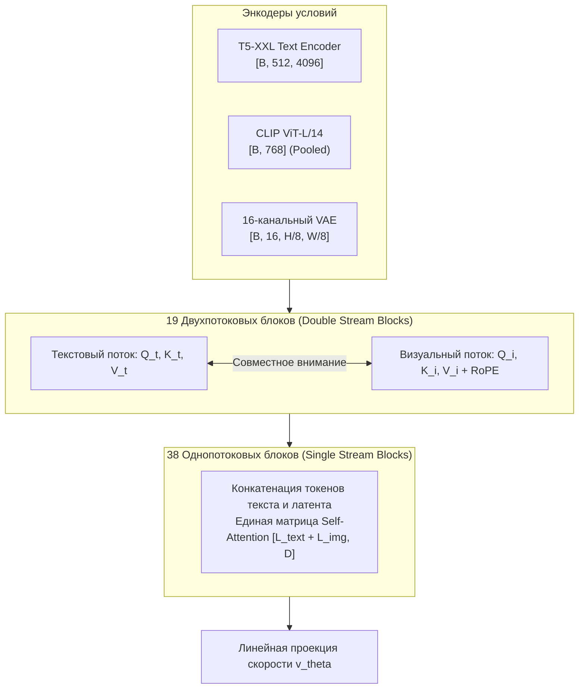

# Современные модели Flow Matching: Архитектура FLUX.1 и трансформерные апскейлеры

## 1. Краткое описание
В этой статье подробно исследуется архитектура моделей семейства FLUX.1 (Black Forest Labs): двухпотоковые и однопотоковые трансформерные блоки MM-DiT, поворотные позиционные эмбеддинги RoPE, 16-канальный VAE и методы Rectified Flow. Анализируются новейшие трансформерные адаптеры апскейлинга (`jasperai/Flux.1-dev-Controlnet-Upscaler`, `Shakker-Labs/FLUX.1-dev-ControlNet-Union-Pro`) и оценивается их применение для генерации фотореализма высшего качества.

---

## 2. Интуитивное объяснение

Если Stable Diffusion 1.5 можно сравнить с художником эпохи раннего Возрождения, а SDXL — с мастером классического реализма, то **FLUX.1** — это цифровая камера сверхвысокого разрешения.

FLUX.1 разработан командой Black Forest Labs (бывшими ведущими исследователями Stability AI, создавшими Stable Diffusion). Главный технологический прорыв модели:
- Модель содержит **12 миллиардов параметров** (в 4.6 раза больше SDXL).
- Сверточный U-Net полностью ликвидирован; вместо него работает гигантский Diffusion Transformer.
- Модель оперирует текстом через трансформер T5-XXL, точно понимая мельчайшие семантические нюансы («двуручный цвайхендер с зазубринами на лезвии, инкрустированный серебром»).

Для пиксель-арта FLUX.1 даёт беспрецедентный уровень фотореализма, превосходя все существующие генеративные модели по рендерингу сложных материалов.

---

## 3. Архитектура FLUX.1 MM-DiT



### 3.1. Ключевые компоненты архитектуры
1. **16-канальный VAE:** В отличие от 4-канального VAE в SD 1.5 и SDXL, FLUX использует 16 скрытых каналов при том же факторе пространственного сжатия $f=8$. Это предотвращает размытие мелких деталей лица и сохраняет тонкие линии.
2. **2D Rotary Position Embeddings (RoPE):** Поворотные позиционные эмбеддинги вычисляются для двумерных координат пространственных патчей, обеспечивая устойчивость внимания к произвольным разрешениям кадра.
3. **Double Stream Blocks (19 слоёв):** Независимая эволюция текстовых и визуальных признаков с обменом информацией в точке внимания.
4. **Single Stream Blocks (38 слоёв):** Слияние текста и изображения в единое смысловое пространство для плотного синтеза текстур.

---

## 4. Специфика версий FLUX.1

| Модель | Параметры | Метод дистилляции | Шагов инференса | Лицензия | Применение к Pixel Art |
|---|---|---|---|---|---|
| **FLUX.1 [schnell]** | 12B | Step-distilled (CFG=0) | **4 шага (Euler)** | Apache 2.0 | Быстрый черновой концепт-арт |
| **FLUX.1 [dev]** | 12B | Guidance-distilled | **25–30 шагов** | Non-commercial | **Эталонный фотореализм деталей** |
| **FLUX.1 [pro]** | 12B+ | Закрытая SOTA-версия | Cloud API | Proprietary | Облачный бенчмаркинг |

---

## 5. Специализированные адаптеры для FLUX.1

1. **`jasperai/Flux.1-dev-Controlnet-Upscaler` (Diffusers Pipeline):**
   - Специализированный ControlNet, обученный командой Jasper AI для задачи супер-разрешения и реставрации.
   - Позволяет подавать низкоразмерный пиксель-арт и восстанавливать высокочастотные текстуры в разрешении до $2048 \times 2048$.
2. **`Shakker-Labs/FLUX.1-dev-ControlNet-Union-Pro`:**
   - Универсальный адаптер (Tile, Depth, Canny, Blur), объединяющий несколько режимов контроля в едином наборе весов.

---

## 6. Практическая реализация: Запуск FLUX.1-dev Upscaler в Diffusers (FP8 / NF4)

Так как модель 12B в точности FP16 требует более 30 ГБ VRAM, в коде используется квантование весов FP8 (`torch.float8_e4m3fn`) или модуль CPU-offloading:

```python
"""nn_upscaler.models.flux_upscaler: Running FLUX.1-dev ControlNet Upscaler in Diffusers."""

import torch
from diffusers import FluxControlNetModel, FluxControlNetPipeline
from PIL import Image
from nn_upscaler.utils.device import get_device


def run_flux_upscaler(
    low_res_image: Image.Image,
    prompt: str = "photorealistic medieval knight, highly detailed, 8k resolution, raw photo",
) -> Image.Image:
    device = get_device()
    print("[*] Загрузка FLUX.1-dev ControlNet Upscaler...")

    # Загрузка специализированного ControlNet апскейлера от Jasper AI
    controlnet = FluxControlNetModel.from_pretrained(
        "jasperai/Flux.1-dev-Controlnet-Upscaler",
        torch_dtype=torch.bfloat16,
    )

    pipe = FluxControlNetPipeline.from_pretrained(
        "black-forest-labs/FLUX.1-dev",
        controlnet=controlnet,
        torch_dtype=torch.bfloat16,
    )

    # Оптимизация видеопамяти под 16 ГБ (RTX 4080 / RTX 4090)
    pipe.enable_model_cpu_offload()

    # Апскейл входа через Nearest до целевого размера 1024x1024
    control_image = low_res_image.resize((1024, 1024), Image.Resampling.NEAREST)

    output = pipe(
        prompt=prompt,
        control_image=control_image,
        controlnet_conditioning_scale=0.65,
        num_inference_steps=28,
        guidance_scale=3.5,
    ).images[0]

    return output
```

---

## 7. Исследовательский анализ и компромиссы

- **Плюсы:** Непревзойдённый уровень микродетализации кожи, металла и тканей. Полное отсутствие размытия контуров, характерного для SD 1.5.
- **Минусы:**
  - Время генерации одного кадра: **25–40 секунд** на RTX 4090 (в 4–5 раз медленнее SDXL).
  - На Apple Silicon MPS модель FLUX.1-dev практически неработоспособна на машинах с оперативной памятью менее 36–64 ГБ из-за размера весов.
  - Лицензия FLUX.1-dev запрещает прямое коммерческое использование без специального соглашения.

---

## 8. Связанные темы
- Математика Flow Matching: [`02_Mathematical_Foundations/05_Flow_Matching_and_Diffusion_Transformers.md`](../02_Mathematical_Foundations/05_Flow_Matching_and_Diffusion_Transformers.md)
- Базовый пайплайн SDXL: [`03_Architectures/03_Latent_Diffusion_SD15_SDXL.md`](03_Latent_Diffusion_SD15_SDXL.md)
- Открытые проекты и экосистема: [`10_Research_and_Experiments/02_Open_Source_Ecosystem_Audit.md`](../10_Research_and_Experiments/02_Open_Source_Ecosystem_Audit.md)
