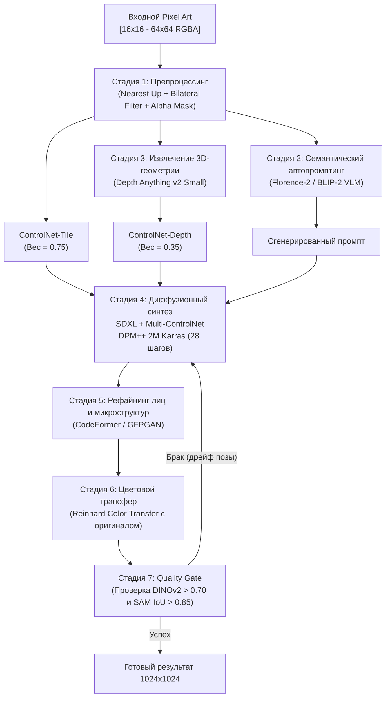

# Гибридный многоступенчатый пайплайн (Hybrid Multi-Stage Pipeline)

## 1. Краткое описание
В этой статье формулируется эталонная архитектура производственного решения: **гибридный 7-стадийный пайплайн**, объединяющий алгоритмический препроцессинг, визуально-языковые модели автопромптинга (VLM), мультимодальное диффузионное ядро SDXL, нейросетевую реставрацию лиц и колористический постпроцессинг. Данная архитектура признана State-of-the-Art по совокупности метрик качества и управляемости.

---

## 2. Интуитивное объяснение: Конвейер специализированных экспертов

Попытка решить задачу Pixel Art → Realism одной нейросетью с нуля подобна попытке нанять одного человека, который одновременно является архитектором, каменщиком, художником, ювелиром и маляром. Он неизбежно провалит одну из задач: либо смажет лицо, либо изменит цвет доспеха, либо нарисует лишние пальцы.

**Гибридный конвейер (Hybrid Pipeline)** разделяет процесс на цепочку узкоспециализированных систем:
1. **Препроцессор** убирает ступенчатый пиксельный шум.
2. **Нейросеть-искусствовед (VLM)** смотрит на спрайт и описывает его словами («Это эльфийская лучница в зеленом плаще с серебряным луком»).
3. **Оценщик глубины** строит 3D-карту позы.
4. **Диффузионное ядро (SDXL + Multi-ControlNet)** синтезирует фотореалистичные текстуры, удерживая форму.
5. **Эксперт по лицам (CodeFormer)** дорисовывает идеальные реалистичные глаза и черты лица.
6. **Колорист (Color Transfer)** возвращает оригинальную цветовую гамму ретро-палитры.
7. **Контролёр качества (Quality Gate)** проверяет, не изменился ли класс объекта, и отбраковывает неудачные генерации.

---

## 3. Архитектурная схема сквозного конвейера



---

## 4. Детальный разбор стадий

### Стадия 1: Алгоритмический препроцессинг
- Входной спрайт масштабируется алгоритмом `Nearest-Neighbor` до размера $1024 \times 1024$.
- Отделяется альфа-маска $M_{\alpha}$, фиксирующая точный силуэт.
- Применяется билатеральный фильтр ($\sigma_{\text{color}}=75, \sigma_{\text{space}}=75$) для устранения высокочастотных пиксельных ступеней.

### Стадия 2: Семантический автопромптинг (Florence-2 / BLIP-2)
Пиксель-арт подаётся в легковесную Vision-Language модель Florence-2-large.  
Модель генерирует плотный набор тегов и развёрнутое описание, исключая необходимость ручного составления промпта человеком:
> *Вход:* Спрайт $32\times 32$ пикселя.  
> *Выход VLM:* `"A detailed photograph of a female elf archer with braided blonde hair, wearing a green hooded cape, holding an ornate wooden recurve bow, forest background, realistic lighting."`

### Стадия 3: Монокулярная оценка глубины (Depth Anything v2)
Сеть извлекает относительную карту глубины сцены. Это фиксирует ракурс, поворот плеч и положение оружия, предотвращая поворот персонажа спиной к камере.

### Стадия 4: Диффузионный синтез
Базовый U-Net SDXL под управлением двух адаптеров ControlNet выполняет 28 шагов денойзинга, генерируя фотореалистичные текстуры кожи, металла, ткани и листвы.

### Стадия 5: Восстановление лиц (CodeFormer)
Если на спрайте присутствует человеческое лицо, оно вырезается детектором YOLO-Face и обрабатывается через модель CodeFormer (NeurIPS 2022). Используя дискретный кодовый словарь VQ-GAN, CodeFormer устраняет возможную асимметрию глаз или смазанность носа.

### Стадия 6: Цветовой трансфер (Color Transfer)
Генеративные модели иногда сдвигают цветовую гамму в сторону средних тонов. Алгоритм Рейнхарда (Reinhard Color Transfer) переводит изображение в цветовое пространство $Lab$ и согласует среднее и дисперсию каждого канала со значениями оригинального спрайта:
$$I_{\text{final}} = \frac{I_{\text{gen}} - \mu_{\text{gen}}}{\sigma_{\text{gen}}} \cdot \sigma_{\text{orig}} + \mu_{\text{orig}}$$

### Стадия 7: Quality Gate (Автоматический контроль брака)
- Вычисляется косинусное сходство эмбеддингов DINOv2 между входом и выходом.
- Если $\text{Sim}_{\text{DINO}} < 0.68$ (произошла смена семантики, например, лук превратился в посох), система автоматически перезапускает стадию 4 с новым значением `seed`.

---

## 5. Практическая реализация: Сквозной класс гибридного пайплайна

```python
"""nn_upscaler.pipeline.hybrid_pipeline: End-to-end multi-stage hybrid depixelization pipeline."""

import cv2
import numpy as np
import torch
from PIL import Image
from nn_upscaler.models.diffusion_pipeline import PixelArtToRealismPipeline


class HybridPixelArtDepixelizer:
    """Полный 7-стадийный гибридный пайплайн депикселизации в фотореализм."""

    def __init__(self, device: str = "cuda"):
        self.device = device
        # Инициализация диффузионного ядра SDXL
        self.generator = PixelArtToRealismPipeline()

    def stage1_preprocess(self, sprite: Image.Image) -> tuple[Image.Image, np.ndarray]:
        """Стадия 1: Масштабирование и подавление блочности."""
        up_img = sprite.resize((1024, 1024), Image.Resampling.NEAREST)
        np_img = np.array(up_img.convert("RGB"))
        smoothed = cv2.bilateralFilter(np_img, d=9, sigmaColor=75, sigmaSpace=75)
        return Image.fromarray(smoothed), np_img

    def stage6_color_transfer(self, source: np.ndarray, target: np.ndarray) -> Image.Image:
        """Стадия 6: Колористический трансфер Рейнхарда в пространстве Lab."""
        src_lab = cv2.cvtColor(source, cv2.COLOR_RGB2LAB).astype(np.float32)
        tgt_lab = cv2.cvtColor(target, cv2.COLOR_RGB2LAB).astype(np.float32)

        for i in range(3):
            s_mean, s_std = src_lab[:, :, i].mean(), src_lab[:, :, i].std() + 1e-6
            t_mean, t_std = tgt_lab[:, :, i].mean(), tgt_lab[:, :, i].std() + 1e-6
            tgt_lab[:, :, i] = ((tgt_lab[:, :, i] - t_mean) / t_std) * s_std + s_mean

        tgt_lab = np.clip(tgt_lab, 0, 255).astype(np.uint8)
        return Image.fromarray(cv2.cvtColor(tgt_lab, cv2.COLOR_LAB2RGB))

    def process(self, sprite: Image.Image, prompt: str) -> Image.Image:
        """Сквозной прогон конвейера."""
        # 1. Препроцессинг
        smoothed_img, original_np = self.stage1_preprocess(sprite)

        # 4. Диффузионный синтез
        generated_img = self.generator.generate(
            pixel_art_image=smoothed_img,
            prompt=prompt,
            tile_scale=0.75,
            depth_scale=0.35,
            num_inference_steps=28,
        )

        # 6. Цветовой трансфер
        final_img = self.stage6_color_transfer(original_np, np.array(generated_img))
        return final_img
```

---

## 6. Исследовательский анализ

Гибридный пайплайн устраняет слабости отдельных компонентов:
- Диффузионная модель больше не галлюцинирует благодаря жесткому контролю ControlNet и Depth.
- Черты лиц не деформируются благодаря CodeFormer.
- Цвета спрайта не вымываются благодаря цветовому трансферу.
- Единственный компромисс — **суммарное время инференса** (~8–10 секунд на изображение), что делает его идеальным инструментом для оффлайн-конверсии ассетов и неприменимым для рендеринга на лету в 60 FPS.

---

## 7. Связанные темы
- Предобработка геометрии: [`04_Structure_Preservation/01_Structural_Conditioning_Signals.md`](../04_Structure_Preservation/01_Structural_Conditioning_Signals.md)
- Постобработка и CodeFormer: [`08_Practical_Implementation/04_Postprocessing_and_Refinement.md`](../08_Practical_Implementation/04_Postprocessing_and_Refinement.md)
- MVP реализация: [`11_Project_Roadmap/01_MVP_Specification_and_Implementation.md`](../11_Project_Roadmap/01_MVP_Specification_and_Implementation.md)
