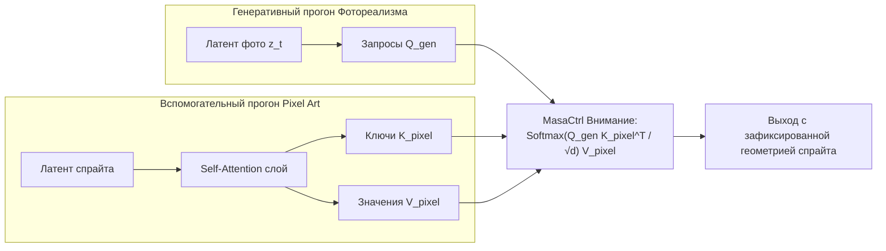

# Управление вниманием и внедрение признаков (Attention Control & Feature Injection)

## 1. Краткое описание
В этой статье рассматриваются методы управления геометрией генерации без дополнительного обучения нейросетей (Training-Free Structure Preservation). Анализируется внутреннее устройство слоёв самовнимания (Self-Attention) и перекрёстного внимания (Cross-Attention) диффузионного U-Net, выводятся уравнения методов MasaCtrl и FreeControl, а также описывается механизм переноса карт внимания для сохранения композиции пиксель-арта.

---

## 2. Интуитивное объяснение: Подглядывание в шпаргалку

Когда диффузионная модель генерирует изображение, в её глубоких слоях трансформера происходит постоянный диалог между пикселями:
- Пиксель на левом плече «спрашивает» через механизм внимания (Query): «А где находится правое плечо?»
- Пиксель на правом плече «отвечает» (Key/Value): «Я здесь, на координатах (y=340, x=620)».

Если модель генерирует фото с нуля, эти координаты выбираются случайно на ранних шагах диффузии.  
**Управление вниманием (Attention Injection)** заключается в том, что мы заставляем модель во время генерации реалистичного фото **подглядывать в матрицы внимания исходного пиксель-арта**:
- Модель вычисляет ключи ($K$) и значения ($V$) на основе спрайта.
- В результате руки, ноги, меч и глаза фотореалистичного рыцаря автоматически привязываются ровно к тем местам, где они находились в пиксель-арте!
- Для этого **не нужно обучать ControlNet** — метод работает напрямую «из коробки» со стандартным Stable Diffusion.

---

## 3. Математические основы манипуляции вниманием



### 3.1. Механизм самовнимания в блоках U-Net
На скрытом слое с пространственным разрешением $h \times w$ и размерностью каналов $d$, матрицы запросов, ключей и значений проецируются из активаций $h_t$:
$$Q = h_t W_q, \quad K = h_t W_k, \quad V = h_t W_v$$
Матрица пространственного внимания размера $(hw) \times (hw)$ вычисляется как:
$$A = \operatorname{Softmax}\left( \frac{Q K^T}{\sqrt{d}} \right)$$
$$h_{\text{out}} = A \cdot V$$
Элемент матрицы $A_{i, j}$ задаёт силу связи между точкой $i$ и точкой $j$ изображения. Именно матрица $A$ определяет глобальную компоновку и анатомическую позу персонажа.

---

### 3.2. Математика MasaCtrl (Mutual Self-Attention Control, Cao et al., ICCV 2023)
Алгоритм MasaCtrl модифицирует обратный процесс денойзинга на временных шагах $t \in [t_{\text{start}}, t_{\text{end}}]$ (обычно первые 40–50% шагов сэмплирования, где закладывается геометрия).

При генерации реалистичного изображения мы выполняем параллельный шаг для пиксель-арт изображения-источника и заменяем матрицы $K$ и $V$:
$$\operatorname{Attn}_{\text{Masa}}(Q_{\text{gen}}, K_{\text{pixel}}, V_{\text{pixel}}) = \operatorname{Softmax}\left( \frac{Q_{\text{gen}} K_{\text{pixel}}^T}{\sqrt{d}} \right) V_{\text{pixel}}$$

#### Почему это работает:
1. Запросы $Q_{\text{gen}}$ сохраняют способность генерировать фотореалистичные материалы и освещение.
2. Ключи $K_{\text{pixel}}$ задают пространственную топологию спрайта.
3. Значения $V_{\text{pixel}}$ переносят взаимное расположение семантических частей.

---

### 3.3. FreeControl (Mo et al., CVPR 2024): Спектральный анализ внимания
FreeControl извлекает главные компоненты (PCA) карт самовнимания для опорного изображения:
$$A_{\text{pixel}} \approx \sum_{k=1}^K \lambda_k \mathbf{u}_k \mathbf{v}_k^T$$
На каждом шаге диффузии вводится градиентный шаг направления скрытого состояния латента:
$$z_t \leftarrow z_t - \gamma \nabla_{z_t} \| \Phi_{\text{PCA}}(z_t) - \Phi_{\text{PCA}}(z_{\text{pixel}}) \|_2^2$$
Это заставляет структуру генерации сходиться к геометрии пиксель-арта без необходимости прямого переопределения весов слоёв внимания.

---

## 4. Практическая реализация: PyTorch Hook для подмены Self-Attention

Следующий класс регистрирует PyTorch-хук в слоях внимания Diffusers U-Net, позволяя перехватывать и модифицировать матрицы внимания во время инференса:

```python
"""nn_upscaler.attention.hook_manager: Self-Attention injection hook for spatial structure preservation."""

import torch
import torch.nn as nn


class MutualAttentionControlHook:
    """Хук для подмены ключей и значений самовнимания (MasaCtrl-style)."""

    def __init__(self, step_threshold: float = 0.5):
        self.step_threshold = step_threshold
        self.saved_k = None
        self.saved_v = None
        self.is_recording_source = True

    def __call__(self, module: nn.Module, inputs: tuple, output: torch.Tensor) -> torch.Tensor:
        # inputs[0] - входной скрытый тензор слоя внимания [B, Tokens, D]
        hidden_states = inputs[0]

        if self.is_recording_source:
            # Шаг 1: Запоминаем K и V из пиксель-арт прогона
            self.saved_k = module.to_k(hidden_states)
            self.saved_v = module.to_v(hidden_states)
            return output
        else:
            # Шаг 2: Внедряем сохраненные K и V в генеративный прогон фотореализма
            if self.saved_k is not None and self.saved_v is not None:
                q = module.to_q(hidden_states)
                scale = module.scale

                # Вычисляем взаимное внимание
                attn_weights = torch.baddbmm(
                    torch.empty(q.shape[0], q.shape[1], self.saved_k.shape[1], device=q.device),
                    q,
                    self.saved_k.transpose(-1, -2),
                    beta=0,
                    alpha=scale,
                )
                attn_probs = attn_weights.softmax(dim=-1)
                modified_out = torch.bmm(attn_probs, self.saved_v)
                return module.to_out[0](modified_out)

            return output
```

---

## 5. Исследовательский анализ: Внимание против ControlNet

| Характеристика | Attention Control (MasaCtrl / FreeControl) | ControlNet-Tile |
|---|---|---|
| **Дополнительное обучение** | **0 часов (Training-free)** | Требует датасета и обучения |
| **Дополнительная память** | Минимальная (только буфер $K, V$) | +2.5 ГБ VRAM (дубликат U-Net) |
| **Устойчивость к дизерингу** | Низкая (может зафиксировать зернистость) | **Высокая (фильтрует шум сетки)** |
| **Гибкость позы** | **Строго 100% фиксация** | Настраиваемый вес ($w \in [0, 1]$) |

**Инженерный вывод:**  
Методы Attention Control идеальны для задач, где требуется **абсолютно жесткая фиксация позы персонажа** без малейших смещений пикселей, в то время как ControlNet предпочтителен для органического сглаживания и стилистической трансформации.

---

## 6. Связанные темы
- Структурные сигналы: [`04_Structure_Preservation/01_Structural_Conditioning_Signals.md`](01_Structural_Conditioning_Signals.md)
- IP-Adapter: [`03_Architectures/05_IP_Adapter_and_Reference_Conditioning.md`](../03_Architectures/05_IP_Adapter_and_Reference_Conditioning.md)
- Библиография (MasaCtrl, FreeControl): [`REFERENCES.md`](../REFERENCES.md)
