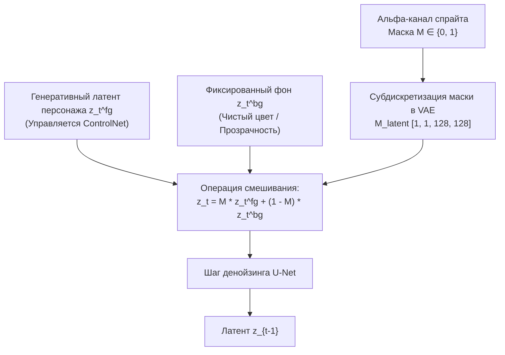

# Региональный промптинг, маскирование и сохранение прозрачности (Alpha-Masking)

## 1. Краткое описание
В этой статье рассматриваются методы изоляции объектов и управления генерацией через пространственные маски. Анализируется проблема отсутствия нативной прозрачности в диффузионных моделях, выводятся уравнения смешивания латентов (Blended Latent Diffusion), описывается региональный промптинг для независимой стилизации частей спрайта и решается проблема краевого просачивания цвета (Edge Bleeding) на границе альфа-канала.

---

## 2. Интуитивное объяснение: Запрет на выход за границы

Игровой спрайт — это не картина в рамке, а изолированный персонаж на прозрачном фоне (RGBA).  
Если просто отдать спрайт в стандартную диффузионную сеть:
1. Модель не понимает альфа-канал и воспринимает прозрачность как сплошной черный или белый цвет.
2. Сеть решает, что персонаж стоит на фоне белой стены или в ночном лесу, и начинает дорисовывать тени на земле, ветки деревьев или кирпичи вокруг рук персонажа.
3. В результате спрайт становится невозможно вернуть обратно в игровой движок без мучительной ручной обтравки.

**Региональное маскирование** создаёт вокруг персонажа непреодолимый силовой барьер:
- Внутри маски диффузия свободно генерирует фотореалистичные ткани и доспехи.
- За пределами маски генерация принудительно блокируется, гарантируя кристально чистый прозрачный фон.

---

## 3. Математика смешивания латентов (Blended Latent Diffusion)



### 3.1. Уравнение пошагового латентного блендинга
Пусть $M \in \{0, 1\}^{H \times W}$ — бинарная маска силуэта спрайта ($M_{i, j} = 1$ для пикселей персонажа, $M_{i, j} = 0$ для прозрачного фона).  
В скрытом пространстве VAE маска уменьшается в 8 раз с сохранением антиалиасинга: $M_{\text{latent}} \in [0, 1]^{h \times w}$.

На каждом шаге диффузии $t \in [T, 0]$ скрытое состояние принудительно перезаписывается линейной комбинацией:
$$z_t = M_{\text{latent}} \odot z_t^{\text{fg}} + (1 - M_{\text{latent}}) \odot z_t^{\text{bg}}$$
где $z_t^{\text{bg}}$ — зашумленный латент нейтрального фонового цвета (обычно нейтральный серый RGB `(127, 127, 127)`, обладающий нулевым сдвигом дисперсии в VAE).

---

### 3.2. Региональный промптинг (Regional Prompting)
Для сложных персонажей глобальный промпт («рыцарь с золотым шлемом и стальным мечом») часто приводит к **смешиванию атрибутов (Attribute Leakage)**: меч становится золотым, а шлем — стальным.

Региональный промптинг делит маску на семантические зоны $M = \sum_{k=1}^K M_k$ (голова, торс, оружие).  
В слоях перекрестного внимания U-Net текстовые проекции модулируются пространственными масками:
$$Z_{\text{regional}} = \sum_{k=1}^K M_k \odot \operatorname{Softmax}\left( \frac{Q (c_k W_k)^T}{\sqrt{d}} \right) (c_k W_v)$$
где $c_k$ — изолированный промпт конкретной зоны (например, $c_1$ = `"golden winged helmet"`, $c_2$ = `"damascus steel blade"`).

---

## 4. Практическая реализация: Пайплайн генерации спрайта с альфа-каналом

```python
"""nn_upscaler.pipeline.alpha_sprite_pipeline: Transparent sprite processing and defringing."""

import cv2
import numpy as np
import torch
from PIL import Image


class TransparentSpritePipeline:
    """Пайплайн депикселизации игровых спрайтов с идеальным сохранением прозрачности."""

    def __init__(self, diffusers_pipe):
        self.pipe = diffusers_pipe

    def extract_and_prepare_mask(
        self, rgba_sprite: Image.Image, target_size=(1024, 1024)
    ) -> tuple[Image.Image, np.ndarray]:
        """Извлечение маски и подготовка RGB-входа на нейтральном сером фоне."""
        sprite_resized = rgba_sprite.resize(target_size, Image.Resampling.NEAREST)
        arr = np.array(sprite_resized)

        if arr.shape[2] == 4:
            alpha = arr[:, :, 3]
            # Бинарная маска силуэта
            mask = (alpha > 10).astype(np.uint8) * 255
            # Подложка нейтрального серого цвета (127, 127, 127) предотвращает цветное просачивание
            rgb = arr[:, :, :3]
            bg = np.ones_like(rgb) * 127
            comp_rgb = np.where(mask[:, :, None] == 255, rgb, bg)
            return Image.fromarray(comp_rgb), mask
        else:
            # Спрайт без альфа-канала
            mask = np.ones((target_size[1], target_size[0]), dtype=np.uint8) * 255
            return sprite_resized.convert("RGB"), mask

    def restore_transparency(
        self, generated_rgb: Image.Image, original_mask: np.ndarray
    ) -> Image.Image:
        """Постобработка: перенос маски и дефринджинг (устранение каймы)."""
        gen_np = np.array(generated_rgb.convert("RGB"))

        # Морфологическое сглаживание маски для органичного края
        smooth_mask = cv2.GaussianBlur(original_mask, (5, 5), sigmaX=1.5)

        # Сборка финального RGBA изображения
        rgba_result = np.dstack((gen_np, smooth_mask))
        return Image.fromarray(rgba_result, mode="RGBA")
```

---

## 5. Исследовательский анализ: Проблема краевого просачивания (Edge Bleeding)

### Физика проблемы:
Если прозрачный фон спрайта перед генерацией залить **черным цветом** (RGB `0, 0, 0`):
- Свертки VAE и U-Net захватывают черные пиксели на границе силуэта.
- В результате вокруг реалистичного персонажа образуется уродливая грязно-черная кайма («угольный ожог»).
- Если залить белым — образуется белое гало.

### Инженерное решение (Defringing Protocol):
1. **Нейтральный фон (Mid-Gray Backdrop):** Заливать прозрачные области строго значением `RGB(127, 127, 127)`.
2. **Морфологическая дилатация (Color Bleed Pre-padding):** Раздвигать цвета крайних пикселей персонажа на 3–5 пикселей вглубь прозрачной зоны до сглаживания.
3. **Alpha Feathering:** Применение мягкого субпиксельного размытия Гаусса ($\sigma=1.2$) к альфа-маске при финальном экспорте.

---

## 6. Связанные темы
- Подготовка датасета спрайтов: [`05_Datasets_and_Preprocessing/04_Dataset_Curation_and_Quality_Filtering.md`](../05_Datasets_and_Preprocessing/04_Dataset_Curation_and_Quality_Filtering.md)
- Оффлайн-конверсия спрайт-листов: [`09_Real_Time_and_Games/01_Offline_Asset_Conversion.md`](../09_Real_Time_and_Games/01_Offline_Asset_Conversion.md)
- Метрика силуэта SAM IoU: [`07_Evaluation_and_Benchmarks/01_Metric_Taxonomy_and_Mathematical_Formulation.md`](../07_Evaluation_and_Benchmarks/01_Metric_Taxonomy_and_Mathematical_Formulation.md)
