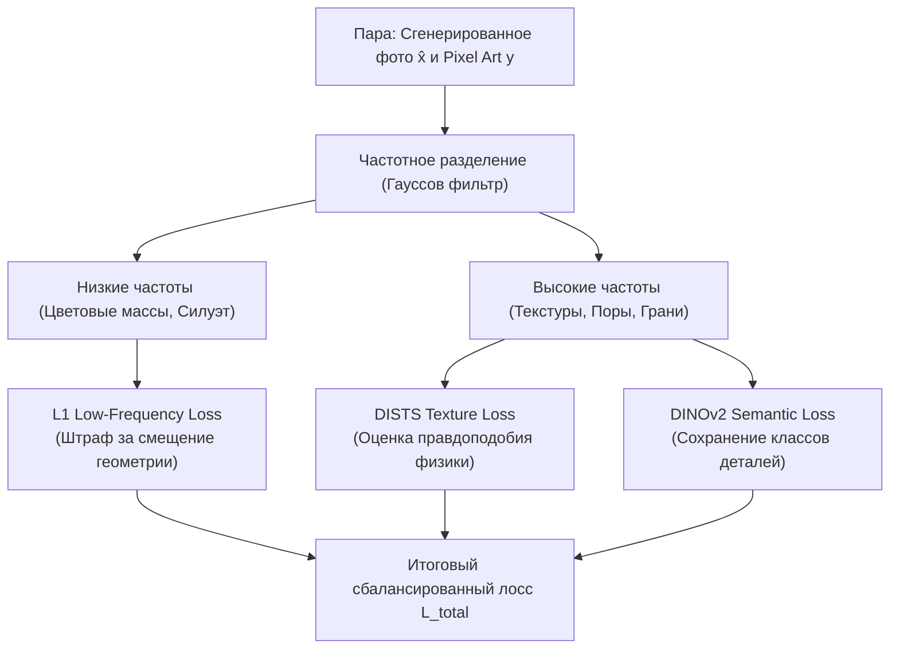

# Функции потерь для структурной согласованности (Structural Consistency Losses)

## 1. Краткое описание
В этой статье формулируются специализированные функции потерь, предназначенные для сохранения строгой геометрии и компоновки объектов при обучении адаптеров депикселизации. Исследуется частотно-развязанный лосс (Frequency Decoupled Loss), семантическая согласованность токенов DINOv2, силуэтный лосс SAM IoU и регуляризация по расстоянию Вассерштейна для сохранения цветовой палитры.

---

## 2. Интуитивное объяснение: Разделение чертежа и покраски

Главная дилемма при обучении модели преобразования Pixel Art → Realism звучит так:  
*«Как строго наказать сеть, если она сделала плечи персонажа шире на 10 сантиметров, но при этом похвалить её, если она нарисовала на доспехе микроскопические царапины и блики?»*

Стандартные функции потерь ($L_1$, $L_2$) не видят разницы между микротекстурой и смещением плеча.  
Решение заключается в **частотной декомпозиции (Frequency Decoupling)**:
- Мы пропускаем изображение через размывающий фильтр (Low-pass filter), оставляя только общие цветовые массы и силуэт. Здесь мы требуем **100% совпадения с пиксель-артом**.
- В полосе высоких частот (High-pass filter) мы, наоборот, **запрещаем совпадение с исходными пикселями** и требуем совпадения с распределением естественных фотореалистичных текстур через перцептивный лосс DISTS и DINOv2.

---

## 3. Математические формулировки структурных потерь



### 3.1. Частотно-развязанная потеря (Frequency Decoupled Loss)
Пусть $G_\sigma$ — оператор свертки с низкочастотным ядром Гаусса ($\sigma = 3.0$).  
Низкочастотная составляющая содержит общую компоновку, позу и свет:
$$x_{\text{low}} = G_\sigma * x, \quad x_{\text{high}} = x - x_{\text{low}}$$

Функция потерь геометрии накладывает строгий штраф только на низкочастотную основу:
$$\mathcal{L}_{\text{geom}}(x, \hat{x}) = \| G_\sigma * \hat{x} - G_\sigma * y_{\text{up}} \|_1$$
где $y_{\text{up}}$ — пиксель-арт, апскейленный через Nearest-Neighbor до целевого разрешения.

---

### 3.2. Силуэтный лосс Segment Anything (SAM Mask IoU Loss)
Для игровых спрайтов внешняя форма критичнее внутренних текстур.  
Пусть $M_{\text{gt}}$ — бинарная маска силуэта исходного спрайта, а $M_{\theta}(\hat{x})$ — маска, предсказанная легковесной версией Segment Anything Model (MobileSAM):
$$\mathcal{L}_{\text{IoU}}(\hat{x}, M_{\text{gt}}) = 1 - \frac{\sum_{i, j} M_{\theta}(\hat{x})_{i, j} \cdot (M_{\text{gt}})_{i, j}}{\sum_{i, j} M_{\theta}(\hat{x})_{i, j} + \sum_{i, j} (M_{\text{gt}})_{i, j} - \sum_{i, j} M_{\theta}(\hat{x})_{i, j} \cdot (M_{\text{gt}})_{i, j}}$$

Градиент этого лосса принудительно стягивает диффузионную генерацию внутрь границ спрайта, исключая «разбухание» силуэта.

---

### 3.3. Согласование цветовой палитры (Wasserstein Color Histogram Loss)
Пиксель-арт обладает уникальным авторским колоритом (NES-палитра, киберпанк-неон). Диффузионные модели склонны сдвигать палитру к усредненным цветам реального мира.  
Для сохранения оригинального цветового настроения вводится одномерное расстояние Вассерштейна (Earth Mover's Distance) между кумулятивными гистограммами каналов $c \in \{R, G, B\}$:
$$\mathcal{L}_{\text{color}}(\hat{x}, y) = \sum_{c \in \{R, G, B\}} \int_0^1 |F_{\hat{x}}^c(v) - F_y^c(v)| \, dv$$
где $F^c(v)$ — эмпирическая кумулятивная функция распределения (CDF) яркостей канала $c$.

---

## 4. Практическая реализация: Модуль частотно-развязанного лосса

```python
"""nn_upscaler.losses.frequency_loss: Frequency Decoupled Structural Loss implementation."""

import torch
import torch.nn as nn
import torch.nn.functional as F


class FrequencyDecoupledStructuralLoss(nn.Module):
    """Частотно-развязанная функция потерь для контролируемой депикселизации."""

    def __init__(self, kernel_size: int = 15, sigma: float = 3.0, weight_geom: float = 1.0):
        super().__init__()
        self.weight_geom = weight_geom

        # Создание 2D ядра Гаусса
        coords = torch.arange(kernel_size, dtype=torch.float32) - (kernel_size - 1) / 2.0
        g1d = torch.exp(-(coords**2) / (2.0 * sigma**2))
        g2d = g1d.unsqueeze(0) * g1d.unsqueeze(1)
        g2d = g2d / g2d.sum()
        # [3, 1, K, K] для глубинной свертки по 3 каналам RGB
        self.register_buffer("kernel", g2d.view(1, 1, kernel_size, kernel_size).repeat(3, 1, 1, 1))
        self.padding = kernel_size // 2

    def forward(
        self, generated_photo: torch.Tensor, upscaled_pixel_art: torch.Tensor
    ) -> torch.Tensor:
        """
        generated_photo: Фотореалистичный выход [B, 3, H, W]
        upscaled_pixel_art: Nearest-апскейл пиксель-арта [B, 3, H, W]
        """
        # Извлечение низких частот (цветовые массы и анатомия)
        low_freq_gen = F.conv2d(generated_photo, self.kernel, padding=self.padding, groups=3)
        low_freq_ref = F.conv2d(upscaled_pixel_art, self.kernel, padding=self.padding, groups=3)

        # Строгий L1 штраф на низких частотах
        loss_geom = F.l1_loss(low_freq_gen, low_freq_ref)

        return self.weight_geom * loss_geom
```

---

## 5. Связанные темы
- Перцептивные метрики: [`02_Mathematical_Foundations/06_Loss_Functions_and_Perceptual_Metrics.md`](../02_Mathematical_Foundations/06_Loss_Functions_and_Perceptual_Metrics.md)
- Обучение LoRA: [`06_Training_and_Fine_Tuning/02_Training_Objectives_and_Loss_Formulation.md`](../06_Training_and_Fine_Tuning/02_Training_Objectives_and_Loss_Formulation.md)
- Метрики оценки: [`07_Evaluation_and_Benchmarks/01_Metric_Taxonomy_and_Mathematical_Formulation.md`](../07_Evaluation_and_Benchmarks/01_Metric_Taxonomy_and_Mathematical_Formulation.md)
