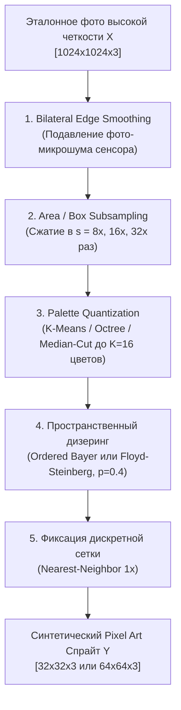

# Синтетический пайплайн деградации данных (Synthetic Degradation Pipeline)

## 1. Краткое описание
В этой статье формулируется алгоритмический и программный пайплайн генерации парных обучающих данных `Pixel Art ↔ Realistic High-Res Photo`. Детально описываются этапы фильтрации, субдискретизации, адаптивного квантования палитры (K-Means, Octree, MedianCut) и пространственного дизеринга. Представлен модуль динамического PyTorch Dataset, генерирующий аугментированные обучающие пары на лету.

---

## 2. Интуитивное объяснение: Завод по производству парных данных

Чтобы обучить нейросеть восстанавливать фотореализм из пикселей, нам нужны миллионы примеров: «Вот пиксельный спрайт рыцаря — а вот точное 4K-фото этого же рыцаря с реальными волосками, порами и царапинами на броне».

В природе таких пар не существует: художники не рисовали пиксельные версии к миллионам современных фотографий.  
Поэтому мы строим **виртуальный деградатор**:
1. Берём миллионы качественных фотографий людей, пейзажей, замков и доспехов.
2. Пропускаем их через специализированный конвейер, который имитирует графические чипы ретро-консолей (NES, GameBoy, Sega).
3. Получаем идеальную обучающую пару: синтетический пиксель-арт на входе и исходное фото высокой чёткости в качестве таргета.

---

## 3. Архитектура алгоритмического конвейера деградации



### 3.1. Квантование цветов: K-Means против Median-Cut
- **Median-Cut:** Делит цветовой куб RGB медианными плоскостями вдоль оси максимальной дисперсии. Быстро, но часто теряет редкие высококонтрастные акцентные цвета (например, красный рубин на сером мече).
- **K-Means Clustering:** Минимизирует внутрикластерную дисперсию в пространстве CIELAB:
  $$\arg\min_{\mathcal{P}} \sum_{k=1}^K \sum_{p \in S_k} \| \operatorname{Lab}(p) - \mathbf{c}_k \|_2^2$$
  Даёт превосходную визуальную передачу контраста, полностью соответствуя выбору художника.

---

## 4. Практическая реализация: Динамический PyTorch Dataset на лету

В модуле `src/nn_upscaler/data/degradation.py` реализована база математической деградации. Ниже представлен полноценный обучающий `Dataset` для обучения LoRA и ControlNet:

```python
"""nn_upscaler.data.synthetic_dataset: PyTorch Dataset generating paired pixel art on-the-fly."""

import random
from pathlib import Path
import numpy as np
import torch
from PIL import Image
from torch.utils.data import Dataset
from torchvision import transforms
from nn_upscaler.data.degradation import PixelArtDegradation, PRESET_PALETTES


class OnTheFlyPixelArtDataset(Dataset):
    """Динамический генератор обучающих пар: Реалистичное фото <-> Синтетический Pixel Art."""

    def __init__(
        self,
        image_dir: str | Path,
        target_size: tuple[int, int] = (1024, 1024),
        scale_factors: list[int] | None = None,
    ):
        self.image_paths = list(Path(image_dir).glob("*.png")) + list(Path(image_dir).glob("*.jpg"))
        self.target_size = target_size
        self.scale_factors = scale_factors or [8, 16, 32]
        self.preset_names = list(PRESET_PALETTES.keys()) + [None]

        self.hr_transform = transforms.Compose(
            [
                transforms.Resize(self.target_size, Image.Resampling.BICUBIC),
                transforms.ToTensor(),
                transforms.Normalize([0.5, 0.5, 0.5], [0.5, 0.5, 0.5]),
            ]
        )

    def __len__(self) -> int:
        return len(self.image_paths)

    def __getitem__(self, idx: int) -> dict[str, torch.Tensor]:
        img_path = self.image_paths[idx]
        hr_image = Image.open(img_path).convert("RGB")

        # 1. Случайная аугментация параметров деградации
        scale = random.choice(self.scale_factors)
        preset = random.choice(self.preset_names)
        num_colors = random.choice([8, 16, 32]) if preset is None else None
        use_dither = random.random() < 0.40

        degrader = PixelArtDegradation(
            scale_factor=scale,
            num_colors=num_colors,
            palette_preset=preset,
            dither=use_dither,
        )

        # 2. Создание низкоразмерного пиксель-арта
        lr_pixel_art = degrader(hr_image)

        # 3. Апскейл пиксель-арта обратно через Nearest для подачи в ControlNet
        lr_upscaled = lr_pixel_art.resize(self.target_size, Image.Resampling.NEAREST)

        # 4. Преобразование в тензоры
        hr_tensor = self.hr_transform(hr_image)
        lr_tensor = self.hr_transform(lr_upscaled)

        return {
            "hr_target": hr_tensor,  # Целевое реалистичное изображение [3, 1024, 1024]
            "control_input": lr_tensor,  # Направляющий пиксель-арт для ControlNet [3, 1024, 1024]
            "scale_factor": torch.tensor(scale),
        }
```

---

## 5. Связанные темы
- Представление пиксель-арта: [`01_Fundamentals/01_Pixel_Art_Representation_and_Aesthetics.md`](../01_Fundamentals/01_Pixel_Art_Representation_and_Aesthetics.md)
- Domain Gap: [`05_Datasets_and_Preprocessing/01_Dataset_Landscape_and_Domain_Gap.md`](01_Dataset_Landscape_and_Domain_Gap.md)
- Обучение LoRA: [`06_Training_and_Fine_Tuning/01_PEFT_and_LoRA_for_Diffusion.md`](../06_Training_and_Fine_Tuning/01_PEFT_and_LoRA_for_Diffusion.md)
