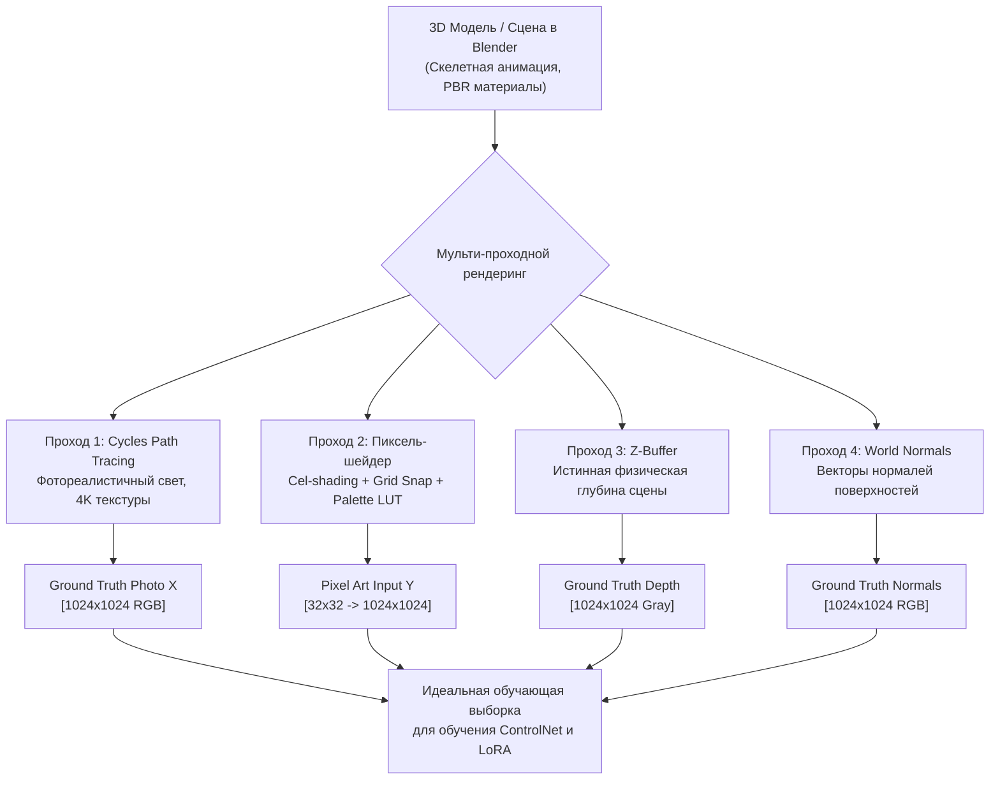

# Синтез парных данных в 3D-движках (Blender / Unreal Engine 5)

## 1. Краткое описание
В этой статье описывается передовая методика преодоления междоменного разрыва (Domain Gap) через двухбуферный рендеринг в современных 3D-движках (Blender Cycles / Unreal Engine 5). Рассматривается одновременный рендеринг фотореалистичной PBR-сцены и стилизованного пиксель-арт спрайта с получением точнейших карт глубин, нормалей и масок сегментации.

---

## 2. Интуитивное объяснение: Идеальный полигон

Почему обычное уменьшение реальных фотографий страдает от дефектов? Потому что на фотографии фон зашумлен, освещение случайно, а точные 3D-координаты каждого миллиметра лица неизвестны.

В **3D-движке (Blender / UE5)** мы обладаем божественным контролем над сценой:
1. У нас есть готовая 3D-модель рыцаря, дерева или замка.
2. Камера №1 делает фотореалистичный снимок с кинематографичным светом (трассировка лучей Cycles/Lumen, честные тени, волоски, блики на металле).
3. В эту же миллисекунду, не сдвигая камеру ни на микрон, Камера №2 рендерит тот же объект через специальный пиксель-арт шейдер (квантованная палитра из 16 цветов, сетка $32\times 32$, контурная обводка).
4. Камера №3 сохраняет карту истинной физической глубины и карты нормалей.

Мы получаем **идеальную обучающую пару**: входной пиксель-арт абсолютно точно соответствует целевой фотореалистичной картине до субмиллиметра, без малейших артефактов или шума!

---

## 3. Архитектура двухбуферного рендеринга (Dual-Buffer Pipeline)



---

## 4. Практическая реализация: Headless-скрипт рендеринга для Blender (Python API)

Следующий скрипт запускается в консольном режиме Blender (`blender --background --python render_pairs.py`) и автоматически рендерит сцену в двух взаимосогласованных режимах:

```python
"""scripts/blender_render_pairs.py: Automated paired data rendering in Blender."""

import bpy
import numpy as np


def setup_render_nodes():
    """Настройка дерева композитинга Blender для вывода PBR фото и Pixel Art."""
    bpy.context.scene.use_nodes = True
    tree = bpy.context.scene.node_tree
    nodes = tree.nodes
    links = tree.links
    nodes.clear()

    # 1. Нода входного рендера
    render_layers = nodes.new("CompositorNodeRLayers")

    # 2. Вывод стандартного фотореалистичного PBR рендера
    file_output_pbr = nodes.new("CompositorNodeOutputFile")
    file_output_pbr.base_path = "data/synthetic_3d/pbr_targets/"
    file_output_pbr.file_slots[0].path = "target_pbr_"
    links.new(render_layers.outputs["Image"], file_output_pbr.inputs[0])

    # 3. Цепочка пикселизации для синтетического спрайта
    pixelate_scale_down = nodes.new("CompositorNodeScale")
    pixelate_scale_down.space = "RELATIVE"
    pixelate_scale_down.inputs["X"].default_value = 0.03125  # Сжатие в 32 раза (32x32)
    pixelate_scale_down.inputs["Y"].default_value = 0.03125

    pixelate_node = nodes.new("CompositorNodePixelate")

    pixelate_scale_up = nodes.new("CompositorNodeScale")
    pixelate_scale_up.space = "RELATIVE"
    pixelate_scale_up.inputs["X"].default_value = 32.0  # Обратный апскейл блоками
    pixelate_scale_up.inputs["Y"].default_value = 32.0

    links.new(render_layers.outputs["Image"], pixelate_scale_down.inputs[0])
    links.new(pixelate_scale_down.outputs[0], pixelate_node.inputs[0])
    links.new(pixelate_node.outputs[0], pixelate_scale_up.inputs[0])

    # 4. Вывод пиксель-арт спрайта
    file_output_pixel = nodes.new("CompositorNodeOutputFile")
    file_output_pixel.base_path = "data/synthetic_3d/pixel_inputs/"
    file_output_pixel.file_slots[0].path = "input_pixel_"
    links.new(pixelate_scale_up.outputs[0], file_output_pixel.inputs[0])


if __name__ == "__main__":
    setup_render_nodes()
    # Запуск рендеринга текущего кадра
    bpy.ops.render.render(write_still=True)
    print("[+] Парный рендеринг успешно завершён!")
```

---

## 5. Исследовательский анализ: Преимущества и стоимость

| Аспект | 2D Синтетическая деградация фото | 3D Двухбуферный рендеринг |
|---|---|---|
| **Себестоимость генерации** | Сверхнизкая (секунды на CPU/GPU) | Средняя (требует 3D-ассетов и рендер-фермы) |
| **Геометрическая точность** | Средняя (Domain Gap шума) | **Абсолютная (100% попиксельное совпадение)** |
| **Карты нормалей и глубин** | Приблизительные (псевдо-нейросети) | **Физически точные (из 3D-движка)** |
| **Временная согласованность видео** | Шумная | **Идеальная скелетная анимация** |

**Стратегическая рекомендация:**  
Для обучения общего базового адаптера (ControlNet-Tile) достаточно 2D-синтетики (50 000 фото). Однако для финальной калибровки модели под конкретную игру и генерации walk-cycle спрайт-листов **3D-синтез в Blender является самым надежным источником данных**.

---

## 6. Связанные темы
- Domain Gap: [`05_Datasets_and_Preprocessing/01_Dataset_Landscape_and_Domain_Gap.md`](01_Dataset_Landscape_and_Domain_Gap.md)
- Фильтрация датасета: [`05_Datasets_and_Preprocessing/04_Dataset_Curation_and_Quality_Filtering.md`](04_Dataset_Curation_and_Quality_Filtering.md)
- Оффлайн ассеты: [`09_Real_Time_and_Games/01_Offline_Asset_Conversion.md`](../09_Real_Time_and_Games/01_Offline_Asset_Conversion.md)
