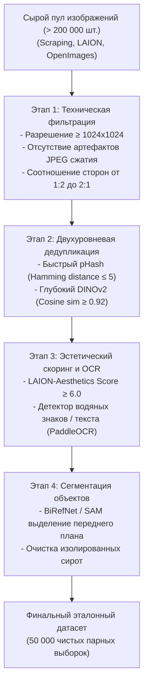

# Курация данных, фильтрация качества и дедупликация

## 1. Краткое описание
В этой статье описывается промышленный процесс подготовки и фильтрации датасетов для обучения моделей депикселизации. Рассматриваются алгоритмы дедупликации изображений на основе перцептивного хеширования (pHash) и эмбеддингов DINOv2, фильтрация по эстетическим оценкам (CLIP Aesthetic Scoring), сегментация фона и методология строгого разделения на Train, Validation и Test Benchmark.

---

## 2. Интуитивное объяснение: Качество важнее количества

В глубоком обучении действует жесткий закон: **«Garbage in — Garbage out» (Мусор на входе — мусор на выходе)**.
Если скормить диффузионной модели 100 000 нефильтрованных изображений из интернета, где половина картинок — это размытые скриншоты со сжатием JPEG, водяными знаками Shutterstock и плохими пропорциями:
- Модель выучит генерировать размытые артефакты сжатия и паразитный шум.
- Если в обучающей выборке будет 500 копий одного и того же спрайта Марио, модель переобучится на него, потеряв способность генерировать других персонажей.

Напротив, тщательно отобранные **10 000 кристально чистых, резких, эстетически безупречных парных изображений** дают качество генерации на порядок выше, чем миллион «мусорных» картинок.

---

## 3. Четырёхэтапный конвейер фильтрации данных



---

## 4. Практическая реализация: Скрипт быстрой дедупликации (pHash + DINOv2)

```python
"""nn_upscaler.data.curation: Deduplication and aesthetic quality filtering pipeline."""

from pathlib import Path
import imagehash
import numpy as np
import torch
from PIL import Image


class DatasetDeduplicator:
    """Двухуровневая дедупликация: pHash (быстрый) + DINOv2 (семантический)."""

    def __init__(
        self, hash_threshold: int = 5, cosine_threshold: float = 0.92, device: str = "cuda"
    ):
        self.hash_threshold = hash_threshold
        self.cosine_threshold = cosine_threshold
        self.device = torch.device(device)
        self.encoder = (
            torch.hub.load("facebookresearch/dinov2", "dinov2_vits14").to(self.device).eval()
        )

    def filter_directory(self, input_dir: Path) -> list[Path]:
        """Фильтрация дубликатов в директории."""
        image_paths = sorted(list(input_dir.glob("*.png")) + list(input_dir.glob("*.jpg")))
        unique_paths = []
        seen_hashes = []
        seen_embeddings = []

        print(f"[*] Старт дедупликации {len(image_paths)} изображений...")

        for path in image_paths:
            try:
                img = Image.open(path).convert("RGB")
            except Exception:
                continue

            # 1. Быстрый фильтр перцептивного хеша
            h = imagehash.phash(img)
            is_duplicate = False
            for prev_h in seen_hashes:
                if abs(h - prev_h) <= self.hash_threshold:
                    is_duplicate = True
                    break

            if is_duplicate:
                continue

            # 2. Глубокий фильтр семантического сходства DINOv2
            with torch.no_grad():
                tensor = img.resize((224, 224), Image.Resampling.BILINEAR)
                tensor = torch.from_numpy(np.array(tensor)).permute(2, 0, 1).float() / 255.0
                tensor = tensor.unsqueeze(0).to(self.device)
                emb = self.encoder(tensor)
                emb = emb / emb.norm(dim=1, keepdim=True)

            for prev_emb in seen_embeddings:
                sim = torch.mm(emb, prev_emb.t()).item()
                if sim >= self.cosine_threshold:
                    is_duplicate = True
                    break

            if not is_duplicate:
                seen_hashes.append(h)
                seen_embeddings.append(emb)
                unique_paths.append(path)

        print(f"[+] Очистка завершена: сохранено {len(unique_paths)} уникальных изображений.")
        return unique_paths
```

---

## 5. Методология разделения на Train / Validation / Test

Для обеспечения строгой воспроизводимости и исключения утечки данных (Data Leakage):
1. **Train Set (80% — 40 000 пар):**
   - 30 000 пар из 2D-синтетического пайплайна деградации фото.
   - 10 000 пар из 3D-движка Blender.
2. **Validation Set (10% — 5 000 пар):**
   - Используется для мониторинга LPIPS и DISTS лоссов во время обучения LoRA каждые 500 шагов.
3. **Golden Test Benchmark (10% — 5 000 пар):**
   - **Не используется в обучении.**
   - Состоит из 2 500 синтетических пар + **2 500 тщательно отобранных вручную классических ретро-спрайтов** из культовых игр (Chrono Trigger, Castlevania, Street Fighter II, Metal Slug) с экспертной экспертной оценкой.

---

## 6. Связанные темы
- Domain Gap: [`05_Datasets_and_Preprocessing/01_Dataset_Landscape_and_Domain_Gap.md`](01_Dataset_Landscape_and_Domain_Gap.md)
- Обучение LoRA: [`06_Training_and_Fine_Tuning/01_PEFT_and_LoRA_for_Diffusion.md`](../06_Training_and_Fine_Tuning/01_PEFT_and_LoRA_for_Diffusion.md)
- Протокол бенчмаркинга: [`07_Evaluation_and_Benchmarks/02_Multi_Axis_Evaluation_Framework.md`](../07_Evaluation_and_Benchmarks/02_Multi_Axis_Evaluation_Framework.md)
