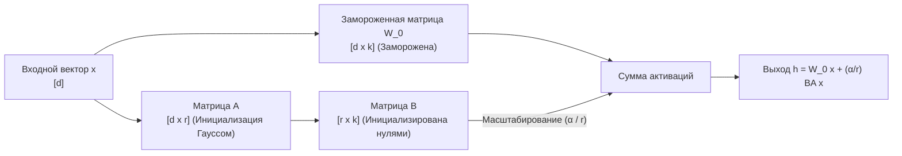

# Параметрически эффективное дообучение (PEFT и LoRA) для диффузионных моделей

## 1. Краткое описание
В этой статье подробно рассматривается математика и практика параметрически эффективного дообучения (Parameter-Efficient Fine-Tuning, PEFT) с использованием адаптации низкого ранга (Low-Rank Adaptation, LoRA, Hu et al., 2022). Исследуются целевые модули внедрения в трансформерные и сверточные слои SDXL, математический вывод масштабирующего фактора $\alpha$, архитектура ControlNet-LoRA и выбор оптимального ранга для задачи Pixel Art → Realism.

---

## 2. Интуитивное объяснение: Настройка микро-плагина вместо пересборки двигателя

Базовая модель SDXL содержит **2.6 миллиарда параметров** и «знает» всё о визуальном мире: законы физики, анатомию человека, свойства отражения света, структуру металлов и тканей.

Если попытаться обучить все 2.6 миллиарда весов на пиксель-арте:
1. Вам потребуется вычислительный кластер из 8 видеокарт NVIDIA A100/H100 стоимостью десятки тысяч долларов.
2. Произойдет **катастрофическое забывание (Catastrophic Forgetting)**: модель забудет, как рисовать фотореалистичные ткани и лица, и начнёт рисовать примитивные цветные пятна.

**LoRA (Low-Rank Adaptation)** решает эту проблему гениально:
- Мы полностью замораживаем все 2.6 миллиарда весов SDXL (сохраняя весь фотореализм мира).
- К каждому слою внимания мы прикрепляем крошечный математический «плагин» из пары узких матриц.
- Обучаются всего **0.2% параметров** (файл весит 50–150 МБ вместо 6.5 ГБ).
- Этот микро-плагин выучивает ровно одну узкую задачу: *«Как преобразовать ступенчатые пиксельные паттерны в гладкие направляющие»*.

---

## 3. Математика Low-Rank Adaptation (LoRA)



### 3.1. Декомпозиция низкого ранга
Пусть $W_0 \in \mathbb{R}^{d \times k}$ — исходная матрица весов полносвязного слоя или проекции внимания ($Q, K, V$).  
Вместо прямого обновления $\Delta W \in \mathbb{R}^{d \times k}$ того же гигантского размера, мы факторизуем его в произведение двух низкоранговых матриц:
$$\Delta W = B \cdot A$$
где $B \in \mathbb{R}^{d \times r}$, $A \in \mathbb{R}^{r \times k}$, а ранг $r \ll \min(d, k)$ (например, $r=32$ при $d=2048$).

Прямой проход слоя модифицируется следующим образом:
$$h = W_0 x + \Delta W x = W_0 x + \frac{\alpha}{r} (B A) x$$
где $\alpha$ — константный гиперпараметр масштабирования.

### 3.2. Инициализация и стабильность старта
- Матрица $A$ инициализируется случайными числами из нормального распределения: $A \sim \mathcal{N}\left(0, \frac{1}{r}\right)$.
- Матрица $B$ инициализируется **строгими нулями**: $B = \mathbf{0}$.

Следовательно, на нулевом шаге обучения:
$$\Delta W = \mathbf{0} \cdot A = \mathbf{0}$$
В момент старта адаптер гарантированно не вносит никаких искажений в предсказания модели, начиная обучение плавно.

---

## 4. Целевые модули внедрения LoRA в SDXL

В SDXL ключевыми узлами являются слои само- и перекрёстного внимания в блоках `Transformer2DModel`:
- `to_q`, `to_k`, `to_v` — проекции внимания запросов, ключей и значений.
- `to_out.0` — выходная проекция слоя внимания.
- `conv1`, `conv2` (LoCon / LyCORIS расширение) — сверточные слои ResNet для захвата локальной текстуры.

### Анализ выбора ранга $r$ для Pixel Art → Realism:

| Ранг $r$ | Размер файла LoRA | Ёмкость памяти признаков | Риск переобучения | Вердикт для задачи |
|---|---|---|---|---|
| **$r = 4 – 8$** | ~15 МБ | Низкая (не хватает емкости для дизеринга) | Минимальный | Недостаточно для снятия палитры |
| **$r = 16 – 32$** | ~60 МБ | Оптимальная (хорошо выучивает стили) | Низкий | 🟢 **Идеально для стилей персонажей** |
| **$r = 64$** | ~150 МБ | **Высокая (учит инверсию квантизации)** | Средний | ✅ **Рекомендуемый стандарт (MVP)** |
| **$r = 128+$** | > 300 МБ | Избыточная (склонность к зубрежке) | Высокий | Риск потери фотореализма |

---

## 5. Практическая реализация: Конфигурация PEFT LoRA для Diffusers

```python
"""nn_upscaler.training.lora_config: PEFT LoRA setup for SDXL U-Net training."""

import torch
from diffusers import UNet2DConditionModel
from peft import LoraConfig, get_peft_model


def setup_sdxl_lora_unet(
    unet: UNet2DConditionModel,
    rank: int = 64,
    alpha: int = 32,
    learning_rate: float = 1e-4,
) -> tuple[torch.nn.Module, torch.optim.Optimizer]:
    """Внедрение LoRA адаптеров в слои внимания U-Net SDXL."""

    lora_config = LoraConfig(
        r=rank,
        lora_alpha=alpha,
        init_lora_weights="gaussian",
        target_modules=[
            "to_k",
            "to_q",
            "to_v",
            "to_out.0",  # Внимание
            "add_k_proj",
            "add_v_proj",  # Дополнительные проекции SDXL
        ],
    )

    # Применение адаптеров (замораживает U-Net и оставляет обучаемыми только A и B)
    unet_lora = get_peft_model(unet, lora_config)
    unet_lora.print_trainable_parameters()
    # Вывод: trainable params: ~12,500,000 || all params: ~2,600,000,000 || trainable%: ~0.48%

    optimizer = torch.optim.AdamW(
        unet_lora.parameters(),
        lr=learning_rate,
        betas=(0.9, 0.999),
        weight_decay=1e-2,
    )

    return unet_lora, optimizer
```

---

## 6. Связанные темы
- Целевые функции потерь: [`06_Training_and_Fine_Tuning/02_Training_Objectives_and_Loss_Formulation.md`](02_Training_Objectives_and_Loss_Formulation.md)
- Управление памятью GPU: [`06_Training_and_Fine_Tuning/04_Hardware_and_VRAM_Management.md`](04_Hardware_and_VRAM_Management.md)
- Диагностика ошибок обучения: [`06_Training_and_Fine_Tuning/05_Troubleshooting_and_Training_Pitfalls.md`](05_Troubleshooting_and_Training_Pitfalls.md)
