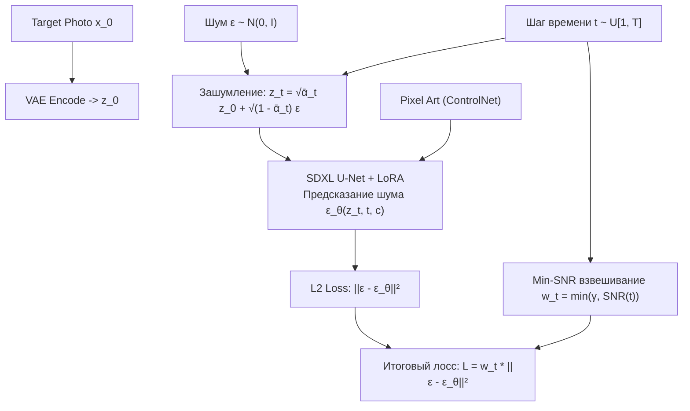

# Целевые функции потерь и оптимизационные критерии обучения

## 1. Краткое описание
В этой статье формулируется сквозной оптимизационный критерий для обучения и дообучения диффузионных адаптеров задачи Pixel Art → Realism. Рассматриваются методы параметризации шума ($\epsilon$-prediction против $v$-prediction), взвешивание шагов через Min-SNR $\gamma$-weighting, техника накопления градиентов (Gradient Accumulation) и смешанная точность (Mixed Precision) для стабильного схождения на ограниченном объеме VRAM.

---

## 2. Интуитивное объяснение: Не все шаги времени одинаково полезны

В процессе обучения диффузионной модели случайным образом выбирается шаг времени $t \in [1, 1000]$:
- На шаге $t=950$ (почти чистый шум) модель закладывает глобальную композицию: где голова, а где ноги. На этом этапе ошибки в микропорах кожи физически не имеют значения.
- На шаге $t=50$ (почти чистое фото) шум минимален. Модель шлифует тончайшие волоски и блики. На этом этапе ошибки в позе уже не могут быть исправлены.

В стандартном обучении DDPM все шаги времени штрафуются одинаково. В результате модель тратит 90% энергии на ранние шумные шаги, пренебрегая прорисовкой реалистичных материалов на поздних этапах.  
Метод **Min-SNR взвешивания** динамически перебалансирует силу градиентов, позволяя модели одновременно выучивать и строгую позу спрайта, и фотореалистичную микрофактуру.

---

## 3. Математическая формулировка оптимизационных критериев



### 3.1. Параметризация шума: $\epsilon$-prediction против $v$-prediction
- **$\epsilon$-prediction (Классический SD 1.5 и SDXL):**  
  Сеть предсказывает добавленный гауссов шум: $\mathcal{L} = \| \epsilon - \epsilon_\theta(z_t, t) \|_2^2$.  
  *Проблема:* При $t \to T$ отношение сигнал/шум стремится к нулю, приводя к нестабильности градиентов.
- **$v$-prediction (Salimans & Ho, 2022 / SD 2.1 / SDXL Turbo):**  
  Сеть предсказывает комбинированный вектор скорости:
  $$v_t = \sqrt{\bar{\alpha}_t} \epsilon - \sqrt{1 - \bar{\alpha}_t} z_0$$
  $$\mathcal{L}_v = \| v_t - v_\theta(z_t, t) \|_2^2$$
  Обеспечивает численную стабильность на всём диапазоне временных шагов $t \in [0, T]$.

---

### 3.2. Min-SNR $\gamma$-взвешивание (Hang et al., ICCV 2023)
Отношение сигнал/шум (Signal-to-Noise Ratio) на шаге $t$ определяется как:
$$\operatorname{SNR}(t) = \frac{\bar{\alpha}_t}{1 - \bar{\alpha}_t}$$

Для предотвращения доминирования сверхтяжелых градиентов на промежуточных шагах времени лосс взвешивается функцией отсечения (clamped weighting):
$$w_t = \min\left( \gamma, \, \operatorname{SNR}(t) \right)$$
где гиперпараметр $\gamma = 5.0$ (стандарт для моделей SDXL).

Целевая функция обучения с Min-SNR принимает вид:
$$\mathcal{L}_{\text{Min-SNR}}(\theta) = \mathbb{E}_{t, z_0, \epsilon} \left[ \frac{w_t}{\operatorname{SNR}(t)} \| \epsilon - \epsilon_\theta(z_t, t, c) \|_2^2 \right]$$

---

## 4. Практическая реализация: Шаг обучения с Min-SNR на PyTorch

```python
"""nn_upscaler.training.trainer_step: Training step implementation with Min-SNR weighting."""

import torch
import torch.nn.functional as F


def compute_snr(timesteps: torch.Tensor, alphas_cumprod: torch.Tensor) -> torch.Tensor:
    """Вычисление SNR(t) = alpha_bar_t / (1 - alpha_bar_t)."""
    alpha_bar = alphas_cumprod[timesteps].float()
    return alpha_bar / (1.0 - alpha_bar)


def training_step_min_snr(
    unet_model: torch.nn.Module,
    noisy_latents: torch.Tensor,
    timesteps: torch.Tensor,
    noise_target: torch.Tensor,
    conditions: dict,
    alphas_cumprod: torch.Tensor,
    gamma: float = 5.0,
) -> torch.Tensor:
    """Один шаг оптимизации с взвешиванием Min-SNR gamma."""
    # 1. Предсказание шума моделью
    noise_pred = unet_model(
        noisy_latents,
        timesteps,
        encoder_hidden_states=conditions["text_embeddings"],
        added_cond_kwargs=conditions["added_cond_kwargs"],
    ).sample

    # 2. Вычисление попиксельного L2 лосса [B, C, H, W]
    loss_unweighted = (noise_pred.float() - noise_target.float()) ** 2
    loss_per_sample = loss_unweighted.mean(dim=[1, 2, 3])  # [B]

    # 3. Расчёт коэффициентов Min-SNR
    snr = compute_snr(timesteps, alphas_cumprod.to(timesteps.device))
    gamma_tensor = torch.full_like(snr, gamma)
    snr_clamped = torch.min(snr, gamma_tensor)
    loss_weights = snr_clamped / snr  # [B]

    # 4. Итоговый взвешенный лосс
    final_loss = (loss_per_sample * loss_weights).mean()
    return final_loss
```

---

## 5. Связанные темы
- LoRA дообучение: [`06_Training_and_Fine_Tuning/01_PEFT_and_LoRA_for_Diffusion.md`](01_PEFT_and_LoRA_for_Diffusion.md)
- Гиперпараметры и оптимизаторы: [`06_Training_and_Fine_Tuning/03_Hyperparameters_and_Optimization.md`](03_Hyperparameters_and_Optimization.md)
- Управление памятью: [`06_Training_and_Fine_Tuning/04_Hardware_and_VRAM_Management.md`](04_Hardware_and_VRAM_Management.md)
