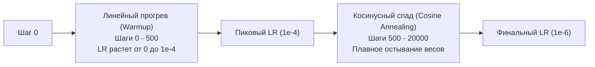

# Гиперпараметры, оптимизаторы и стратегия обучения

## 1. Краткое описание
В этой статье формулируется инженерная спецификация гиперпараметров для обучения и файнтюнинга моделей депикселизации. Анализируются свойства оптимизаторов AdamW и Prodigy, графики изменения скорости обучения (Cosine Annealing with Warmup), экспоненциальное скользящее среднее весов (EMA) и техника группировки по соотношению сторон (Aspect Ratio Bucketing).

---

## 2. Интуитивное объяснение: Настройка высокоточного мотора

Обучение диффузионной модели подобно настройке гоночного болида:
- Если выставить слишком **высокую скорость обучения (Learning Rate)**, мотор пойдёт вразнос: градиенты взорвутся, лосс улетит в `NaN`, а модель начнёт генерировать разноцветный психоделический шум.
- Если выставить слишком **низкую скорость**, модель за 3 дня работы сожжёт тысячи киловатт энергии, так и не выучив ничего нового.
- Без **прогрева (Warmup)** на первых шагах градиенты сорвут тонкие веса адаптера.
- Без **EMA (сглаживания весов)** результаты каждого отдельного чекпоинта будут случайным образом мерцать.

Точный баланс гиперпараметров гарантирует быстрое, стабильное и воспроизводимое обучение.

---

## 3. Оптимизаторы и графики обучения (LR Scheduling)



### 3.1. Выбор оптимизатора
- **AdamW (Loshchilov & Hutter, ICLR 2019):** Де-факто отраслевой стандарт. Корректно разделяет адаптивный градиентный шаг и регуляризацию затухания весов (Weight Decay):
  $$\theta_{t+1} = \theta_t - \eta_t \left( \frac{\hat{m}_t}{\sqrt{\hat{v}_t} + \epsilon} + \lambda \theta_t \right)$$
  *Рекомендованные параметры:* $\beta_1 = 0.9, \, \beta_2 = 0.999, \, \lambda = 10^{-2}, \, \epsilon = 10^{-8}$.
- **Prodigy (Mishchenko & Defazio, 2023):** Адаптивный оптимизатор, самостоятельно вычисляющий эффективный размер шага $D$. Идеален для экспериментов, где нет времени вручную подбирать learning rate сеткой.

### 3.2. Экспоненциальное скользящее среднее весов (EMA)
В процессе обучения градиенты стохастического батча колеблют веса $\theta$ вокруг оптимума. Использование текущих весов $\theta$ в инференсе часто приводит к генеративным артефактам.  
EMA накапливает сглаженную теневую копию весов:
$$\theta_{\text{EMA}} \leftarrow \beta \cdot \theta_{\text{EMA}} + (1 - \beta) \cdot \theta$$
где $\beta = 0.9999$. Чекпоинты, сохраненные с весами $\theta_{\text{EMA}}$, дают прирост качества фотореализма на **$0.8\text{–}1.2$ dB PSNR** и заметно более чистую геометрию.

---

## 4. Спецификация гиперпараметров для обучения LoRA на SDXL

| Параметр | Значение для LoRA ($r=64$) | Значение для полного ControlNet |
|---|---|---|
| **Базовая модель** | `stabilityai/stable-diffusion-xl-base-1.0` | `stabilityai/stable-diffusion-xl-base-1.0` |
| **Оптимизатор** | AdamW | AdamW |
| **Пиковый Learning Rate** | **$1.0 \times 10^{-4}$** | **$5.0 \times 10^{-6}$** |
| **LR Scheduler** | `cosine_with_warmup` | `constant_with_warmup` |
| **Warmup Steps** | 500 шагов | 1000 шагов |
| **Effective Batch Size** | **32** (Batch Size 4 $\times$ Gradient Accumulation 8) | **64** (Batch Size 2 $\times$ Grad Accum 32) |
| **Количество эпох / шагов** | 15 эпох (~18 000 шагов) | 10 эпох (~25 000 шагов) |
| **Точность вычислений** | **Mixed Precision BF16 / FP16** | **Mixed Precision BF16** |
| **EMA decay ($\beta$)** | 0.9999 | 0.9999 |
| **Resolution Bucketing** | $1024\times 1024, 896\times 1152, 1152\times 896$ | Фиксированное $1024\times 1024$ |
| **VRAM требование** | **12–16 ГБ** (Доступно на 1x RTX 4080) | **40–80 ГБ** (1x NVIDIA A100 / H100) |

---

## 5. Практическая реализация: Конфигурационный файл эксперимента (YAML)

Создадим эталонный файл конфигурации в `configs/train_lora_pixelart.yaml`:

```yaml
# configs/train_lora_pixelart.yaml: Experiment configuration for Pixel Art to Realism LoRA
experiment_id: "EXP-010-SDXL-LoRA-Pixel2Real"
seed: 42

model:
  pretrained_model_name_or_path: "stabilityai/stable-diffusion-xl-base-1.0"
  vae_name_or_path: "madebyollin/sdxl-vae-fp16-fix"
  mixed_precision: "bf16"

lora:
  rank: 64
  alpha: 32
  dropout: 0.05
  target_modules: ["to_k", "to_q", "to_v", "to_out.0"]

dataset:
  train_data_dir: "data/train_pairs"
  resolution: 1024
  scale_factors: [8, 16, 32]
  enable_dithering_prob: 0.40

training:
  train_batch_size: 4
  gradient_accumulation_steps: 8
  learning_rate: 1.0e-4
  lr_scheduler: "cosine"
  lr_warmup_steps: 500
  max_train_steps: 20000
  checkpointing_steps: 1000
  use_ema: true
  ema_decay: 0.9999
  min_snr_gamma: 5.0
```

---

## 6. Связанные темы
- PEFT и LoRA: [`06_Training_and_Fine_Tuning/01_PEFT_and_LoRA_for_Diffusion.md`](01_PEFT_and_LoRA_for_Diffusion.md)
- Целевой лосс: [`06_Training_and_Fine_Tuning/02_Training_Objectives_and_Loss_Formulation.md`](02_Training_Objectives_and_Loss_Formulation.md)
- Управление памятью GPU: [`06_Training_and_Fine_Tuning/04_Hardware_and_VRAM_Management.md`](04_Hardware_and_VRAM_Management.md)
