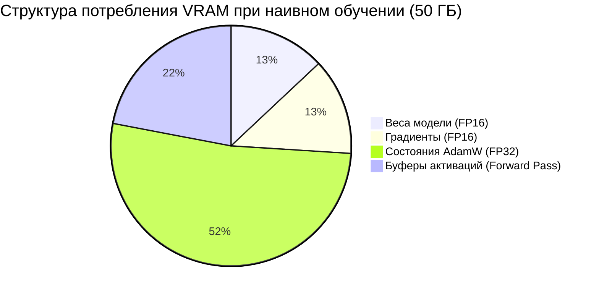

# Управление видеопамятью (VRAM) и аппаратная оптимизация (CUDA / Apple Silicon MPS)

## 1. Краткое описание
В этой статье даётся исчерпывающее инженерное руководство по управлению памятью GPU и аппаратной оптимизации инференса и обучения. Анализируется структура бюджета видеопамяти (веса, градиенты, состояния оптимизатора AdamW, буферы активаций), рассматриваются техники Gradient Checkpointing, FlashAttention-2, SDPA, CPU-Offloading и тайлинга VAE. Детально разбираются особенности запуска на NVIDIA CUDA и Apple Silicon (Metal Performance Shaders, MPS).

---

## 2. Интуитивное объяснение: Почему взрывается память?

Разработчик часто думает:  
*«Веса модели SDXL в формате FP16 весят 6.5 гигабайт. Моя видеокарта имеет 16 гигабайт. Почему же при старте обучения я немедленно получаю `CUDA out of memory`?»*

Ответ кроется в **скрытых спутниках обучения**:
1. Сами веса: 6.5 ГБ.
2. Градиенты для каждого веса: еще 6.5 ГБ.
3. Оптимизатор AdamW хранит два внутренних состояния (скользящее среднее градиента $m$ и дисперсию $v$) в точности FP32: это **еще 26 гигабайт**!
4. Активации прямого прохода на разрешении $1024 \times 1024$: еще 10–15 ГБ!

Итого для полного обучения требуется **более 50 ГБ VRAM**.  
Чтобы обучать модели и выполнять генерацию на потребительских картах (8–16 ГБ), мы обязаны виртуозно применять инженерные техники компрессии вычислительного графа.

---

## 3. Анатомия бюджета видеопамяти (VRAM Budget Breakdown)



### 3.1. Ключевые техники сжатия памяти:
1. **Low-Rank Adaptation (LoRA):** Вместо 2.6 млрд весов обучаются 12 млн. Состояния оптимизатора сокращаются с 26 ГБ до **~100 МБ**!
2. **Gradient Checkpointing:** Во время прямого прохода U-Net промежуточные тензоры активаций не сохраняются в памяти, а освобождаются. При обратном проходе они быстро пересчитываются заново. Экономит **до 70% памяти активаций** ценой небольшого замедления шага (+20% времени).
3. **Scaled Dot-Product Attention (SDPA / FlashAttention-2):** Вычисляет внимание блоками без материализации гигантской матрицы $(hw) \times (hw)$ в VRAM, снижая пространственную сложность с $\mathcal{O}(N^2)$ до $\mathcal{O}(N)$.
4. **Tiled VAE Decoding:** Декодирование изображения $1024 \times 1024$ разбивается на перекрывающиеся латентные тайлы $64 \times 64$, исключая пиковый скачок VRAM в момент завершения генерации.

---

## 4. Специфика платформ: NVIDIA CUDA против Apple Silicon (MPS)

### 4.1. NVIDIA GPU (CUDA)
- **Точность:** Нативная поддержка `torch.bfloat16` (Ampere / Ada Lovelace / Hopper) исключает риск переполнения чисел (overflow), характерный для FP16.
- **Оптимизация внимания:** Использование `torch.backends.cuda.matmul.allow_tf32 = True` и `xformers`.
- **CPU Offload:** Возможность выгрузки неиспользуемых компонентов (текстовых энкодеров) в оперативную память через `accelerate`.

### 4.2. Apple Silicon (macOS Metal / MPS)
- **Архитектура объединенной памяти (Unified Memory):** GPU делит общую оперативную память с CPU (16, 36, 64, 128 ГБ).
- **Рекомендованная точность:** Строго **`torch.float32`** для сложных диффузионных сверток на некоторых версиях macOS Metal, так как некоторые операции VAE и ядер FFT в FP16 вызывают появление черных квадратов (NaN).
- **Очистка кэша:** Обязательный вызов `torch.mps.empty_cache()` между генерациями для предотвращения фрагментации пула памяти macOS.

---

## 5. Сводная таблица требований по VRAM для сценариев Pixel Art → Realism

| Сценарий использования | Архитектура | Разрешение | Минимальный VRAM | Рекомендуемый GPU | Время кадра |
|---|---|---|---|---|---|
| **Классический апскейл (EXP-000..003)** | EDSR-Light / xBRZ | 1024x1024 | **< 2 ГБ** | Любой CPU / GPU / M1 | < 20 мс |
| **Быстрый cGAN инференс** | ResNet-PatchGAN | 512x512 | **2–4 ГБ** | GTX 1660 / RTX 3050 | ~25 мс |
| **Zero-Shot MVP Инференс** | SDXL + ControlNet-Tile | 1024x1024 | **8–10 ГБ** | RTX 3060 / M2 Pro (16G) | 6–10 с |
| **SOTA FLUX.1 Инференс** | FLUX.1-dev + Upscaler | 1024x1024 | **16–24 ГБ** | RTX 4080 / 4090 / M3 Max | 25–40 с |
| **Обучение LoRA (Fine-Tuning)** | SDXL LoRA ($r=64$) | 1024x1024 | **12–14 ГБ** | RTX 4080 (16G) / RTX 3090 | ~0.6 с/шаг |
| **Обучение полного ControlNet** | SDXL ControlNet Full | 1024x1024 | **40–80 ГБ** | NVIDIA A100 (80G) / H100 | ~1.2 с/шаг |

---

## 6. Практическая реализация: Менеджер памяти и авто-роутинг устройств

В проекте `nn-upscaler` управление устройствами стандартизировано через модуль `nn_upscaler.utils.device`:

```python
"""nn_upscaler.utils.device_manager: Hardware detection, memory optimization and cache cleanup."""

import gc
import torch


def get_optimal_device() -> torch.device:
    """Определяет оптимальное аппаратное устройство для текущей среды."""
    if torch.cuda.is_available():
        return torch.device("cuda")
    elif torch.backends.mps.is_available():
        return torch.device("mps")
    else:
        return torch.device("cpu")


def cleanup_memory_cache():
    """Безопасная принудительная очистка фрагментированного кэша памяти."""
    gc.collect()
    if torch.cuda.is_available():
        torch.cuda.empty_cache()
        torch.cuda.ipc_collect()
    elif torch.backends.mps.is_available():
        torch.mps.empty_cache()


def configure_pipeline_memory(pipeline):
    """Применяет максимальный пакет оптимизаций VRAM к Diffusers пайплайну."""
    device = get_optimal_device()

    if device.type == "cuda":
        # Включение SDPA и выгрузки неактивных блоков на CPU
        pipeline.enable_model_cpu_offload()
        pipeline.enable_vae_tiling()
        torch.backends.cuda.matmul.allow_tf32 = True
    elif device.type == "mps":
        # Для Apple Silicon включаем VAE тайлинг
        pipeline.enable_vae_tiling()

    return pipeline
```

---

## 7. Связанные темы
- LoRA дообучение: [`06_Training_and_Fine_Tuning/01_PEFT_and_LoRA_for_Diffusion.md`](01_PEFT_and_LoRA_for_Diffusion.md)
- Продакшн пайплайн: [`08_Practical_Implementation/02_Diffusers_Production_Pipeline.md`](../08_Practical_Implementation/02_Diffusers_Production_Pipeline.md)
- Протокол агентов: [`AGENTS.md`](../../AGENTS.md)
