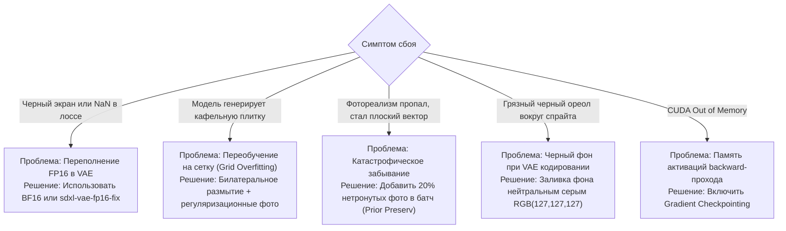

# Типичные ошибки, сбои обучения и диагностика проблем (Troubleshooting & Pitfalls)

## 1. Краткое описание
В этой статье систематизируются типичные инженерные и алгоритмические сбои, возникающие при обучении и инференсе моделей депикселизации. Разбираются феномены появления черных изображений (NaN/Inf в VAE FP16), переобучение на пиксельную сетку, потеря фотореализма (катастрофическое забывание) и утечка цвета на границах маски. Приводятся готовые диагностические скрипты и чек-лист проверки перед запуском обучения.

---

## 2. Каталог критических сбоев и решений



---

### Сбой 1: Появление черных изображений (NaN / Inf Overflow)
- **Симптом:** На середине инференса или обучения функция потерь внезапно становится равной `NaN`, а на выходе сохраняются сплошные черные прямоугольники.
- **Причина:** Декодер VAE в Stable Diffusion XL содержит сверточные слои с высокими весовыми коэффициентами. В точности `torch.float16` максимальное представимое число равно $65504$. При расчете дисперсии латентов происходит арифметическое переполнение (Overflow), порождающее значения `+inf` и `NaN`.
- **Решение:**
  1. Заменить оригинальный VAE на исправленный патч: `madebyollin/sdxl-vae-fp16-fix`.
  2. На NVIDIA GPU переключить обучение на `torch.bfloat16` (диапазон экспоненты как у FP32).
  3. На Apple Silicon MPS принудительно использовать `torch.float32`.

---

### Сбой 2: Переобучение на пиксельную сетку (Grid Overfitting)
- **Симптом:** Модель выучивает прямую зависимость «входной квадрат $\to$ выходной квадрат». В результате даже при свободной генерации по текстовому промпту всё лицо персонажа покрывается мелкой шахматной фактурой кубиков.
- **Причина:** Недостаточная аугментация входного пиксель-арта и слишком высокий ранг LoRA ($r > 128$), при котором адаптер механически заучивает пиксельные границы обучающего датасета.
- **Решение:**
  1. Внедрить в обучающий цикл динамическую билатеральную фильтрацию со случайным радиусом $\sigma \in [20, 90]$.
  2. Снизить ранг LoRA до $r=64$ или $r=32$.
  3. Добавить в датасет 15–20% чистых, не деградированных фотографий с пустым условием (Classifier-Free Guidance Training).

---

### Сбой 3: Катастрофическое забывание фотореализма (Catastrophic Forgetting)
- **Симптом:** Модель строго держит силуэт спрайта, но полностью разучилась генерировать объемный физический свет, кожу и металл, скатившись к генерации плоской мультяшной заливки (Cell-shading).
- **Причина:** Отсутствие регуляризации априорного знания (Prior Preservation).
- **Решение:**
  1. Использовать композитный лосс с перцептивной метрикой DISTS (см. [`02_Mathematical_Foundations/06_Loss_Functions_and_Perceptual_Metrics.md`](../02_Mathematical_Foundations/06_Loss_Functions_and_Perceptual_Metrics.md)).
  2. Обучать адаптер исключительно на остаточных матрицах LoRA, ни в коем случае не размораживая основной бэкбон U-Net.

---

## 3. Практическая реализация: Диагностический скрипт валидации здоровья весов

```python
"""nn_upscaler.training.sanity_checker: Diagnostic script checking for NaN, Inf, and gradient health."""

import torch


def inspect_model_gradients(model: torch.nn.Module) -> dict:
    """Проверка модели на взрыв градиентов (Exploding Gradients) и наличие NaN."""
    total_norm = 0.0
    has_nan = False
    has_inf = False

    for name, param in model.named_parameters():
        if param.grad is not None:
            # Проверка на NaN и Inf
            if torch.isnan(param.grad).any():
                print(f"[!] КРИТИЧЕСКАЯ ОШИБКА: Обнаружен NaN в градиентах слоя {name}")
                has_nan = True
            if torch.isinf(param.grad).any():
                print(f"[!] КРИТИЧЕСКАЯ ОШИБКА: Обнаружен Inf в градиентах слоя {name}")
                has_inf = True

            param_norm = param.grad.data.norm(2)
            total_norm += param_norm.item() ** 2

    total_norm = total_norm**0.5

    return {
        "global_grad_norm": float(total_norm),
        "is_healthy": not (has_nan or has_inf),
        "has_exploding_grads": total_norm > 10.0,
    }


def clip_and_sanitize_gradients(model: torch.nn.Module, max_norm: float = 1.0):
    """Обрезка градиентов (Gradient Clipping) для предотвращения взрыва оптимизации."""
    torch.nn.utils.clip_grad_norm_(model.parameters(), max_norm=max_norm)
```

---

## 4. Чек-лист перед запуском обучения (Pre-flight Training Checklist)

Перед постановкой эксперимента на ночь или запуском платного облачного GPU-инстанса:
- [ ] **Датасет очищен от битых файлов:** Проверена валидность открытия каждого изображения через Pillow.
- [ ] **Разрешение делится на 8:** Все целевые фото имеют стороны, кратные 8 ($1024\times 1024, 896\times 1152$), иначе декодер VAE упадёт с ошибкой размерности.
- [ ] **Проверен Gradient Checkpointing:** Флаг `unet.enable_gradient_checkpointing()` активирован.
- [ ] **Зафиксирован случайный seed:** Вызов `torch.manual_seed(42)` для воспроизводимости.
- [ ] **Запущен пробный шаг (Smoke Test):** Выполнен 1 шаг forward + backward прохода на тестовом батче без падения VRAM.

---

## 5. Связанные темы
- LoRA дообучение: [`06_Training_and_Fine_Tuning/01_PEFT_and_LoRA_for_Diffusion.md`](01_PEFT_and_LoRA_for_Diffusion.md)
- Управление памятью GPU: [`06_Training_and_Fine_Tuning/04_Hardware_and_VRAM_Management.md`](04_Hardware_and_VRAM_Management.md)
- Дорожная карта экспериментов: [`11_Project_Roadmap/02_Experiment_Roadmap_and_Decision_Gates.md`](../11_Project_Roadmap/02_Experiment_Roadmap_and_Decision_Gates.md)
