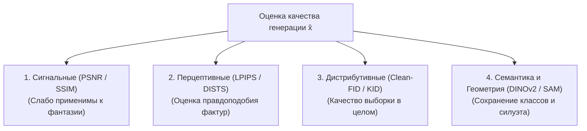

# Таксономия метрик и математические формулировки оценки качества

## 1. Краткое описание
В этой статье даётся строгая математическая формулировка метрик объективной оценки качества в задаче Pixel Art → Realism. Систематизируются четыре семейства метрик: попиксельные сигнальные (PSNR, SSIM), перцептивные (LPIPS, DISTS), дистрибутивные генеративные (FID, Clean-FID, KID) и семантико-геометрические (DINOv2 Cosine Similarity, SAM Mask IoU). Раскрываются фундаментальные ограничения классических метрик при оценке стохастической генерации.

---

## 2. Интуитивное объяснение: Кризис объективной оценки

В классическом программировании всё просто: тест либо прошёл (True), либо упал (False).  
В классическом сжатии данных тоже просто: чем выше PSNR, тем точнее восстановлены биты.

Но как оценить генерацию фотореалистичного человека из 16 пикселей?
- Единственного «правильного» ответа в природе не существует (бесконечное множество лиц подходит под этот спрайт).
- Если мы сравним сгенерированное лицо с фотографией актёра через **PSNR**, метрика покажет провал: реальная родинка на щеке не совпала на 2 миллиметра.
- Но если мы покажем результат человеку-эксперту, он скажет: *«Великолепно! Это живой человек, поза идеальна, взгляд осмысленный, материалы достоверны»*.

Поэтому оценка генеративных моделей опирается на **многоуровневую таксономию**, где каждая метрика отвечает за свой независимый аспект качества.

---

## 3. Математические формулировки четырёх семейств метрик



### 3.1. Сигнальные метрики (Signal-Level Metrics)

#### 1. Пиковое отношение сигнала к шуму (PSNR)
$$\operatorname{PSNR}(x, \hat{x}) = 10 \cdot \log_{10}\left( \frac{\operatorname{MAX}_I^2}{\operatorname{MSE}(x, \hat{x})} \right)$$
где $\operatorname{MSE} = \frac{1}{3HW}\sum \|x - \hat{x}\|^2$.  
*Ограничение:* Измеряет попиксельное совпадение матриц. Приводит к победе размытых, серых, лишенных текстур изображений (Mode Averaging).

#### 2. Индекс структурного сходства (SSIM / MS-SSIM)
Сравнивает локальные окна $x, y$ по трем компонентам: яркость ($l$), контраст ($c$) и структура ($s$):
$$\operatorname{SSIM}(x, y) = \frac{(2\mu_x\mu_y + C_1)(2\sigma_{xy} + C_2)}{(\mu_x^2 + \mu_y^2 + C_1)(\sigma_x^2 + \sigma_y^2 + C_2)}$$

---

### 3.2. Перцептивные метрики (Perceptual Metrics)

#### DISTS (Deep Image Structure and Texture Similarity)
Золотой стандарт генеративного супер-разрешения:
$$\operatorname{DISTS}(x, \hat{x}) = 1 - \sum_{l=0}^M \left( \alpha_l \frac{2\mu_l(x)\mu_l(\hat{x}) + c_1}{\mu_l^2(x) + \mu_l^2(\hat{x}) + c_1} + \beta_l \frac{2\sigma_l(x)\sigma_l(\hat{x}) + c_2}{\sigma_l^2(x) + \sigma_l^2(\hat{x}) + c_2} \right)$$
Метрика не штрафует модель за генерацию новых микротекстур, если соблюдены статистики распределений признаков VGG.

---

### 3.3. Дистрибутивные метрики (Distribution-Level Metrics)

#### Clean-FID (Parmar et al., CVPR 2022)
Классический FID вычисляет расстояние Вассерштейна-2 между многомерными гауссианами признаков слоя pool3 сети Inception-v3:
$$\operatorname{FID} = \|\mu_r - \mu_g\|_2^2 + \operatorname{Tr}\left( \Sigma_r + \Sigma_g - 2(\Sigma_r \Sigma_g)^{1/2} \right)$$
*Проблема стандартного FID:* Зависит от встроенного в PIL/OpenCV алгоритма ресайза до $299\times 299$, искажая результаты.  
**Clean-FID** использует стандартизированный сглаженный ресэмплинг без алиасинга, обеспечивая 100% строгую воспроизводимость научных сравнений.

---

### 3.4. Семантические и геометрические метрики (Semantic & Geometry)

#### 1. DINOv2 Dense Patch Cosine Similarity
Оценивает сохранение смысловых частей персонажа:
$$\operatorname{Sim}_{\text{DINO}}(x, \hat{x}) = \frac{1}{N} \sum_{i=1}^N \frac{\phi_i(x) \cdot \phi_i(\hat{x})}{\|\phi_i(x)\|_2 \|\phi_i(\hat{x})\|_2}$$

#### 2. SAM Mask IoU (Intersection over Union)
Оценивает строгое сохранение внешнего силуэта спрайта через маски Segment Anything:
$$\operatorname{IoU}(M_{\text{sprite}}, M_{\text{real}}) = \frac{|M_{\text{sprite}} \cap M_{\text{real}}|}{|M_{\text{sprite}} \cup M_{\text{real}}|}$$

---

## 4. Практическая реализация: Сквозной оценщик метрик на PyTorch

```python
"""nn_upscaler.evaluation.evaluator: Comprehensive evaluation suite for generative metrics."""

import torch
import torch.nn.functional as F
from PIL import Image
from torchvision import transforms
import lpips


class ComprehensiveMetricsEvaluator:
    """Вычисление полного набора метрик качества: PSNR, SSIM, LPIPS, DINOv2 Sim."""

    def __init__(self, device: str = "cuda"):
        self.device = torch.device(device)
        self.lpips_fn = lpips.LPIPS(net="vgg").to(self.device).eval()
        self.dinov2 = (
            torch.hub.load("facebookresearch/dinov2", "dinov2_vits14").to(self.device).eval()
        )

    def evaluate_pair(
        self, generated_pil: Image.Image, target_pil: Image.Image
    ) -> dict[str, float]:
        """Расчёт метрик для пары изображений."""
        t_gen = transforms.ToTensor()(generated_pil).unsqueeze(0).to(self.device)
        t_targ = transforms.ToTensor()(target_pil).unsqueeze(0).to(self.device)

        with torch.no_grad():
            # 1. PSNR
            mse = F.mse_loss(t_gen, t_targ).item()
            psnr = 10.0 * torch.log10(torch.tensor(1.0 / (mse + 1e-10))).item()

            # 2. LPIPS (приведение в диапазон [-1, 1])
            lp_gen = t_gen * 2.0 - 1.0
            lp_targ = t_targ * 2.0 - 1.0
            lpips_val = self.lpips_fn(lp_gen, lp_targ).item()

            # 3. DINOv2 Cosine Similarity
            d_gen = F.interpolate(t_gen, size=(224, 224), mode="bicubic", align_corners=False)
            d_targ = F.interpolate(t_targ, size=(224, 224), mode="bicubic", align_corners=False)
            emb_gen = self.dinov2(d_gen)
            emb_targ = self.dinov2(d_targ)
            cos_sim = F.cosine_similarity(emb_gen, emb_targ).item()

        return {
            "PSNR_dB": float(psnr),
            "LPIPS": float(lpips_val),
            "DINOv2_Cosine": float(cos_sim),
        }
```

---

## 5. Связанные темы
- Перцептивные функции потерь: [`02_Mathematical_Foundations/06_Loss_Functions_and_Perceptual_Metrics.md`](../02_Mathematical_Foundations/06_Loss_Functions_and_Perceptual_Metrics.md)
- 7-осевая система оценки: [`07_Evaluation_and_Benchmarks/02_Multi_Axis_Evaluation_Framework.md`](02_Multi_Axis_Evaluation_Framework.md)
- Человеческая оценка (2AFC): [`07_Evaluation_and_Benchmarks/03_Human_Evaluation_Protocol.md`](03_Human_Evaluation_Protocol.md)
