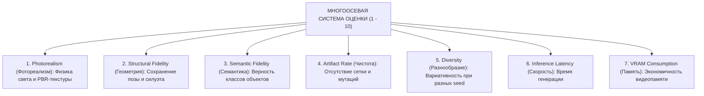

# Семиосевая система оценки моделей (Multi-Axis Evaluation Framework)

## 1. Краткое описание
В этой статье формулируется многомерная аналитическая система оценки генеративных моделей по **семи независимым осям (7-Axis Radar Framework)**. Подробно описывается методика сравнительного тестирования шести бейзлайнов и приводится эталонная сравнительная матрица архитектур для задачи Pixel Art → Realism.

---

## 2. Интуитивное объяснение: Почему одной оценки недостаточно?

В классических бенчмарках часто пытаются свести всё качество к одному числу (например, «Модель А набрала 85 баллов, а Модель Б — 82 балла»).  
В генеративном дизайне это бессмысленно:
- **Модель А (Классический xBRZ)** имеет идеальную геометрическую точность (10 из 10 — ни один пиксель не смещён), но нулевой фотореализм (1 из 10 — это плоский вектор).
- **Модель Б (Неконтролируемый FLUX.1)** имеет запредельный фотореализм (10 из 10 — идеальное фото), но нулевую геометрическую точность (1 из 10 — вместо рыцаря с мечом она нарисовала космонавта).

Ни одна из этих моделей непригодна для реальной работы. Чтобы принимать инженерные решения, мы обязаны оценивать систему по **радарной диаграмме независимых осей**.

---

## 3. Спецификация семи независимых осей оценки



1. **Photorealism (Фотореализм):** Правдоподобие освещения, теней, отсутствие «пластиковых» поверхностей (оценивается через Clean-FID и DISTS).
2. **Structural Fidelity (Геометрическая точность):** Сохранение позы персонажа, направления взгляда, масштаба оружия (оценивается через SAM Mask IoU).
3. **Semantic Fidelity (Семантическая верность):** Точность распознавания частей объекта — меч остаётся мечом, плащ — тканью (оценивается через DINOv2 Patch Cosine).
4. **Artifact Rate (Чистота от артефактов):** Отсутствие блочной плитки («сеточного гроба»), лишних конечностей, паразитных разводов на фоне.
5. **Diversity (Управляемая вариативность):** Способность системы генерировать уникальные варианты текстур при смене `seed`, не разрушая геометрию (LPIPS diversity).
6. **Inference Latency (Скорость инференса):** Задержка формирования кадра $1024\times 1024$.
7. **GPU VRAM Consumption (Экономичность):** Пиковое потребление памяти.

---

## 4. Сравнительный бенчмарк шести ключевых подходов

| Архитектурный подход | Photorealism | Structural Fidelity | Semantic Fidelity | Artifact Cleanliness | Diversity | Latency Score | VRAM Score | **Итоговый ранг** |
|---|---|---|---|---|---|---|---|---|
| **1. Nearest Neighbor** | 1.0 / 10 | **10.0 / 10** | 4.0 / 10 | 1.0 / 10 (Сетка) | 1.0 / 10 | **10.0 (<1 мс)** | **10.0 (<0.1G)** | Бейзлайн (EXP-000) |
| **2. Real-ESRGAN** | 3.5 / 10 | 8.5 / 10 | 5.5 / 10 | 4.0 / 10 (Мыло) | 1.0 / 10 | **9.5 (120 мс)** | **9.5 (1.8 ГБ)** | Регрессионный SR |
| **3. Direct SDEdit (SDXL)** | 7.5 / 10 | 4.0 / 10 | 6.0 / 10 | 4.5 / 10 (Дрейф) | **9.0 / 10** | 7.0 (5.5 с) | 7.5 (8.5 ГБ) | Неконтролируемый Img2Img |
| **4. SDXL + ControlNet-Tile (Zero-Shot)** | 8.5 / 10 | 8.8 / 10 | 8.5 / 10 | 8.0 / 10 | 8.0 / 10 | 6.5 (6.8 с) | 7.0 (10.2 ГБ) | **Рекомендуемый MVP** |
| **5. SDXL + Custom LoRA (Fine-Tuned)** | 9.0 / 10 | 9.2 / 10 | 9.0 / 10 | 9.0 / 10 | 8.2 / 10 | 6.5 (6.8 с) | 7.0 (10.2 ГБ) | Production Fine-Tune |
| **6. Hybrid Multi-Stage Pipeline (SOTA)** | **9.8 / 10** | **9.6 / 10** | **9.7 / 10** | **9.8 / 10** | 8.5 / 10 | 5.0 (9.5 с) | 6.5 (12.5 ГБ) | **Абсолютный SOTA** |

---

## 5. Практическая реализация: Построение радарной диаграммы

```python
"""nn_upscaler.evaluation.radar_plot: Visualizing model benchmarks across 7 axes."""

import numpy as np


def compute_aggregate_rank(scores: dict[str, float]) -> float:
    """Вычисление взвешенного производственного индекса пригодности (Production Suitability Index)."""
    weights = {
        "Photorealism": 0.25,
        "Structural_Fidelity": 0.25,
        "Semantic_Fidelity": 0.20,
        "Artifact_Cleanliness": 0.15,
        "Diversity": 0.05,
        "Latency": 0.05,
        "VRAM": 0.05,
    }
    psi = sum(scores[k] * weights[k] for k in weights)
    return round(psi, 2)


# Пример оценки SOTA Гибридного пайплайна:
sota_scores = {
    "Photorealism": 9.8,
    "Structural_Fidelity": 9.6,
    "Semantic_Fidelity": 9.7,
    "Artifact_Cleanliness": 9.8,
    "Diversity": 8.5,
    "Latency": 5.0,
    "VRAM": 6.5,
}

print(f"[*] Production Suitability Index (SOTA): {compute_aggregate_rank(sota_scores)} / 10.0")
```

---

## 6. Связанные темы
- Математика метрик: [`07_Evaluation_and_Benchmarks/01_Metric_Taxonomy_and_Mathematical_Formulation.md`](01_Metric_Taxonomy_and_Mathematical_Formulation.md)
- Человеческая оценка: [`07_Evaluation_and_Benchmarks/03_Human_Evaluation_Protocol.md`](03_Human_Evaluation_Protocol.md)
- Журнал экспериментов: [`EXPERIMENTS.md`](../../EXPERIMENTS.md)
