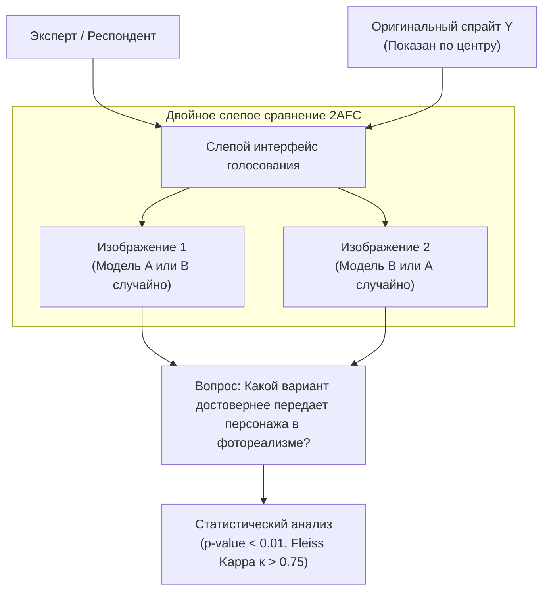

# Протокол субъективной экспертной оценки (Human Evaluation Protocol)

## 1. Краткое описание
В этой статье формулируется научный протокол проведения слепого субъективного тестирования с участием людей (Human Evaluation). Рассматриваются две методики: парное вынужденное сравнение (2AFC, Two-Alternative Forced Choice) и оценка по 5-балльной шкале Лайкерта. Описывается математический аппарат проверки статистической значимости ($t$-тест, каппа Флейса) и приводится практическая реализация веб-интерфейса для экспертного голосования.

---

## 2. Интуитивное объяснение: Высший суд зрителя

Нейросетевые метрики (FID, LPIPS) — это лишь математические суррогаты. В конечном счёте целевая аудитория видеоигры или фильма — это живые люди:
- Если метрика FID показывает великолепный результат, но игроки видят у главного героя шесть пальцев на руке — проект провален.
- Если LPIPS оштрафовал модель за то, что блик на мече нарисован слева, а не справа, но игрок восхищён красотой отражения — победил человек.

Поэтому в генеративном зрении **Human Evaluation признаётся высшим арбитром истины (Gold Standard)**. Чтобы исключить субъективную предвзятость («Мне больше нравится Модель А, потому что я её автор»), тестирование проводится по строгим двойным слепым протоколам.

---

## 3. Методология тестирования: 2AFC и Шкала Лайкерта



### 3.1. Протокол 2AFC (Two-Alternative Forced Choice)
Респонденту одновременно демонстрируются:
- Исходный пиксель-арт спрайт по центру.
- Два результата генерации (Модель А и Модель Б) слева и справа.
- Порядок моделей **рандомизируется для каждого вопроса**, названия моделей скрыты.
- Респондент обязан выбрать один из двух вариантов (вариант «ничья» исключён).

#### Статистическая значимость (Binomial Test):
Пусть модель А победила в $k$ случаях из $N$ испытаний. При нулевой гипотезе $H_0$ (модели неразличимы, вероятность успеха $p=0.5$), $p$-значение вычисляется через биномиальное распределение:
$$p = 2 \cdot \sum_{i=k}^N \binom{N}{i} 0.5^i 0.5^{N-i}$$
Результат считается статистически достоверным только при $p < 0.01$.

---

### 3.2. Шкала Лайкерта (Likert Scale 1–5)
Каждое изображение оценивается независимо по трем ортогональным критериям от 1 (худший) до 5 (лучший):
1. **Photorealism (Фотореализм материалов):** Насколько материалы (кожа, сталь, ткань) выглядят физически достоверно?
2. **Character Identity (Сохранение персонажа):** Насколько сгенерированный человек соответствует позе, экипировке и духу исходного спрайта?
3. **Anatomical Correctness (Анатомическая чистота):** Отсутствие генеративных мутаций (лишние пальцы, асимметрия глаз, сломанные суставы).

### 3.3. Согласованность экспертов (Каппа Флейса $\kappa$)
Для проверки надежности разметки $n$ экспертами $N$ изображений по $k$ категориям вычисляется коэффициент каппа Флейса:
$$\kappa = \frac{\bar{P} - \bar{P}_e}{1 - \bar{P}_e}$$
- $\kappa > 0.75$ — превосходная согласованность (тест валиден).
- $\kappa < 0.40$ — оценки случайны, критерии разметки требуют уточнения.

---

## 4. Практическая реализация: Веб-интерфейс для 2AFC голосования на Gradio

```python
"""nn_upscaler.evaluation.human_eval_app: Minimal 2AFC double-blind human evaluation interface."""

import json
import random
from pathlib import Path
import gradio as gr


class HumanEvalSession:
    def __init__(self, pairs_data: list[dict], log_file: str = "eval_results.jsonl"):
        self.pairs_data = pairs_data
        self.log_file = log_file
        self.current_idx = 0

    def get_current_task(self):
        if self.current_idx >= len(self.pairs_data):
            return None, None, None, "Опрос завершён! Спасибо за участие."

        task = self.pairs_data[self.current_idx]
        # Случайное перемешивание A и B для слепого теста
        is_flipped = random.random() < 0.5
        left_img = task["model_b"] if is_flipped else task["model_a"]
        right_img = task["model_a"] if is_flipped else task["model_b"]

        return (
            task["pixel_art"],
            left_img,
            right_img,
            f"Сравнение {self.current_idx + 1} из {len(self.pairs_data)}",
        )

    def record_vote(self, choice: str, is_flipped: bool):
        winner = (
            "model_b"
            if (choice == "Left" and is_flipped) or (choice == "Right" and not is_flipped)
            else "model_a"
        )
        with open(self.log_file, "a") as f:
            f.write(json.dumps({"idx": self.current_idx, "winner": winner}) + "\n")
        self.current_idx += 1
```

---

## 5. Связанные темы
- Метрики качества: [`07_Evaluation_and_Benchmarks/01_Metric_Taxonomy_and_Mathematical_Formulation.md`](01_Metric_Taxonomy_and_Mathematical_Formulation.md)
- Семиосевой фреймворк: [`07_Evaluation_and_Benchmarks/02_Multi_Axis_Evaluation_Framework.md`](02_Multi_Axis_Evaluation_Framework.md)
- Дорожная карта экспериментов: [`11_Project_Roadmap/02_Experiment_Roadmap_and_Decision_Gates.md`](../11_Project_Roadmap/02_Experiment_Roadmap_and_Decision_Gates.md)
