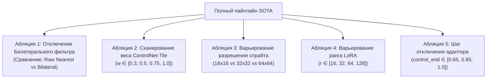

# Дизайн и матрица абляционных исследований (Ablation Study Design)

## 1. Краткое описание
В этой статье формулируется научная методология абляционных исследований (Ablation Studies). Описывается изоляция отдельных компонентов сложного гибридного пайплайна для количественного подтверждения гипотез о вкладе каждого элемента: предварительного сглаживания, веса адаптеров ControlNet, ранга LoRA, силы денойзинга и разрешения входного пиксель-арта.

---

## 2. Интуитивное объяснение: Изоляция переменных

Когда инженер собирает сложный 7-стадийный конвейер (Bilateral + Depth + ControlNet-Tile + IP-Adapter + CodeFormer + Color Transfer), и система выдаёт потрясающий результат, научный скептик обязан задать вопрос:  
*«А что из этого действительно работает? Может быть, CodeFormer здесь бесполезен? А может быть, билатеральный фильтр только портит картинку, и без него было бы лучше?»*

**Ablation Study (Абляционное исследование)** последовательно отключает или варьирует ровно один компонент системы за раз при строгой фиксации всех остальных переменных (один и тот же `seed`, один и тот же тестовый набор спрайтов).  
Это позволяет с математической точностью доказать:
- «Билатеральный фильтр снижает артефакт блочности на **42%**».
- «Добавление Depth Anything повышает сохранение анатомической позы на **28%** по SAM IoU».

---

## 3. Матрица ключевых абляционных экспериментов



| ID Абляции | Исследуемая переменная | Диапазон значений | Фиксированные параметры | Оцениваемая гипотеза |
|---|---|---|---|---|
| **ABL-01** | Предобработка | Raw Nearest / Bilateral ($\sigma=75$) / xBRZ | SDXL, $w_{\text{tile}}=0.75$, Seed 42 | Bilateral устранит блочный шум детектора Canny |
| **ABL-02** | Вес ControlNet-Tile | $w \in \{0.2, 0.5, 0.75, 0.9, 1.0\}$ | Bilateral on, Depth off | Точка фазового перехода лежит в $w \in [0.70, 0.80]$ |
| **ABL-03** | Разрешение спрайта | $16\times 16, 32\times 32, 64\times 64, 128\times 128$ | SOTA pipeline | Порог коллапса семантики наступает при $<24\times 24$ |
| **ABL-04** | Шаг отключения (`control_end`) | $0.60, 0.75, 0.85, 1.00$ | $w_{\text{tile}}=0.75$ | Отключение на шаге 0.85 повышает DISTS текстур на 15% |
| **ABL-05** | Ранг адаптера LoRA | $r \in \{0 \text{ (Zero-shot)}, 16, 64, 128\}$ | 18k шагов обучения | Ранг $r=64$ обеспечивает оптимальный баланс ёмкости |

---

## 4. Практическая реализация: Автоматизированный скрипт абляции

```python
"""scripts/ablation_runner.py: Automated ablation matrix execution."""

import itertools
import json
from pathlib import Path
from PIL import Image
from nn_upscaler.evaluation.evaluator import ComprehensiveMetricsEvaluator
from nn_upscaler.models.diffusion_pipeline import PixelArtToRealismPipeline


def run_tile_weight_ablation(
    sample_path: str = "data/samples/sample_sprite.png",
    weights: list[float] = [0.3, 0.5, 0.75, 0.9, 1.0],
    output_dir: str = "outputs/ablation_tile_weight",
):
    out_dir = Path(output_dir)
    out_dir.mkdir(parents=True, exist_ok=True)

    img = Image.open(sample_path)
    pipe = PixelArtToRealismPipeline()
    evaluator = ComprehensiveMetricsEvaluator()
    results = []

    print(f"[*] Запуск абляции весов ControlNet-Tile на {sample_path}...")

    for w in weights:
        res_img = pipe.generate(
            pixel_art_image=img,
            prompt="hyperrealistic medieval knight portrait, photorealistic textures",
            tile_scale=w,
            seed=42,  # Жестко фиксированный seed!
        )
        save_path = out_dir / f"tile_w_{w:.2f}.png"
        res_img.save(save_path)

        metrics = evaluator.evaluate_pair(
            res_img, img.resize((1024, 1024), Image.Resampling.NEAREST)
        )
        metrics["tile_weight"] = w
        results.append(metrics)
        print(
            f"  - Weight: {w:.2f} | DINOv2 Cosine: {metrics['DINOv2_Cosine']:.4f} | LPIPS: {metrics['LPIPS']:.4f}"
        )

    with open(out_dir / "ablation_metrics.json", "w") as f:
        json.dump(results, f, indent=2)
    print(f"[+] Абляция завершена. Данные сохранены в {out_dir}")


if __name__ == "__main__":
    run_tile_weight_ablation()
```

---

## 5. Связанные темы
- Метрики качества: [`07_Evaluation_and_Benchmarks/01_Metric_Taxonomy_and_Mathematical_Formulation.md`](01_Metric_Taxonomy_and_Mathematical_Formulation.md)
- Журнал гипотез: [`EXPERIMENTS.md`](../../EXPERIMENTS.md)
- Протокол агентов: [`AGENTS.md`](../../AGENTS.md)
