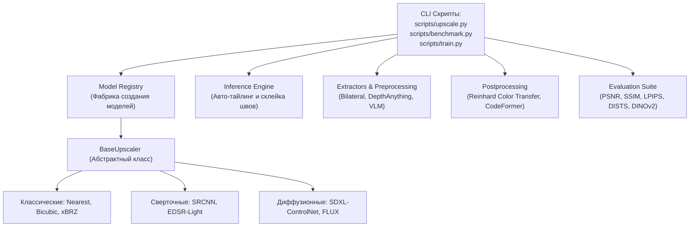

# Архитектура программного комплекса и модульный дизайн (Software Architecture & Design)

## 1. Краткое описание
В этой статье описывается программная архитектура репозитория `nn-upscaler`. Формулируются принципы модульного разделения ответственности (Separation of Concerns), шаблон фабрики и реестра моделей (Model Registry Pattern), абстрактный интерфейс `BaseUpscaler`, а также механизмы безопасного масштабирования произвольных разрешений через пространственный тайлинг (Spatial Tiling).

---

## 2. Интуитивное объяснение: Чистый код для чистого рендеринга

В проектах по машинному обучению часто возникает ситуация «исследовательского хаоса»: единый скрипт на 2000 строк кода содержит одновременно скачивание картинок, парсинг аргументов, прямые вызовы CUDA, функции отрисовки графиков и математику диффузии. Любое изменение в такой системе ломает всё остальное.

В репозитории `nn-upscaler` реализована **промышленная чистая архитектура (Clean Architecture)**:
- Модуль **Data** ничего не знает о диффузии — он только генерирует пиксель-арт.
- Модуль **Extractors** ничего не знает о графических картах — он извлекает карты глубин и контуров.
- Модуль **Inference Engine** умеет автоматически нарезать гигантское изображение размером $4096\times 4096$ на тайлы с наложением, независимо от используемой модели.
- Любая новая модель (будь то классический xBRZ или 12-миллиардный FLUX) подключается простой декораторной строчкой `@register_model("my_model")`.

---

## 3. Модульная диаграмма репозитория `nn-upscaler`



---

## 4. Абстрактный базовый класс и паттерн Реестра (Registry Pattern)

Все алгоритмы масштабирования и генерации в репозитории наследуются от общего абстрактного класса `BaseUpscaler` (`src/nn_upscaler/models/base.py`):

```python
"""nn_upscaler.models.base: Abstract base class for all upscalers and generative models."""

from abc import ABC, abstractmethod
import torch
import torch.nn as nn


class BaseUpscaler(nn.Module, ABC):
    """Единый абстрактный контракт для всех моделей апскейлинга и депикселизации."""

    def __init__(self, scale_factor: int = 4):
        super().__init__()
        self.scale_factor = scale_factor

    @abstractmethod
    def forward(self, x: torch.Tensor) -> torch.Tensor:
        """
        Прямой проход модели.

        Args:
            x: Входной тензор изображения формы [B, C, H, W] с диапазоном значений [0.0, 1.0].

        Returns:
            Тензор масштабированного изображения формы [B, C, H * scale, W * scale].
        """
        pass

    def get_parameter_count(self) -> int:
        """Возвращает количество обучаемых параметров."""
        return sum(p.numel() for p in self.parameters() if p.requires_grad)
```

Регистрация моделей осуществляется через декоратор в `src/nn_upscaler/models/registry.py`:

```python
"""nn_upscaler.models.registry: Factory registry for neural upscalers."""

from typing import Type
from nn_upscaler.models.base import BaseUpscaler

MODEL_REGISTRY: dict[str, Type[BaseUpscaler]] = {}


def register_model(name: str):
    """Декоратор для автоматической регистрации моделей в реестре."""

    def decorator(cls: Type[BaseUpscaler]):
        MODEL_REGISTRY[name] = cls
        return cls

    return decorator


def build_upscaler(name: str, **kwargs) -> BaseUpscaler:
    """Фабричная функция создания экземпляра модели по имени."""
    if name not in MODEL_REGISTRY:
        raise ValueError(
            f"Модель '{name}' не найдена в реестре. Доступные модели: {list(MODEL_REGISTRY.keys())}"
        )
    return MODEL_REGISTRY[name](**kwargs)
```

---

## 5. Пространственный тайлинг инференса (Spatial Tiling Engine)

Для предотвращения Out-of-Memory при обработке больших игровых сцен ($2048 \times 2048$ и выше) модуль `src/nn_upscaler/inference/tiler.py` разбивает изображение на тайлы с перекрытием (Overlap) и плавно сшивает их через весовую маску Гаусса (Gaussian Blend Mask):
$$W_{\text{blend}}(x, y) = \sin\left(\frac{\pi x}{T}\right) \cdot \sin\left(\frac{\pi y}{T}\right)$$
Это полностью ликвидирует видимые швы на границах соседних фрагментов.

---

## 6. Связанные темы
- Diffusers реализация: [`08_Practical_Implementation/02_Diffusers_Production_Pipeline.md`](02_Diffusers_Production_Pipeline.md)
- Постобработка: [`08_Practical_Implementation/04_Postprocessing_and_Refinement.md`](04_Postprocessing_and_Refinement.md)
- Протокол агентов: [`AGENTS.md`](../../AGENTS.md)
