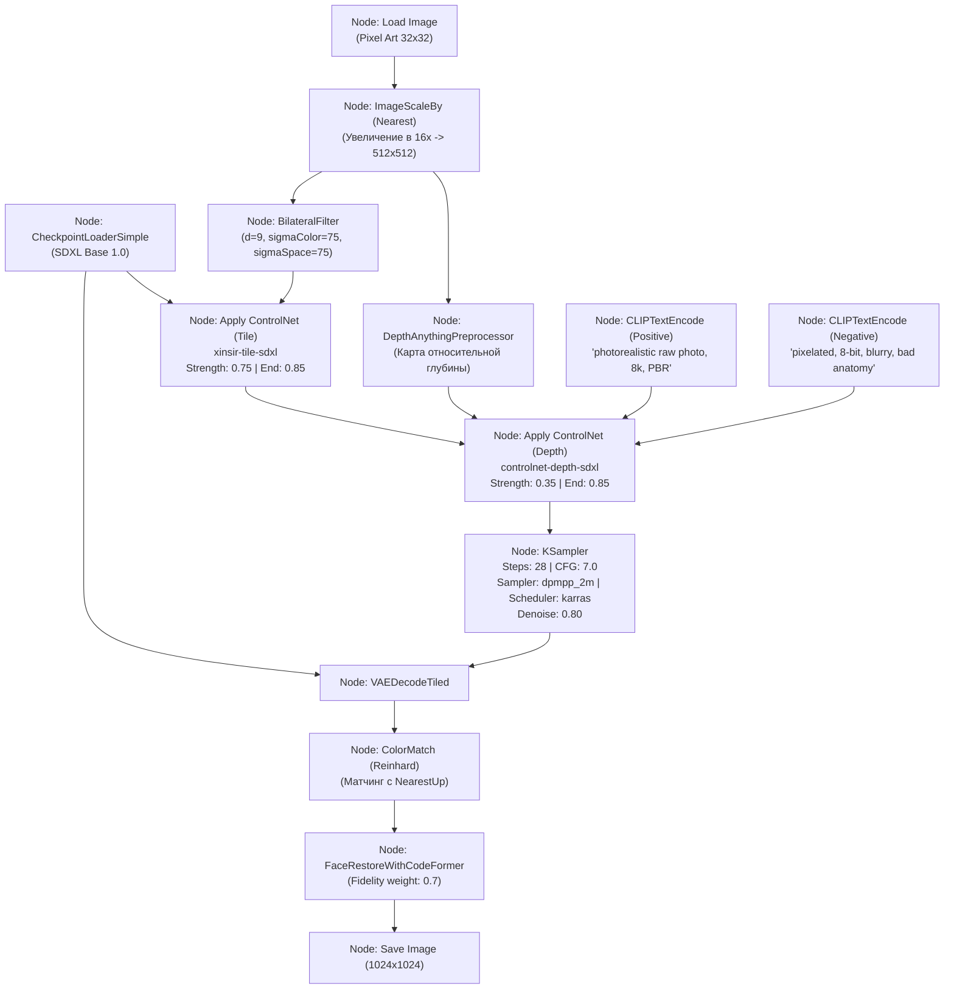

# Руководство по нодовому прототипированию в ComfyUI (ComfyUI Workflow Guide)

## 1. Краткое описание
В этой статье описывается построение визуального интерактивного графа в среде ComfyUI для быстрого прототипирования и отладки пайплайнов Pixel Art → Realism. Приводится полная спецификация нодового графа, объединяющего препроцессинг, двухканальный ControlNet (Tile + Depth), KSampler с калибровкой планировщика Karras, ноды цветового матчинга и реставрации лиц CodeFormer, а также описывается программный запуск воркфлоу через ComfyUI API.

---

## 2. Интуитивное объяснение: Лаборатория ручек и проводов

Написание кода на чистом PyTorch — это идеальный путь для продакшна, но медленный путь для визуального исследования: чтобы покрутить вес адаптера с 0.70 на 0.75, вам нужно перезапускать скрипт, ждать компиляции графа и проверять сохраненный PNG.

**ComfyUI** представляет собой интерактивную визуальную лабораторию:
- Вы видите весь конвейер как блок-схему из соединённых проводов (нод).
- Вы можете в реальном времени визуализировать промежуточный выход каждого этапа: как именно билатеральный фильтр сгладил контур, какую карту глубины построил Depth Anything и что именно выдал ControlNet.
- Найдя идеальные параметры в визуальном интерфейсе, вы можете экспортировать нодовый граф в формат JSON и вызывать его программно из Python!

---

## 3. Архитектура визуального нодового графа



---

## 4. Спецификация ключевых нод и гиперпараметров

1. **`BilateralFilter` (Кастомная нода ComfyUI-PostProcessing):**
   - Устраняет пиксельные ступеньки, сохраняя перепады цветов между объектом и фоном. Параметры: `radius = 9`, `sigma_color = 75`, `sigma_space = 75`.
2. **`Apply ControlNet (Tile)`:**
   - Модель: `xinsir/controlnet-tile-sdxl-1.0`.
   - `strength`: **$0.72 – 0.78$**.
   - `start_percent`: $0.0$.
   - `end_percent`: **$0.85$** (критично для появления микропор кожи).
3. **`Apply ControlNet (Depth)`:**
   - Модель: `diffusers/controlnet-depth-sdxl-1.0`.
   - `strength`: **$0.30 – 0.35$**.
4. **`KSampler`:**
   - `steps`: 28 шагов.
   - `sampler_name`: `dpmpp_2m`.
   - `scheduler`: `karras` (плавное затухание шума).
   - `denoise`: $0.80$ (если на вход подается апскейленный латент).
5. **`ColorMatch`:**
   - Метод: `reinhard`. Возвращает оригинальную контрастность и баланс белого.

---

## 5. Программная интеграция: ComfyUI Headless Execution через WebSocket API

Вы можете использовать настроенный воркфлоу ComfyUI как бэкенд для своего игрового пайплайна:

```python
"""nn_upscaler.inference.comfyui_client: Headless execution of exported ComfyUI workflows via API."""

import json
import urllib.request
import urllib.parse


def queue_comfyui_prompt(prompt_workflow_dict: dict, server_address: str = "127.0.0.1:8188") -> str:
    """Отправка графа нод в очередь инференса локального сервера ComfyUI."""
    p = {"prompt": prompt_workflow_dict}
    data = json.dumps(p).encode("utf-8")
    req = urllib.request.Request(f"http://{server_address}/prompt", data=data)
    with urllib.request.urlopen(req) as response:
        resp_json = json.loads(response.read().decode("utf-8"))
        prompt_id = resp_json["prompt_id"]
        print(f"[+] Задача успешно поставлена в очередь ComfyUI с ID: {prompt_id}")
        return prompt_id
```

---

## 6. Связанные темы
- Diffusers реализация: [`08_Practical_Implementation/02_Diffusers_Production_Pipeline.md`](02_Diffusers_Production_Pipeline.md)
- Постобработка и CodeFormer: [`08_Practical_Implementation/04_Postprocessing_and_Refinement.md`](04_Postprocessing_and_Refinement.md)
- Стратегии уровней ограничений: [`04_Structure_Preservation/05_Constraint_Level_Strategies.md`](../04_Structure_Preservation/05_Constraint_Level_Strategies.md)
