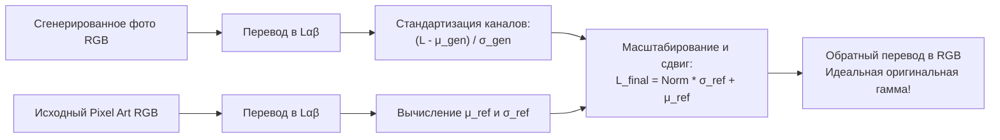

# Постобработка, реставрация лиц и согласование палитры (Postprocessing & Refinement)

## 1. Краткое описание
В этой статье рассматриваются методы финальной полировки сгенерированных изображений: статистический и гистограммный перенос цветов (Reinhard и Wasserstein Color Transfer), локальная реставрация лиц с помощью кодовых книг VQ-GAN (CodeFormer), бесшовное вклеивание через уравнение Пуассона и устранение краевых гало-артефактов на альфа-канале (Defringing).

---

## 2. Интуитивное объяснение: Завершающая полировка

Диффузионная модель выполняет 90% тяжёлой генеративной работы, но часто оставляет мелкие шероховатости:
1. **Цветовой сдвиг (Color Drift):** Диффузия обучена на фотографиях и любит приглушать цвета, превращая ярко-синий плащ персонажа в блекло-серый.
2. **Асимметрия мелких лиц:** Если всё изображение занимает $1024\times 1024$, а лицо персонажа — всего $64\times 64$, диффузия может нарисовать один глаз чуть выше другого.
3. **Грязная граница силуэта:** На стыке между прозрачным фоном и плечом персонажа могут остаться серые разводы.

Блок **Постобработки (Postprocessing)** устраняет эти недочеты за миллисекунды: возвращает оригинальные сочные цвета спрайта, полирует глаза и улыбку персонажа до кинематографичного идеала и начисто вырезает силуэт.

---

## 3. Математика цветового переноса Рейнхарда (Reinhard Color Transfer)

Цветовое пространство RGB сильно скоррелировано: изменение красного канала влияет на общую яркость.  
Алгоритм Рейнхарда (Reinhard et al., 2001) переводит изображения в **декоррелированное цветовое пространство $L\alpha\beta$**:
- Канал $L$ — яркость (Luminance).
- Канал $\alpha$ — хроматическая ось «зелёный–красный».
- Канал $\beta$ — хроматическая ось «синий–жёлтый».



Математическая формула нормализации для каждого канала $c \in \{L, \alpha, \beta\}$:
$$I_{\text{matched}}^c(x, y) = \frac{I_{\text{gen}}^c(x, y) - \mu_{\text{gen}}^c}{\sigma_{\text{gen}}^c} \cdot \sigma_{\text{ref}}^c + \mu_{\text{ref}}^c$$

---

## 4. Реставрация лиц: CodeFormer (Zhou et al., NeurIPS 2022)

CodeFormer решает задачу восстановления лиц через поиск в дискретном кодовом словаре (Discrete Codebook Lookup):
1. **Предварительно обученный VQ-GAN:** Хранит в кодовой книге $\mathcal{Z} = \{\mathbf{z}_k\}_{k=1}^{1024}$ идеальные, высококачественные представления человеческих глаз, бровей, губ и носов.
2. **Трансформер соответствия (Lookup Transformer):** Анализирует поврежденное или пикселизированное лицо и подбирает наиболее правдоподобный дискретный код из словаря.
3. **Параметр контроля fidelity $\alpha$:** Позволяет плавно балансировать между максимальным сходством с оригиналом ($\alpha=1.0$) и максимальным фотореализмом ($\alpha=0.0$). Оптимальное значение для пиксель-арта: $\alpha = 0.65 – 0.75$.

---

## 5. Практическая реализация: Модуль постобработки в PyTorch и OpenCV

```python
"""nn_upscaler.postprocessing.refinement: Comprehensive postprocessing pipeline."""

import cv2
import numpy as np
from PIL import Image


class PostprocessingRefiner:
    """Модуль финальной полировки: цветовой трансфер и дефринджинг альфа-канала."""

    @staticmethod
    def reinhard_color_transfer(
        target_img: Image.Image, source_reference: Image.Image
    ) -> Image.Image:
        """Перенос оригинальной цветовой гаммы со спрайта на реалистичное изображение."""
        tgt = np.array(target_img.convert("RGB")).astype(np.float32)
        src = np.array(source_reference.convert("RGB")).astype(np.float32)

        tgt_lab = cv2.cvtColor(tgt / 255.0, cv2.COLOR_RGB2LAB)
        src_lab = cv2.cvtColor(src / 255.0, cv2.COLOR_RGB2LAB)

        res_lab = np.zeros_like(tgt_lab)
        for i in range(3):
            t_mean, t_std = tgt_lab[:, :, i].mean(), tgt_lab[:, :, i].std() + 1e-6
            s_mean, s_std = src_lab[:, :, i].mean(), src_lab[:, :, i].std() + 1e-6

            # Нормализация и перенос статистик
            res_lab[:, :, i] = ((tgt_lab[:, :, i] - t_mean) / t_std) * s_std + s_mean

        res_rgb = cv2.cvtColor(res_lab, cv2.COLOR_LAB2RGB)
        res_rgb = np.clip(res_rgb * 255.0, 0, 255).astype(np.uint8)
        return Image.fromarray(res_rgb)

    @staticmethod
    def clean_alpha_edges(rgba_image: Image.Image, threshold: int = 20) -> Image.Image:
        """Устранение краевых артефактов и каймы на прозрачном фоне."""
        arr = np.array(rgba_image)
        if arr.shape[2] != 4:
            return rgba_image

        rgb = arr[:, :, :3]
        alpha = arr[:, :, 3]

        # 1. Жесткая отсечка фонового шума
        clean_alpha = np.where(alpha < threshold, 0, alpha)

        # 2. Мягкое сглаживание границы маски (Feathering)
        clean_alpha = cv2.GaussianBlur(clean_alpha, (3, 3), 0.8)

        # 3. Дефринджинг (устранение затемнения на границе полупрозрачности)
        fg_mask = clean_alpha > 0
        mean_color = rgb[fg_mask].mean(axis=0) if fg_mask.any() else np.array([127, 127, 127])

        # Принудительная замена полностью прозрачных пикселей на нейтральный тон
        rgb[clean_alpha == 0] = mean_color

        return Image.fromarray(np.dstack((rgb, clean_alpha)), mode="RGBA")
```

---

## 6. Связанные темы
- Гибридный пайплайн: [`03_Architectures/07_Hybrid_Multi_Stage_Pipeline.md`](../03_Architectures/07_Hybrid_Multi_Stage_Pipeline.md)
- Маскирование прозрачности: [`04_Structure_Preservation/03_Regional_Prompting_and_Masking.md`](../04_Structure_Preservation/03_Regional_Prompting_and_Masking.md)
- Библиография (CodeFormer): [`REFERENCES.md`](../REFERENCES.md)
