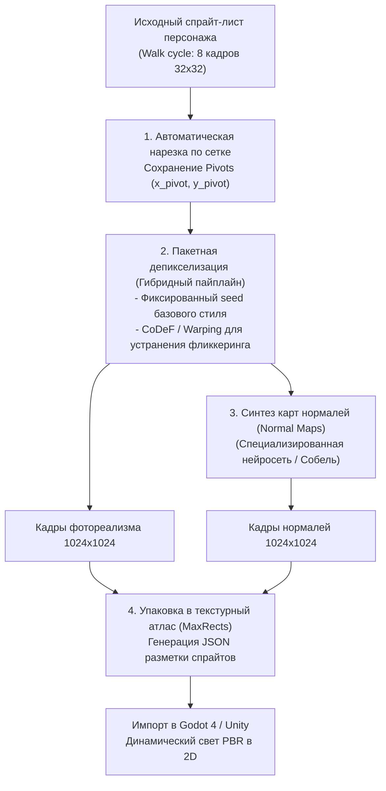

# Пакетная оффлайн-конверсия игровых ассетов (Offline Asset Conversion)

## 1. Краткое описание
В этой статье рассматривается производственный пайплайн оффлайн-конверсии двухмерных игровых ассетов (спрайт-листов, анимационных клипов, тайлсетов) в фотореалистичные ассеты высокой четкости с генерацией PBR-карт нормалей. Анализируются методы сохранения координат опорных точек (Pivots) и коллизий (Hitboxes), а также алгоритмы плотной упаковки в текстурные атласы (MaxRects Atlas Packing).

---

## 2. Интуитивное объяснение: Ремастер культовой игры за пару дней

Существует два принципиальных подхода к использованию ИИ в играх:
1. **Генерация на лету (Real-Time In-Game):** Пытаться запустить нейросеть прямо во время игры на компьютере игрока. Требует видеокарту за \$2000, потребляет гигаватты энергии и чревато мерцанием текстур.
2. **Оффлайн-пререндеринг (Offline Batch Processing):** Прогнать все спрайты игры через гибридный пайплайн один раз во время разработки. В саму игру упаковываются уже готовые текстуры ультра-высокой четкости и карты нормалей.

Второй подход позволяет **уже сегодня выпустить полноценный HD/4K-ремастер ретро-игры**, который будет идеально летать в 120 FPS даже на мобильных телефонах и Nintendo Switch!

---

## 3. Архитектура пакетного конвейера обработки спрайт-листов



---

## 4. Сохранение физических коллизий (Hitboxes) и опорных точек (Pivots)

При увеличении разрешения спрайта в $32\times$ раз (с $32\times 32$ до $1024\times 1024$) критически важно синхронно отмасштабировать метаданные игрового движка:
1. **Опорная точка (Pivot / Anchor Point):** Точка, относительно которой движок позиционирует персонажа в мире (обычно центр между стопами на земле):
   $$\mathbf{P}_{\text{new}} = \mathbf{P}_{\text{old}} \cdot s$$
   где $s = 32$ — фактор увеличения. Если диффузия сместит стопы относительно пивота, персонаж в игре провалится сквозь платформу.
2. **Фиксация центра масс:** Модуль постобработки вычисляет центр масс альфа-маски и принудительно центрирует сгенерированного персонажа на исходный пивот.

---

## 5. Практическая реализация: Скрипт пакетной нарезки и сборки атласа

```python
"""nn_upscaler.games.spritesheet_processor: Batch slicing and atlas packing for game spritesheets."""

from pathlib import Path
import numpy as np
from PIL import Image


class SpriteSheetProcessor:
    """Пакетный обработчик спрайт-листов с сохранением сетки анимации."""

    def __init__(self, frame_width: int = 32, frame_height: int = 32):
        self.frame_width = frame_width
        self.frame_height = frame_height

    def slice_sheet(self, sheet_image: Image.Image) -> list[Image.Image]:
        """Нарезка листа на отдельные кадры."""
        w, h = sheet_image.size
        cols = w // self.frame_width
        rows = h // self.frame_height
        frames = []

        for r in range(rows):
            for c in range(cols):
                box = (
                    c * self.frame_width,
                    r * self.frame_height,
                    (c + 1) * self.frame_width,
                    (r + 1) * self.frame_height,
                )
                frames.append(sheet_image.crop(box))

        print(f"[+] Спрайт-лист нарезан на {len(frames)} кадров ({cols}x{rows}).")
        return frames

    def pack_atlas(self, high_res_frames: list[Image.Image], cols: int = 4) -> Image.Image:
        """Сборка масштабированных кадров обратно в текстурный атлас высокой четкости."""
        if not high_res_frames:
            raise ValueError("Список кадров пуст!")

        fw, fh = high_res_frames[0].size
        rows = (len(high_res_frames) + cols - 1) // cols
        atlas = Image.new("RGBA", (cols * fw, rows * fh), (0, 0, 0, 0))

        for idx, frame in enumerate(high_res_frames):
            c = idx % cols
            r = idx // cols
            atlas.paste(frame, (c * fw, r * fh))

        print(f"[+] Атлас собран: итоговое разрешение {cols * fw}x{rows * fh}")
        return atlas
```

---

## 6. Связанные темы
- Временная стабильность анимации: [`09_Real_Time_and_Games/02_Temporal_Consistency_and_Deflickering.md`](02_Temporal_Consistency_and_Deflickering.md)
- Интеграция в Godot и Unity: [`09_Real_Time_and_Games/04_Game_Engine_Integration_Godot_Unity.md`](04_Game_Engine_Integration_Godot_Unity.md)
- Библиография (Moreira et al. по картам нормалей): [`REFERENCES.md`](../REFERENCES.md)
