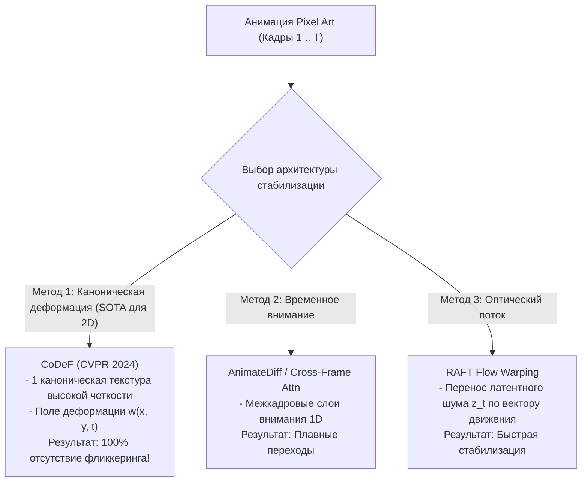

# Временная согласованность и подавление мерцания видео (Temporal Consistency & Deflickering)

## 1. Краткое описание
В этой статье исследуется критическая проблема генеративного видео: временная рассогласованность соседних кадров, перцептивное мерцание (Temporal Flickering) и «кипение» текстур (Texture Crawling). Рассматриваются три передовых метода стабилизации: канонические поля деформаций (CoDeF), временное межкадровое внимание (Cross-Frame Attention / AnimateDiff) и регуляризация деформации оптического потока (RAFT Flow Warping).

---

## 2. Интуитивное объяснение: Синдром кипящей ткани

Представьте, что вы отдали 8 кадров анимации ходьбы персонажа восьми разным художникам, изолированным в отдельных комнатах:
- Первый художник нарисовал на куртке героя медные пуговицы.
- Второй — серебряные молнии.
- Третий нарисовал заплату на локте, а четвёртый забыл её нарисовать.

Когда вы запустите эти 8 кадров со скоростью 12 кадров в секунду, зритель увидит кошмар: одежда персонажа будет бешено пульсировать, пуговицы — мерцать и менять форму, а лицо — мутировать на каждом шаге. Это называется **стробоскопическим фликкерингом (Flickering)**.

В диффузионных моделях причиной мерцания является независимый случайный шум, с которого начинается генерация каждого кадра. Чтобы анимация стала плавной, модель обязана помнить и связывать историю генерации всех предыдущих кадров.

---

## 3. Методологии стабилизации видеопоследовательностей



---

### 3.1. Метод CoDeF: Канонические поля деформации (Ouyang et al., CVPR 2024)
Идеальное решение для 2D-спрайтов и анимаций:
1. Видеопоследовательность кадров спрайта разворачивается в **единую плоскую статическую каноническую текстуру (Canonical Image $I_{\text{canon}}$)**, содержащую все видимые части персонажа (лицо с разных сторон, элементы одежды).
2. Обучается компактная координатная нейросеть (MLP), предсказывающая поле 2D-деформации $W_t(x, y)$, которое проецирует пиксели канонической текстуры в координаты кадра $t$.
3. **Генерация фотореализма запускается ровно ОДИН РАЗ к статическому каноническому изображению $I_{\text{canon}}$!**
4. Полученная фотореалистичная текстура высокого разрешения затем покадрово деформируется выученным векторным полем $W_t$.  
*Результат:* **Математическая гарантия 100% отсутствия мерцания**, так как текстура одна и та же на всех кадрах.

---

### 3.2. Перенос латентного шума по полю оптического потока (Flow-Guided Noise Warping)
Если полный CoDeF недоступен, применяется последовательный перенос начального латентного шума.  
Пусть $F_{t \to t-1}$ — векторное поле оптического потока между кадрами (вычисленное сетью RAFT):
$$\epsilon_t = \gamma \cdot \operatorname{Warp}(\epsilon_{t-1}, F_{t \to t-1}) + \sqrt{1 - \gamma^2} \cdot \eta_t$$
где $\gamma \approx 0.85$, а $\eta_t \sim \mathcal{N}(0, \mathbf{I})$ — малая независимая добавка.  
Шум движется синхронно с движением конечностей спрайта, заставляя U-Net генерировать стабильные текстуры.

---

## 4. Практическая реализация: Расчет метрики мерцания Warping Error

```python
"""nn_upscaler.evaluation.warping_error: Measurement of video temporal consistency."""

import cv2
import numpy as np
import torch


def calculate_temporal_warping_error(frames: list[np.ndarray]) -> float:
    """Вычисляет среднюю покадровую ошибку деформации оптического потока (Warping Error E_warp).

    Args:
        frames: Список последовательных кадров RGB в uint8 [H, W, 3]

    Returns:
        Средняя ошибка E_warp (чем ниже, тем стабильнее видео, идеал < 0.03).
    """
    if len(frames) < 2:
        return 0.0

    errors = []
    for i in range(1, len(frames)):
        prev_gray = cv2.cvtColor(frames[i - 1], cv2.COLOR_RGB2GRAY)
        curr_gray = cv2.cvtColor(frames[i], cv2.COLOR_RGB2GRAY)

        # Вычисление оптического потока Гуннара Фарнебека
        flow = cv2.calcOpticalFlowFarneback(prev_gray, curr_gray, None, 0.5, 3, 15, 3, 5, 1.2, 0)

        # Обратная деформация предыдущего кадра по потоку
        h, w = prev_gray.shape
        flow_map_x, flow_map_y = np.meshgrid(np.arange(w), np.arange(h))
        map_x = (flow_map_x + flow[:, :, 0]).astype(np.float32)
        map_y = (flow_map_y + flow[:, :, 1]).astype(np.float32)

        warped_prev = cv2.remap(frames[i - 1], map_x, map_y, interpolation=cv2.INTER_LINEAR)

        # Оценка расхождения деформированного кадра и текущего
        diff = np.abs(frames[i].astype(np.float32) - warped_prev.astype(np.float32)) / 255.0
        errors.append(np.mean(diff))

    return float(np.mean(errors))
```

---

## 5. Связанные темы
- Оффлайн ассеты: [`09_Real_Time_and_Games/01_Offline_Asset_Conversion.md`](01_Offline_Asset_Conversion.md)
- Интеграция в движки: [`09_Real_Time_and_Games/04_Game_Engine_Integration_Godot_Unity.md`](04_Game_Engine_Integration_Godot_Unity.md)
- Библиография (CoDeF, Ouyang et al.): [`REFERENCES.md`](../REFERENCES.md)
