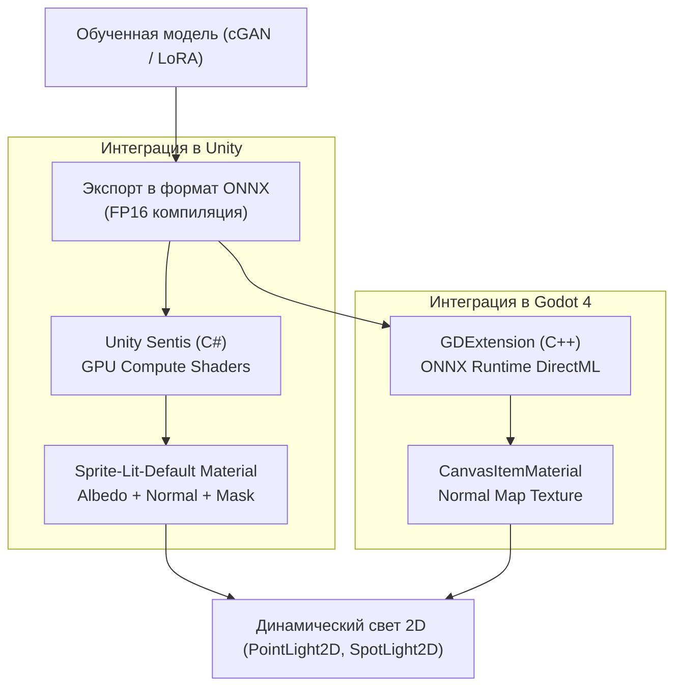

# Интеграция в игровые движки (Godot 4 и Unity)

## 1. Краткое описание
В этой статье рассматриваются архитектурные пути интеграции моделей депикселизации и сгенерированных ассетов в современные игровые движки Godot Engine 4 и Unity. Описывается инференс нейросетей формата ONNX через Unity Sentis и Godot GDExtension, настройка динамического физического освещения 2.5D (Normal-Mapped 2D Lighting) и архитектура фонового асинхронного IPC-демона.

---

## 2. Интуитивное объяснение: Оживление пикселей в игре

Сгенерировать фотореалистичное изображение в Python — это только половина дела. Настоящая цель — сделать так, чтобы игрок мог управлять этим персонажем:
- Персонаж бежит по 2D-платформеру, на него падают тени от факелов на стене.
- Металл доспеха реалистично бликует при движении источника света.
- Игра не тормозит и выдаёт стабильные 60 кадров в секунду.

Для этого мы используем мощь **2.5D PBR-рендеринга**: персонаж остаётся плоским 2D-спрайтом, но за счёт сгенерированных карт нормалей (Normal Maps) игровой движок освещает его как полноценную трёхмерную модель!

---

## 3. Архитектура интеграции с игровыми движками



---

## 4. Настройка PBR 2D-освещения в Godot 4 и Unity

Когда сгенерирован фотореалистичный спрайт и к нему построена карта нормалей:
1. **Канал Albedo (Диффузный цвет):** Фотореалистичный спрайт $1024\times 1024$.
2. **Канал Normal (Векторы нормалей):** Карта в формате Tangent Space Normal (сине-фиолетовый фон), где каналы RGB кодируют пространственные направления нормали $(n_x, n_y, n_z)$.
3. **Источники света (2D Lights):** Игровой движок вычисляет закон Ламберта для каждого пикселя:
   $$I_{\text{diffuse}} = I_{\text{light}} \cdot \max(0, \, \mathbf{N}(x, y) \cdot \mathbf{L}(x, y))$$
   Персонаж мгновенно приобретает честный трёхмерный объём, оставаясь 2D-спрайтом!

---

## 5. Практическая реализация: C# скрипт для Unity Sentis

Unity Sentis позволяет запускать компактные экспортированные модели без внешнего Python-интерпретатора:

```csharp
// Unity Sentis C# Script: Running ONNX Neural Upscaler directly on GPU
using UnityEngine;
using Unity.Sentis;

public class NeuralSpriteUpscaler : MonoBehaviour
{
    [SerializeField] private ModelAsset onnxModelAsset;
    [SerializeField] private Texture2D lowResSprite;
    
    private Model runtimeModel;
    private IWorker worker;

    void Start()
    {
        // 1. Загрузка скомпилированной ONNX модели
        runtimeModel = ModelLoader.Load(onnxModelAsset);
        // 2. Создание инференс-воркера на движке GPU Compute
        worker = new Worker(runtimeModel, BackendType.GPUCompute);
    }

    public RenderTexture UpscaleSprite(Texture2D inputTexture)
    {
        // 3. Преобразование текстуры в тензор Sentis
        using TensorFloat inputTensor = TextureConverter.ToTensor(inputTexture, width: 64, height: 64, channels: 3);
        
        // 4. Мгновенный инференс на GPU
        worker.Schedule(inputTensor);
        TensorFloat outputTensor = worker.PeekOutput() as TensorFloat;

        // 5. Обратное преобразование тензора в RenderTexture для отображения
        RenderTexture resultTexture = new RenderTexture(1024, 1024, 0, RenderTextureFormat.ARGB32);
        TextureConverter.RenderToTexture(outputTensor, resultTexture);

        return resultTexture;
    }

    void OnDestroy()
    {
        worker?.Dispose();
    }
}
```

---

## 6. Связанные темы
- Оффлайн ассеты: [`09_Real_Time_and_Games/01_Offline_Asset_Conversion.md`](01_Offline_Asset_Conversion.md)
- Real-Time инференс: [`09_Real_Time_and_Games/03_Real_Time_Inference_and_StreamDiffusion.md`](03_Real_Time_Inference_and_StreamDiffusion.md)
- Дорожная карта интеграции: [`11_Project_Roadmap/03_Post_MVP_Scaling_and_Future_Frontiers.md`](../11_Project_Roadmap/03_Post_MVP_Scaling_and_Future_Frontiers.md)
