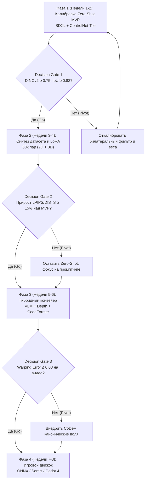

# План экспериментов и критерии принятия решений (Experiment Roadmap & Decision Gates)

## 1. Краткое описание
В этой статье формулируется пошаговая дорожная карта исследований и разработки проекта `nn-upscaler`, разбитая на четыре двухнедельные фазы. Для каждого этапа задаются строгие количественные критерии перехода (Decision Gates: Stop / Pivot / Go), исключающие пустую трату вычислительных ресурсов и гарантирующие прогресс к цели.

---

## 2. Общая схема фаз проекта

---

## 3. Детальный план фаз и контрольные критерии (Decision Gates)

### Фаза 1 (Недели 1–2): Калибровка и валидация Zero-Shot MVP
- **Цель:** Запустить стабильный инференс без дообучения весов на базе `stabilityai/stable-diffusion-xl-base-1.0` и `xinsir/controlnet-tile-sdxl-1.0`.
- **Задачи:**
  - Настройка автоматического переключения устройств (Apple Silicon MPS / CUDA).
  - Подбор оптимального диапазона веса Tile ($w \in [0.70, 0.78]$).
  - Проведение абляции билатерального фильтра.
- **Decision Gate 1 (Критерий перехода к Фазе 2):**
  - Экспертная оценка фотореализма $\ge 7.5 / 10$ на 50 тестовых спрайтах.
  - Сохранение силуэта по SAM Mask $IoU \ge 0.82$.
  - Отсутствие падений в OOM при разрешении $1024\times 1024$.

---

### Фаза 2 (Недели 3–4): Синтетический датасет и обучение кастомной LoRA
- **Цель:** Научить модель самостоятельно обращать дизеринг (Bayer / Floyd-Steinberg) без необходимости сильного внешнего размытия.
- **Задачи:**
  - Генерация 40 000 парных изображений через 2D-пайплайн деградации.
  - Рендеринг 10 000 эталонных пар в Blender Cycles (двухбуферный режим).
  - Обучение LoRA ранга $r=64$ на U-Net слоях внимания SDXL.
- **Decision Gate 2 (Критерий перехода к Фазе 3):**
  - Обученная LoRA превосходит Zero-Shot MVP по перцептивной метрике DISTS минимум на **15%**.
  - Полное исчезновение шума дизеринга на ретро-палитрах GameBoy и PICO-8.
  - *Правило остановки (Stop Rule):* Если прирост DISTS $< 5\%$ — признать дообучение экономически нецелесообразным, зафиксировать Zero-Shot пайплайн и перейти к оптимизации промптов.

---

### Фаза 3 (Недели 5–6): Сборка полного гибридного конвейера
- **Цель:** Достижение максимального фотореализма (9.5/10) и стабилизация анимации.
- **Задачи:**
  - Подключение VLM автопромптинга (Florence-2) для исключения ручного ввода текста.
  - Внедрение реставратора лиц CodeFormer для портретов.
  - Интеграция алгоритма CoDeF для устранения фликкеринга в спрайт-листах.
- **Decision Gate 3 (Критерий перехода к Фазе 4):**
  - Покадровая ошибка деформации оптического потока $E_{\text{warp}} \le 0.03$ на 16-кадровой анимации.
  - Средняя оценка согласованности персонажа в 2AFC тесте $> 85\%$.

---

### Фаза 4 (Недели 7–8): Игровой движок и оптимизация инференса
- **Цель:** Интеграция сгенерированных ассетов и моделей в Godot 4 и Unity.
- **Задачи:**
  - Экспорт легковесного студенческого генератора в формат ONNX.
  - Сборка 2.5D сцены с динамическим PBR-освещением по картам нормалей.
  - Проведение стресс-теста производительности (FPS и задержка).
- **Decision Gate 4 (Финал проекта):**
  - Игра со сгенерированными ассетами выдаёт стабильные **60 FPS** на целевом оборудовании.
  - Время оффлайн-конверсии спрайт-листа персонажа (8 кадров) $\le 60$ секунд.

---

## 4. Матрица управления рисками (Risk Management Matrix)

| Риск | Вероятность | Критичность | Превентивное действие (Mitigation Action) |
|---|---|---|---|
| **Коллапс градиентов при обучении LoRA** | Средняя | Высокая | Включение Min-SNR $\gamma=5.0$, обрезка градиентов `max_norm=1.0`. |
| **Мерцание при покадровой анимации** | Высокая | Критическая | Переход от покадровой диффузии к канонической деформации CoDeF. |
| **OOM на пользовательских Mac с 16GB** | Средняя | Высокая | Автоматический тайлинг VAE и принудительный `torch.mps.empty_cache()`. |
| **Семантический сдвиг мелких предметов** | Высокая | Средняя | Повышение веса ControlNet-Tile до 0.85 в зоне предметов через маски. |

---

## 5. Связанные темы
- Спецификация MVP: [`11_Project_Roadmap/01_MVP_Specification_and_Implementation.md`](01_MVP_Specification_and_Implementation.md)
- Пост-MVP горизонты: [`11_Project_Roadmap/03_Post_MVP_Scaling_and_Future_Frontiers.md`](03_Post_MVP_Scaling_and_Future_Frontiers.md)
- Журнал экспериментов: [`EXPERIMENTS.md`](../../EXPERIMENTS.md)
