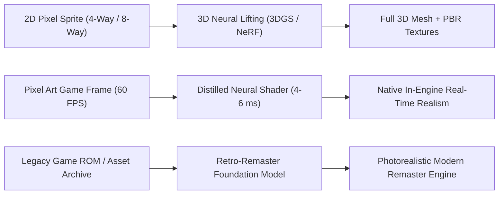
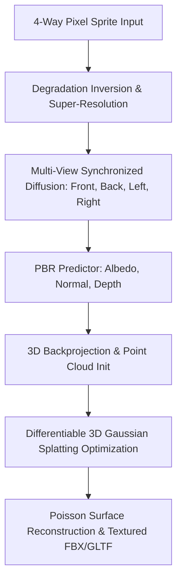

# 03. Масштабирование Post-MVP и Научно-Технические Фронтиры

В данном руководстве формулируются долгосрочные направления развития технологии **Pixel Art → Realism** после успешного развертывания базового пайплайна (Phase 1–2). Мы рассматриваем переход от покадрового 2D-апскейлинга к генерации 3D-ассетов (3D Gaussian Splatting, NeRF), дистиллированным нейросетевым шейдерам реального времени, специализированным мультимодальным Foundation Models для ремастеринга ретро-игр и дифференцируемому обратному рендерингу (PBR Inverse Graphics).

---

## 1. Интуитивное объяснение и видение фронтира

Базовый MVP решает задачу статического преобразования одиночных спрайтов и тайлов $I_{\text{pixel}} \to I_{\text{real}}$ на базе диффузионных адаптеров (ControlNet-Tile). Однако игровая индустрия и цифровой продакшн требуют фундаментально иных возможностей:



1. **От плоского спрайта к физическому 3D-объекту:** Вместо апскейлинга спрайта направления "вид спереди" и отдельного апскейлинга "вид сбоку" (что приводит к рассогласованию пропорций и деталей), система должна восстанавливать **единую трехмерную геометрию и PBR-материалы** (Albedo, Normal, Roughness, Metallic) по набору ортогональных пиксельных проекций.
2. **От 3-секундного инференса к 6-миллисекундному шейдеру:** Замена тяжелых 30-шаговых диффузионных пайплайнов на дистиллированные одношаговые или двухшаговые модели на базе Rectified Flow / Consistency Models, выполняющиеся непосредственно в цикле рендеринга движка (Unity Sentis / Unreal Engine Neural Network Engine / Metal Performance Shaders).
3. **От узких эвристик к Retro-Foundation Model:** Создание большой мультимодальной модели, понимающей семантику ретро-платформ (NES, SNES, Sega Genesis, Neo-Geo, Game Boy, Arcade CPS-2), умеющей автоматически сегментировать тайловые карты, палитры и строить физически корректный мир.

---

## 2. Теоретические и математические основы

### 2.1. 3D-реконструкция по сверхмалоракурсным пиксельным проекциям (Sparse-View 3D Lifting)

Классическая фотограмметрия (Structure from Motion, SfM) требует десятков плотных фотографий с непрерывным перекрытием. Для пиксельных игровых персонажей доступно лишь 4 или 8 ортографических ракурсов (Front, Back, Left, Right, Diagonals), каждый размером $32\times 32$ или $64\times 64$ пикселя.

Задача формулируется как восстановление объемного поля или набора 3D-гауссианов $\mathcal{G} = \{g_i\}_{i=1}^N$:
$$g_i = \left( \boldsymbol{\mu}_i \in \mathbb{R}^3,\, \boldsymbol{\Sigma}_i \in \mathbb{S}_+^3,\, \mathbf{c}_i \in \mathbb{R}^k,\, \alpha_i \in [0, 1] \right)$$
где $\boldsymbol{\mu}_i$ — центр гауссиана, $\boldsymbol{\Sigma}_i = \mathbf{R} \mathbf{S} \mathbf{S}^T \mathbf{R}^T$ — ковариационная матрица (задаваемая кватернионом вращения $\mathbf{q}$ и масштабом $\mathbf{s}$), $\mathbf{c}_i$ — сферические гармоники (SH) цвета, $\alpha_i$ — прозрачность.

Рендеринг цвета пикселя $p$ при заданном луче осуществляется через сплэтинг:
$$C(p) = \sum_{i \in \mathcal{N}(p)} \mathbf{c}_i \alpha_i \prod_{j=1}^{i-1} (1 - \alpha_j)$$

#### Многоракурсная согласованность через эпиполярную диффузию (Multi-View Epipolar Attention)
Для обеспечения согласованности между ракурсами $v \in \{1, \dots, V\}$ слои внимания диффузионного генератора дополняются эпиполярными кросс-ракурсными связями:
$$\text{Attention}_{\text{MV}}(Q_v, K_{1:V}, V_{1:V}) = \text{Softmax}\left( \frac{Q_v K_{1:V}^T}{\sqrt{d}} + \mathbf{M}_{\text{epipolar}} \right) V_{1:V}$$
где матрица маскирования $\mathbf{M}_{\text{epipolar}}(p, p') = 0$, если точка $p'$ в ракурсе $v'$ лежит на эпиполярной линии точки $p$ ракурса $v$, и $-\infty$ в противном случае.

### 2.2. Обратный дифференцируемый рендеринг PBR (Differentiable Inverse Rendering)

Вместо генерации простого RGB-изображения, система обучает генератор $\mathcal{G}_{\text{PBR}}$ предсказывать карты уравнения рендеринга Кука-Торренса (Cook-Torrance BRDF):
$$L_o(\mathbf{x}, \boldsymbol{\omega}_o) = L_e(\mathbf{x}, \boldsymbol{\omega}_o) + \int_{\Omega} f_r(\mathbf{x}, \boldsymbol{\omega}_i, \boldsymbol{\omega}_o) L_i(\mathbf{x}, \boldsymbol{\omega}_i) (\boldsymbol{\omega}_i \cdot \mathbf{n})\, d\boldsymbol{\omega}_i$$

Где параметры BRDF $f_r$ разложены на каналы:
- Альбедо $\mathbf{a}(\mathbf{x}) \in [0, 1]^3$ (базовый цвет без бликов и затенений).
- Вектор нормали $\mathbf{n}(\mathbf{x}) \in \mathbb{S}^2$ (микрогеометрия поверхности).
- Шероховатость $\rho(\mathbf{x}) \in [0, 1]$ (параметр микрограней GGX/Trowbridge-Reitz).
- Металличность $m(\mathbf{x}) \in [0, 1]$ (диэлектрик vs проводник, определяющий коэффициент Френеля $F_0$).

Функция потерь при обучении дифференцируемого декодера PBR:
$$\mathcal{L}_{\text{Inverse}} = \lambda_{\text{reproj}} \|\mathcal{R}(\mathbf{a}, \mathbf{n}, \rho, m, \mathcal{E}) - I_{\text{target}}\|_1 + \lambda_{\text{reg}} \|\nabla \mathbf{n}\|_1 + \lambda_{\text{ortho}} \|\mathbf{n} \cdot \mathbf{t}\|_2$$
где $\mathcal{R}(\cdot)$ — дифференцируемый растровый шейдер (например, nvdiffrast или Mitsuba 3), $\mathcal{E}$ — сферическая карта окружения (HDRI Environment Map).

### 2.3. Экстремальная дистилляция в 1–2 шага (Rectified Flow / Consistency Distillation)

Для достижения инференса в 60 FPS ($<16.6\text{ ms}$) традиционный 30-шаговый DDIM/DPM-Solver неприменим. Решение заключается в дистилляции траектории потока ODE:
$$\frac{d\mathbf{z}_t}{dt} = v_\theta(\mathbf{z}_t, t)$$

В модели Consistency Distillation (CD) обучается нейросеть $f_\theta(\mathbf{z}_t, t)$, отображающая любую точку траектории напрямую в начальную точку $t=0$:
$$f_\theta(\mathbf{z}_{t_{n+1}}, t_{n+1}) \approx f_{\theta^-}(\hat{\mathbf{z}}_{t_n}, t_n)$$
где $\hat{\mathbf{z}}_{t_n}$ получен одним шагом ODE-солвера из $\mathbf{z}_{t_{n+1}}$, а $\theta^-$ — экспоненциальное скользящее среднее (EMA) параметров.

---

## 3. Архитектура перспективных систем

### 3.1. Пайплайн Pixel2Gaussian (3DGS Reconstruction)



### 3.2. Компоненты большой ретро-модели (Retro-Foundation Model: RetroFM)

1. **Hierarchical Palette & Tile Tokenizer:**
   Пиксельное изображение кодируется не стандартным непрерывным VAE, а дискретным квантователем, сохраняющим информацию о сеточной топологии ($16\times 16$ тайлы, палитровые индексы $0..255$).
2. **Context-Aware Style & Platform Conditioning:**
   Текстово-чиповый эмбеддинг платформы (например, `[NES_Ricoh2A03]`, `[SNES_Mode7]`, `[Arcade_CPS2]`), позволяющий модели учитывать технические ограничения ретро-оборудования и точно разделять авторский замысел и аппаратные артефакты.
3. **Decoupled PBR Generation Head:**
   Многоголовочный декодер, генерирующий одновременно:
   - Diffuse Albedo ($1024\times 1024 \times 3$).
   - Normal Map Tangent Space ($1024\times 1024 \times 3$).
   - Roughness-Metallic-AO ORM Map ($1024\times 1024 \times 3$).
   - Displacement/Height Map ($1024\times 1024 \times 1$).

---

## 4. Практическая реализация: Прототип 3D-Lifting и PBR-декомпозиции

Ниже приведена модульная реализация на PyTorch, демонстрирующая связку ортогонального предсказания нормалей и обратного проецирования в облако точек для последующей оптимизации 3D Gaussian Splatting.

```python
"""
pixel2gaussian_prototype.py
Прототип модуля 3D-лифтинга и предсказания карт глубин/нормалей
для пиксельных спрайтов с последующей генерацией облака точек.
"""

from dataclasses import dataclass
from typing import Dict, Tuple

import numpy as np
import torch
import torch.nn as nn
import torch.nn.functional as F


@dataclass
class CameraParameters:
    fov: float  # в градусах, для ортографического приближения близко к 0 или большой фокус
    elevation: float  # угол наклона
    azimuth: float  # угол поворота вокруг вертикальной оси (0, 90, 180, 270)
    distance: float


class PixelNormalDepthEstimator(nn.Module):
    """
    Легковесный сверточный декодер для оценки карты нормалей поверхности [B, 3, H, W]
    и относительной карты глубин [B, 1, H, W] по апскейленному спрайту.
    """

    def __init__(self, in_channels: int = 3):
        super().__init__()
        self.encoder = nn.Sequential(
            nn.Conv2d(in_channels, 64, kernel_size=3, padding=1),
            nn.BatchNorm2d(64),
            nn.LeakyReLU(0.2, inplace=True),
            nn.Conv2d(64, 128, kernel_size=3, stride=2, padding=1),  # H/2
            nn.BatchNorm2d(128),
            nn.LeakyReLU(0.2, inplace=True),
            nn.Conv2d(128, 256, kernel_size=3, stride=2, padding=1),  # H/4
            nn.BatchNorm2d(256),
            nn.LeakyReLU(0.2, inplace=True),
        )

        self.depth_head = nn.Sequential(
            nn.ConvTranspose2d(256, 128, kernel_size=4, stride=2, padding=1),
            nn.LeakyReLU(0.2, inplace=True),
            nn.ConvTranspose2d(128, 64, kernel_size=4, stride=2, padding=1),
            nn.LeakyReLU(0.2, inplace=True),
            nn.Conv2d(64, 1, kernel_size=3, padding=1),
            nn.Sigmoid(),  # Depth in [0, 1]
        )

        self.normal_head = nn.Sequential(
            nn.ConvTranspose2d(256, 128, kernel_size=4, stride=2, padding=1),
            nn.LeakyReLU(0.2, inplace=True),
            nn.ConvTranspose2d(128, 64, kernel_size=4, stride=2, padding=1),
            nn.LeakyReLU(0.2, inplace=True),
            nn.Conv2d(64, 3, kernel_size=3, padding=1),
            nn.Tanh(),  # Vectors in [-1, 1]
        )

    def forward(self, x: torch.Tensor) -> Tuple[torch.Tensor, torch.Tensor]:
        feat = self.encoder(x)
        depth = self.depth_head(feat)
        normal = self.normal_head(feat)
        # L2-нормализация векторов нормалей
        normal = F.normalize(normal, p=2, dim=1)
        return depth, normal


def unproject_depth_to_point_cloud(
    rgb: torch.Tensor, depth: torch.Tensor, mask: torch.Tensor, scale: float = 1.0
) -> Tuple[torch.Tensor, torch.Tensor]:
    """
    Преобразование карты глубины и RGB-цвета в трехмерное облако точек (X, Y, Z, R, G, B).

    Args:
        rgb: [3, H, W] тензор цвета в диапазоне [0, 1]
        depth: [1, H, W] тензор глубины в диапазоне [0, 1]
        mask: [1, H, W] бинарная маска объекта (фон отсекается)
        scale: физический масштаб объекта в мировых координатах

    Returns:
        points: [N, 3] координаты точек (X, Y, Z)
        colors: [N, 3] цвета точек (R, G, B)
    """
    _, H, W = depth.shape
    device = depth.device

    # Создание регулярной ортографической сетки координат XY
    ys, xs = torch.meshgrid(
        torch.linspace(-1.0, 1.0, H, device=device),
        torch.linspace(-1.0, 1.0, W, device=device),
        indexing="ij",
    )

    # Z вычисляется из глубины
    zs = (depth.squeeze(0) - 0.5) * 2.0 * scale

    valid_mask = mask.squeeze(0) > 0.5

    x_valid = xs[valid_mask]
    y_valid = -ys[valid_mask]  # Инверсия оси Y для согласования с 3D
    z_valid = zs[valid_mask]

    points = torch.stack([x_valid, y_valid, z_valid], dim=-1)  # [N, 3]

    r = rgb[0][valid_mask]
    g = rgb[1][valid_mask]
    b = rgb[2][valid_mask]
    colors = torch.stack([r, g, b], dim=-1)  # [N, 3]

    return points, colors


if __name__ == "__main__":
    device = torch.device("cpu")
    model = PixelNormalDepthEstimator().to(device)
    model.eval()

    # Синтетический входной тензор (апскейленный персонаж 256x256)
    dummy_input = torch.rand(1, 3, 256, 256, device=device)
    dummy_mask = torch.ones(1, 1, 256, 256, device=device)

    with torch.no_grad():
        depth, normal = model(dummy_input)
        pts, cols = unproject_depth_to_point_cloud(dummy_input[0], depth[0], dummy_mask[0])

    print(f"Pred Depth Shape: {depth.shape}, min={depth.min():.2f}, max={depth.max():.2f}")
    print(f"Pred Normal Shape: {normal.shape}")
    print(f"Generated Point Cloud: {pts.shape[0]} points initialized for 3DGS optimization.")
```

---

## 5. Долгосрочные научные рубежи (Open Research Frontiers)

### 5.1. Каузальные диффузионные модели для бесконечных анимаций (Streaming Video Diffusion)
Текущие подходы (AnimateDiff, SVD) генерируют пачки по 16–24 кадра. При попытке соединить клипы в длинную анимацию (бесконечный бег, боевые комбо в файтингах) неизбежно накапливается фазовый сдвиг и деградация внешности.
- **Исследовательский фронтир:** Обучение авторегрессионных трансформеров с бесконечной памятью KV-кэша (например, StreamingT2V, Ring-Attention), где контекст предыдущих 100 кадров сохраняется в сжатом скрытом представлении $\mathbf{s}_t = \text{GRU}(\mathbf{s}_{t-1}, \mathbf{z}_t)$, гарантируя нулевой дрифт формы и палитры на тысячах кадров.

### 5.2. Семантический интерактивный холст (Artist-in-the-Loop Co-Creation)
Полная замена художника генератором часто отвергается арт-директорами из-за потери контроля над микродеталями.
- **Исследовательский фронтир:** Двунаправленная синхронизация. Художник меняет 1 пиксель меча на $32\times 32$ канвасе — модель в реальном времени локально перерисовывает только высокочастотные блики на лезвии в фотореалистичном $1024\times 1024$ представлении (Local Latent Inpainting), сохраняя глобальную композицию нетронутой.

### 5.3. Физически обоснованный нейросетевой ремастеринг звука и физики (Audio & Physics Co-Generation)
Ремастеринг не должен ограничиваться визуальным рядом:
- Восстановление 8-битного чиптюна (Chiptune/MIDI) в оркестровый саундтрек или живую запись инструментов, синхронизированную с ритмом пиксельной анимации.
- Автоматическая генерация физических коллайдеров (Ragdoll / Convex Hull) и скелетной анимации (Rigging & Skinning) напрямую по 2D-пиксельным спрайтам.

---

## Резюме раздела

Масштабирование технологии **Pixel Art → Realism** выходит далеко за рамки классического апскейлинга. Это комплексный переход к **интеллектуальному восстановлению замысла автора**:
1. Перевод плоских пикселей в полноценные физические 3D-ассеты (3DGS, PBR-шейдинг).
2. Оптимизация инференса до субмиллисекундных задержек в игровых движках.
3. Сохранение исторического наследия видеоигр через специализированные Foundation Models.
