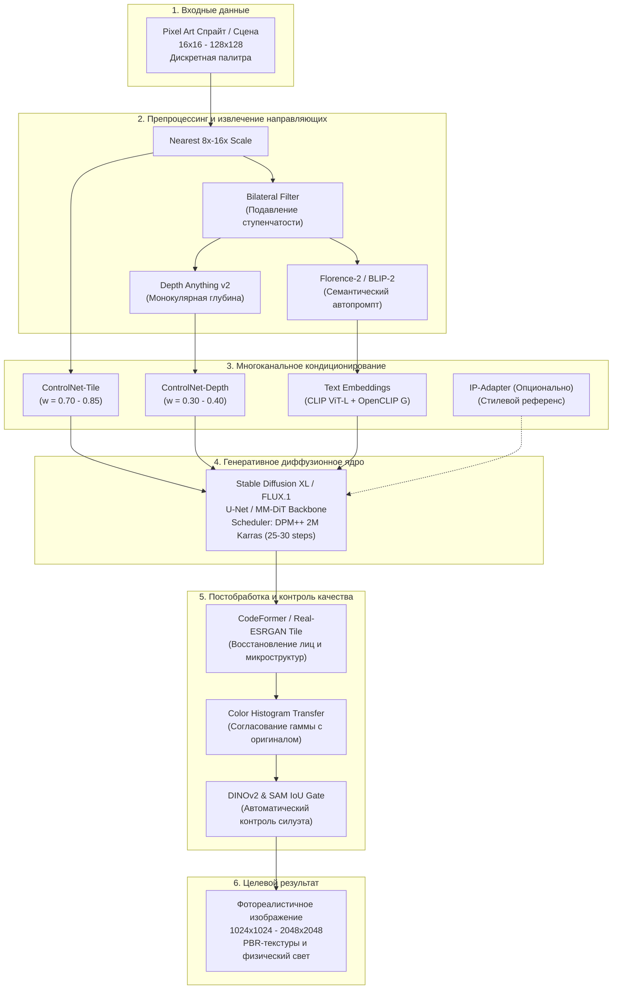

# Pixel Art → Realism: Инженерная база знаний и фундаментальное руководство

Добро пожаловать в структурированную базу знаний, посвящённую исследованию и разработке систем генеративного преобразования изображений в стиле **Pixel Art в фотореалистичные изображения высокой чёткости (Pixel Art → Realism)**.

Данный проект объединяет математические основы некорректно поставленных обратных задач (Ill-Posed Inverse Problems), теорию генеративных диффузионных и Flow-Matching моделей, методы структурного контроля (Structural Conditioning), пайплайны подготовки синтетических и 3D-данных, а также инженерные решения для оффлайн- и real-time-пайплайнов.

---

## 🗺️ Карта базы знаний

```text
pixel-art-to-realism/
├── README.md                                  # Текущий файл: портал и навигация
├── GLOSSARY.md                                # Детальный глоссарий терминов
├── REFERENCES.md                              # Академическая библиография и репозитории
├── LEARNING_PATH.md                           # Образовательный маршрут и программа изучения
├── sources/
│   └── Deep_Research_Original.md              # Исходный отчёт глубокого исследования
│
├── 01_Fundamentals/                           # Основы представления и деградации
│   ├── 01_Pixel_Art_Representation_and_Aesthetics.md
│   ├── 02_Image_Formation_and_Degradation_Models.md
│   └── 03_Problem_Formulation_and_Task_Taxonomy.md
│
├── 02_Mathematical_Foundations/               # Математический аппарат генеративных моделей
│   ├── 01_Probability_and_Information_Theory.md
│   ├── 02_Variational_Autoencoders_and_Latent_Spaces.md
│   ├── 03_Generative_Adversarial_Networks.md
│   ├── 04_Diffusion_Models_and_SDEs.md
│   ├── 05_Flow_Matching_and_Diffusion_Transformers.md
│   └── 06_Loss_Functions_and_Perceptual_Metrics.md
│
├── 03_Architectures/                          # Архитектуры моделей трансляции и генерации
│   ├── 01_Classical_and_Regression_SR.md
│   ├── 02_GAN_Translation_Models.md
│   ├── 03_Latent_Diffusion_SD15_SDXL.md
│   ├── 04_ControlNet_and_Adapters.md
│   ├── 05_IP_Adapter_and_Reference_Conditioning.md
│   ├── 06_Modern_Flow_Matching_FLUX.md
│   └── 07_Hybrid_Multi_Stage_Pipeline.md
│
├── 04_Structure_Preservation/                 # Методы сохранения структуры и контроля
│   ├── 01_Structural_Conditioning_Signals.md
│   ├── 02_Attention_Control_and_Feature_Injection.md
│   ├── 03_Regional_Prompting_and_Masking.md
│   ├── 04_Losses_for_Structural_Consistency.md
│   └── 05_Constraint_Level_Strategies.md
│
├── 05_Datasets_and_Preprocessing/             # Данные, синтез, domain gap и фильтрация
│   ├── 01_Dataset_Landscape_and_Domain_Gap.md
│   ├── 02_Synthetic_Degradation_Pipeline.md
│   ├── 03_3D_Engine_Synthetic_Data_Generation.md
│   └── 04_Dataset_Curation_and_Quality_Filtering.md
│
├── 06_Training_and_Fine_Tuning/               # Обучение, LoRA, оптимизация и железо
│   ├── 01_PEFT_and_LoRA_for_Diffusion.md
│   ├── 02_Training_Objectives_and_Loss_Formulation.md
│   ├── 03_Hyperparameters_and_Optimization.md
│   ├── 04_Hardware_and_VRAM_Management.md
│   └── 05_Troubleshooting_and_Training_Pitfalls.md
│
├── 07_Evaluation_and_Benchmarks/              # Метрики качества и протоколы тестирования
│   ├── 01_Metric_Taxonomy_and_Mathematical_Formulation.md
│   ├── 02_Multi_Axis_Evaluation_Framework.md
│   ├── 03_Human_Evaluation_Protocol.md
│   └── 04_Ablation_Study_Design.md
│
├── 08_Practical_Implementation/               # Инженерная реализация и код
│   ├── 01_Software_Architecture_and_Design.md
│   ├── 02_Diffusers_Production_Pipeline.md
│   ├── 03_ComfyUI_Workflow_Guide.md
│   ├── 04_Postprocessing_and_Refinement.md
│   └── 05_Diagnostics_and_Common_Bugs.md
│
├── 09_Real_Time_and_Games/                    # Видеоигры, стабильность и real-time
│   ├── 01_Offline_Asset_Conversion.md
│   ├── 02_Temporal_Consistency_and_Deflickering.md
│   ├── 03_Real_Time_Inference_and_StreamDiffusion.md
│   └── 04_Game_Engine_Integration_Godot_Unity.md
│
├── 10_Research_and_Experiments/               # Анализ литературы и открытые вопросы
│   ├── 01_Literature_Review_and_State_of_the_Art.md
│   ├── 02_Open_Source_Ecosystem_Audit.md
│   └── 03_Open_Research_Questions.md
│
└── 11_Project_Roadmap/                        # Дорожная карта, MVP и принятие решений
    ├── 01_MVP_Specification_and_Implementation.md
    ├── 02_Experiment_Roadmap_and_Decision_Gates.md
    └── 03_Post_MVP_Scaling_and_Future_Frontiers.md
```

---

## 🔬 Архитектурная панорама задачи



---

## 🎯 Ключевые концептуальные выводы базы знаний

1. **Супер-разрешение (SR) не равно Депикселизации (Depixelization):**
   Классические алгоритмы (xBRZ, EDSR, SwinIR) предполагают непрерывный аналоговый сигнал. Применение их к пиксель-арту даёт замыленные пятна или векторные кривые, но не генерирует отсутствующие физические текстуры.
2. **Информационное бутылочное горлышко (Information Bottleneck):**
   При переходе от спрайта $32\times 32$ к фото $1024\times 1024$ теряется более $99.98\%$ информации. Восстановление однозначного первоисточника математически невозможно — задача требует вероятностного сэмплирования из распределения $p(x_{\text{real}} \mid y_{\text{pixel}})$.
3. **Ловушка Canny-детекторов (Grid Hallucination):**
   Подача пиксель-арта напрямую в высокочастотные детекторы границ приводит к генерации кирпичной плитки на месте тела персонажа. Решением является **предварительная билатеральная фильтрация** и использование **деградационно-устойчивых адаптеров (ControlNet-Tile)**.
4. **Ограничения Real-Time в играх:**
   Полноразмерные диффузионные модели требуют от 3 до 20 секунд на кадр на топовых GPU. Для 60 FPS ($16.6\text{ мс}$) необходим переход на оффлайн-пререндеринг спрайт-листов либо дистиллированные одношаговые студенческие модели (StreamDiffusion / MobileNet-cGAN).

---

## 🚀 Быстрый старт

Для запуска первого рабочего прототипа следуйте [MVP Спецификации](11_Project_Roadmap/01_MVP_Specification_and_Implementation.md) и выполните в корне репозитория:

```bash
# 1. Синхронизация зависимостей через uv
uv sync --extra dev

# 2. Проверка доступности GPU (MPS / CUDA)
uv run python scripts/smoke_test.py

# 3. Запуск инференса базовой модели
uv run python scripts/upscale.py \
  --input data/samples/sample_sprite.png \
  --model nearest \
  --scale 4 \
  --output outputs/baseline_nearest.png
```

Перейдите к [Образовательному маршруту](LEARNING_PATH.md) для систематического изучения базы знаний.
